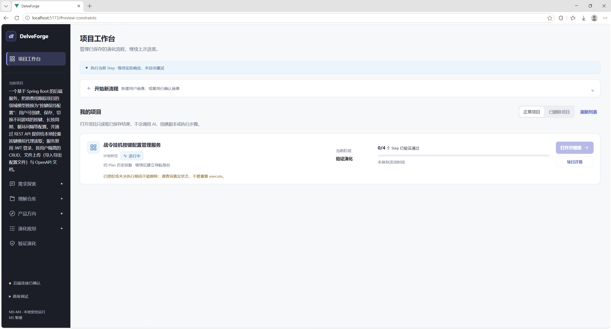
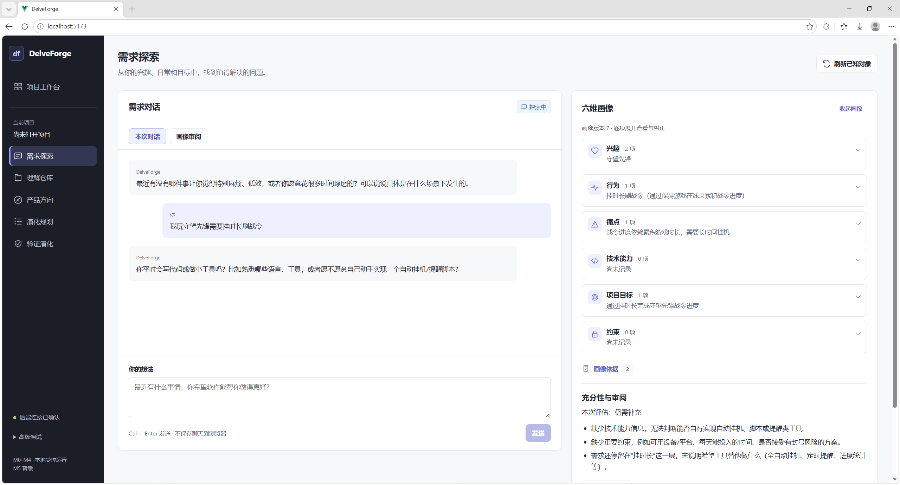
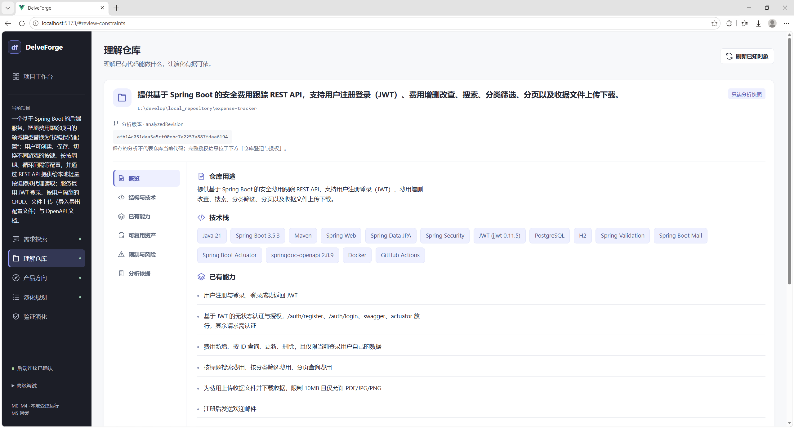
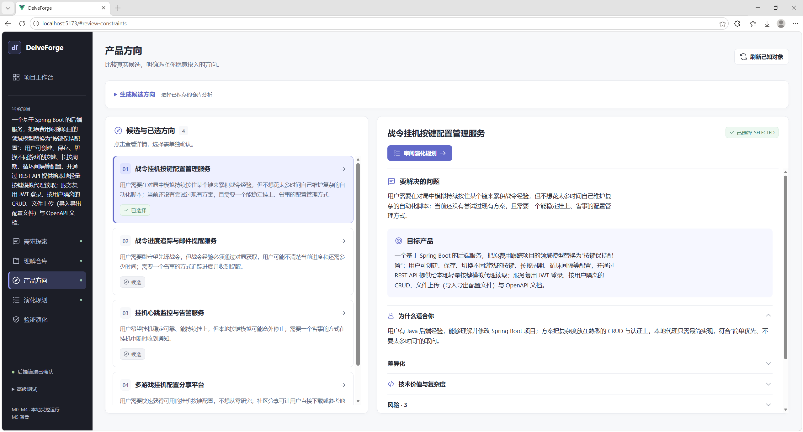
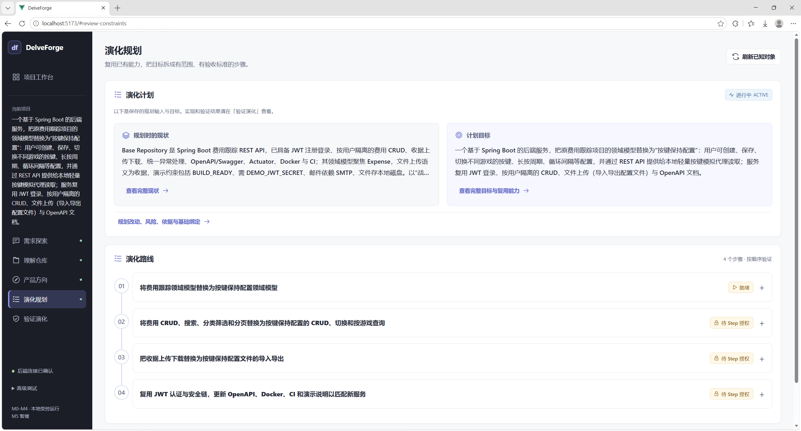
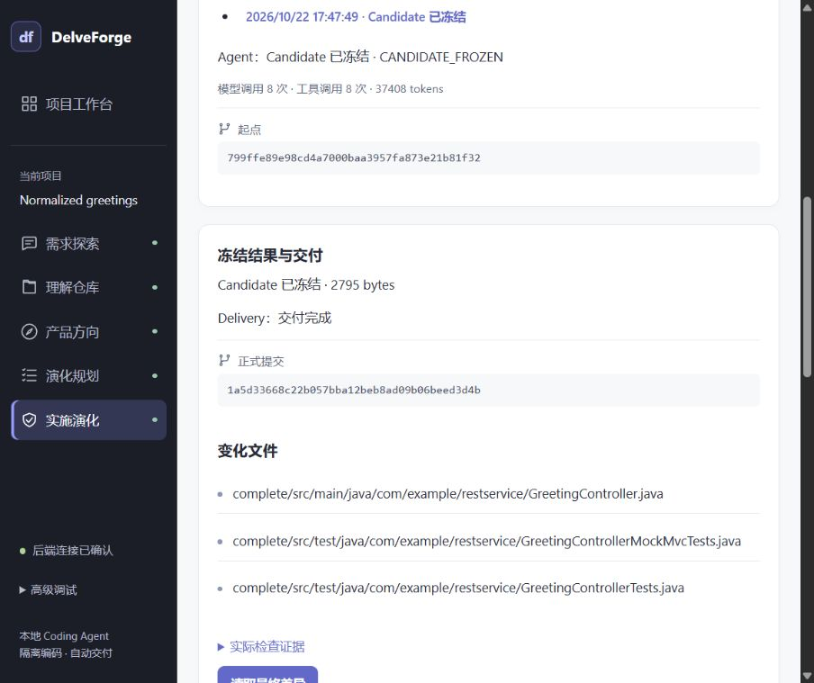

# DelveForge

**Personalized Project Discovery & Evolution Agent**

> 🔨 **Evolution Before Rewrite.**
>
> 从真实需求出发，发现值得做的项目，让已有代码成为新想法的起点。


## 🎯 About DelveForge

完成一个课程项目或教程项目后，下一个项目应该做什么？

热门项目清单可以提供题目，却很难回答：**这个项目为什么适合我？能否满足真实需求？我已经写过的代码有没有复用价值？**

DelveForge 是一个面向开发者的个性化项目探索与演化 Agent。

它通过 AI 对话理解用户的兴趣、痛点、技术能力和项目目标，分析已有 Git 仓库的功能与可复用资产，再提出个性化产品方向和演化计划。

在此基础上，用户可逐步授权 Coding Agent 在 Docker 沙箱中编码与检查。冻结 Candidate 后，系统自动校验并交付到独立 WorkingCopy，接受正式 Git commit 后才将 Step 标记成功。

**目前更适合体验需求探索、仓库理解、方向发现与演化规划。代码自动演化仍处于实验性阶段，不能保证稳定完成。**

## ✨ What Can It Do?

DelveForge 提供项目工作台，以及从需求探索到代码验证的五个业务阶段。

| 功能 | 说明 |
| --- | --- |
| 🗂️ **Project Workspace** | 管理不同项目、查看历史记录和已验证步骤，支持继续项目与重新规划 |
| 💬 **User Discovery** | 通过多轮 AI 对话探索需求，生成六维用户画像，由用户审阅、纠正并确认 |
| 🔍 **Repository Understanding** | 只读分析本地 Git 仓库，识别模块、技术栈、已有能力、可复用资产、限制和风险 |
| 💡 **Product Direction** | 结合用户需求与已有代码，生成个性化产品方向，展示依据与风险，由用户选择 |
| 📋 **Evolution Planning** | 为选定方向生成演化计划，拆分目标、范围和计划变更 |
| 🧪 **Autonomous Evolution（实验性）** | 经逐 Step 授权后，在隔离沙箱中多轮编码与 Maven 检查；冻结结果自动交付，展示真实活动与交付状态 |

### 🧭 Workflow

```text
Explore Your Needs
        ↓
Understand Existing Repositories
        ↓
Discover Product Directions
        ↓
Plan Incremental Evolution
        ↓
Review & Confirm Steps
        ↓
Run Coding Agent in Docker
        ↓
Freeze Candidate → Deliver & Accept Git Revision
```

DelveForge 不会自动替用户决定产品方向，也不会在选择方向后直接修改代码。

**AI Proposes, Domain Decides.**

AI 提出建议，系统检查结构、依据、授权和状态。正式可信版本来自确定性交付；测试证据单独记录，NOT_TESTED 不会冒充测试通过。

## 🖼️ Screenshots

### 🗂️ Project Workspace

管理项目流程、历史规划与已验证步骤。



### 💬 User Discovery

AI 对话、六维画像与人工确认。



### 🔍 Repository Understanding

Git 仓库分析、功能模块与可复用资产。



### 💡 Product Direction

个性化产品方向、推荐依据与潜在风险。



### 📋 Evolution Planning

演化路线、步骤范围与验收标准。



### 🧪 Autonomous Evolution

查看 Step、WorkingCopy、代码修改与实际验证结果。



## 🚀 Quick Start

目前推荐在 **Windows 本地环境**中运行。

### 1. Requirements

- **JDK 21**
- **Git CLI**
- **Node.js**：`^20.19.0` 或 `>=22.12.0`
- **pnpm 12.9.1**
- **DeepSeek API Key**
- 运行 Coding Agent 还需已启动的 **Linux Docker Engine API 1.48+**（例如 Docker Desktop）；启动器会自动构建并验证 JDK 17/21 工具镜像，见 [Agent 运行说明](docs/AUTONOMOUS_AGENT.md#environment)。

Maven Wrapper 已内置，SQLite 无需单独安装数据库服务。

### 2. One-Command Startup

在 PowerShell 中执行：

```powershell
git clone https://github.com/ayywl288/DelveForge.git
cd DelveForge
.\setup-delveforge.ps1
```

根据提示输入 **DeepSeek API Key**，其余配置直接回车即可使用默认值。

从仓库根目录启动时，SQLite 默认固定为 `data/delveforge.db`，不需要每次设置数据库环境变量。
当前代码由 Flyway 向前迁移至 V25，正常重启复用原库。**已有数据库升级前，先停止应用并备份数据库和全部托管 WorkingCopy（包括历史 roots）**；V25 会归档旧 M4/M5 执行行并停用相关计划，保留代码副本与其他业务数据。首次启动即可能迁移，不要先启动再备份。步骤见 [升级与本地运行](docs/AUTONOMOUS_AGENT.md#local-startup-and-upgrade)。开发验收只使用独立数据库。
切换到此新环境前先确认旧请求结束并正常停止旧服务；保留原浏览器存储，使用独立的 Edge 配置文件访问页面，不能清除未知执行标记来绕过等待。

脚本会自动检查环境和 Docker，按当前工具源码构建缺失的 JDK 17/21 镜像，核验实际脚本、协议 v1 和 JDK，
再将固定 image ID 传给新后端，安装前端依赖并启动 Spring Boot 和 Vite。首次运行需要联网下载镜像及依赖；
以后源码未变会复用镜像并重新核验。工具源码更新时选择新标签，不覆盖旧镜像。
未安装 Docker 时，可明确运行 `.\setup-delveforge.ps1 -DisableAgent` 使用探索与规划；该模式不能执行 Agent。
Docker 不可达或不兼容时启动会说明原因，不会默默启用不可用的 Agent。

启动后打开终端显示的访问地址，通常为：

**http://127.0.0.1:5173**

停止应用时，在前后端终端中分别按 `Ctrl+C`。

### ⚙️ Custom Configuration

启动时选择 `Customize configuration? [y/N]` 中的 `y`，即可自定义：

- 后端端口（默认 `8080`）
- DeepSeek Model / Base URL
- SQLite 数据库路径
- WorkingCopy 存储目录
- 日志目录及历史 WorkingCopy Roots

**所有可选配置留空即使用应用默认值。** 修改后端端口时，脚本会同步配置前端代理。

正常启动直接使用 `application.yml`，不再激活 `m4-local`。模型为 `deepseek-flash`，沿用已使用的流式与运行预算；如账号不支持该模型，请选择自定义配置。

**注意：** Agent 执行消耗外部 API 额度，累计 tokens 不再设默认硬停止；可查看提供者报告的用量并取消。取消不是暂停，当前不支持断点续跑；余额耗尽或其他执行失败后可能需新建 Run。模型/工具调用次数、时间和沙箱等其他执行限额仍生效。代码自动演化仍属于实验性功能。

### 🔧 Troubleshooting

如果 PowerShell 阻止运行脚本，请先确认脚本来源，并通过 `Get-ExecutionPolicy -List` 检查执行策略。不要直接永久放宽系统安全策略。

需要手动启动前后端、调整环境变量或管理历史 WorkingCopy 时，请参考 [当前运行说明](docs/AUTONOMOUS_AGENT.md#local-startup-and-upgrade)。后端和 Vite 默认仅监听本机；开发 HTTP 接口没有用户认证或多租户隔离，不应直接暴露到不受信任网络。

## 📦 Demo Repositories

DelveForge 准备了三个 Java / Maven 演示仓库，帮助体验项目探索与演化流程。

它们通过 **Git Bundle** 分发，可以恢复成独立的本地 Git 仓库。

| Demo | 主要功能 | 基线状态 |
| --- | --- | --- |
| **GS REST** | Spring REST Greeting 示例 | BUILD_READY · 3 tests |
| **TodoList API** | 用户与任务 CRUD、日期及任务归属 | BUILD_READY · 4 tests |
| **ExpenseTracker** | 费用管理、分类、检索和分页 | BUILD_READY · 12 tests |

### 📥 Download & Restore

下载入口：[GitHub Releases](https://github.com/ayywl288/DelveForge/releases)

可下载的 Demo：

- `gs-rest-service.bundle`
- `todolist-api.bundle`
- `expense-tracker.bundle`

下载 Bundle 后，在文件所在目录打开 PowerShell。以 GS REST 为例：

```powershell
git -c core.autocrlf=false clone .\gs-rest-service.bundle .\gs-rest-service
```

这样便会从 Bundle 恢复一个独立的 Git 仓库。

如果想先确认基线能否正常构建：

```powershell
cd gs-rest-service

.\mvnw.cmd verify
```

首次执行可能需要联网下载 Maven 依赖。这是用户自己的基线检查；Agent 使用独立的 Docker-managed Central 缓存与每 Run Maven repository，不继承宿主机 `.m2`。

其他两个 Demo 的操作方式相同，只需替换 Bundle 文件名及目标目录。

### 💡 How to Use

启动 DelveForge 后：

1. 在 **Project Workspace** 中新建项目。
2. 通过 **User Discovery** 探索需求，审阅并确认用户画像。
3. 在 **Repository Understanding** 中登记本地 Git 仓库，填写真实的读取权限、许可证信息与使用授权。
4. 运行仓库分析，查看已有功能、结构和可复用能力。
5. 在 **Product Direction** 中生成并选择感兴趣的方向。
6. 通过 **Evolution Planning** 生成并审阅演化计划。
7. 准备 WorkingCopy、确认一个 Step，进入实施页启动 Agent。查看工具活动、检查证据和自动 Delivery；后续 Step 仍需分别确认、启动。

代码演化仍受模型、项目依赖和运行环境影响；失败尝试可从可信版本重新开始，已有冻结结果则重新核对交付。

三个 Demo 均经过各自的基线构建验证，但 **BUILD_READY 不代表 AI 演化已经成功**。

Demo 的来源、固定 Git Revision、SHA-256 和许可说明见 [Demo Catalog](docs/demos/README.md)。

其中 GS REST 的代码为 Apache-2.0，教程文字为 CC BY-ND 3.0。DelveForge 记录用户的授权与许可声明，但不代替法律许可审查。

## 🧪 Experimental Code Evolution

当前 Agent/Delivery 路径已有一次真实 Provider 驱动的两 Step 交付：在固定版本的公开 GS REST 仓库上，逐 Step 确认并启动，分别通过 6 / 8 项最终测试，第二步基线等于第一步正式 commit。M1–M3 输入为夹具事实；该结果不是全流程真实对话验收。运行及 2026-10-23 审查修复证据见 [Task 2 验收](docs/validation/task2-autonomous-evolution.md)。

以下两例属于已退役 M4 路径的历史 Provider 验证：

| 案例 | 历史验证结果 |
| --- | --- |
| **DelveForge Self-Evolution** | 指定 Step 修改 2 个 Java 文件；BUILD、完整 TEST（1346 项）和 DIFF_CHECK 通过 |
| **GS REST Evolution** | 从 `e38e4a1` 演化到 `c822cc3`；新增 8 个 Java 文件、338 行代码，BUILD 与 10 项聚焦测试通过 |

对应验证报告：

- [DelveForge Self-Evolution](docs/validation/m4-real-provider-verified-evolution-smoke.md)
- [GS REST Evolution Evidence](docs/validation/task-f-project-workspace-history-recovery.md)

**这些都是特定版本、特定 Step 的历史成功案例，并不代表现在能够稳定复现。**

当前 Task 2 已替换上述历史版本的一次性 CodingProposal、独立 Repair / Rollback 路径。Agent 成功、Candidate 冻结与 Step 交付成功分别记录；实际执行和恢复证据见 [Task 2 验收](docs/validation/task2-autonomous-evolution.md)。

因此，目前代码演化主要用于实验与工程验证，**不应被视为可靠的通用 AI Coding 工具**。

## ⚠️ Current Limitations

- **Local Git Only**：目前使用用户明确授权的本地 Git 仓库，不支持自动搜索并获取任意在线项目。
- **Bounded Understanding**：仓库分析受材料预算、模型输出和代码覆盖范围限制，无法保证充分理解大型或复杂项目。
- **Analysis First**：需求探索、仓库分析、方向发现与规划是当前推荐体验的核心能力，但这些 AI 阶段也可能因领域校验失败而中断。
- **Experimental Evolution**：代码修改与验证主要针对受信任的小型 Java/Maven 仓库，即使是 Demo 或历史成功过的仓库也不保证再次演化成功。
- **Limited Verification**：支持受控 Maven 检查和 JDK 17/21；仅支持公开 Central 依赖，不承诺私库、外部服务或任意构建工具。NOT_TESTED 保留实际含义，已知未解决失败会阻止接受。
- **Docker Required**：项目构建在无网络、非 root 的受限 Docker 容器中执行；正式 Git 交付由系统控制，原始仓库保持只读。
- **Native Delivery**：正式写入支持具备所需原生 API 的 Windows 和 Linux x86-64；其它平台或能力不可用时拒绝交付。Linux 证据是 29 项交付补验，完整后端验收运行在 Windows，并非完整 Linux 产品验收。
- **Conservative Recovery**：已知 A/B/C 截面可恢复交付；部分写入、外部改动或未知现场保留为 RECOVERY_REQUIRED，不自动清理或覆盖。

## 🛠️ Tech Stack

| Layer | Technologies |
| --- | --- |
| Backend | Java 21 · Spring Boot 3.5 · Maven |
| AI Gateway | Spring AI 1.1.8 Coding Agent · M1–M3 Text Gateway |
| Persistence | SQLite · Flyway · MyBatis-Plus |
| Frontend | Vue 3 · TypeScript · Vite · pnpm |
| Repository | Git CLI · Revision-pinned Analysis |
| Evolution | Docker Sandbox · Frozen Candidate · Git/SQLite Delivery |

DelveForge 使用 Maven 多模块架构，将领域规则、应用编排和外部基础设施实现分离。

工程设计重点包括：

- **Revision-pinned Understanding**：仓库分析绑定明确的 Git Revision，避免将旧分析结果误认为当前源码状态。
- **Explicit Authorization**：用户画像确认、资产使用授权、方向选择、Step 确认与代码执行保持独立。
- **Verification Before Trust**：模型提出的代码修改首先是 Candidate，只有满足相应验证要求，才会推进 Verified Revision。

### 📚 Documentation

- [Product Design](docs/PRODUCT.md) · [Architecture](docs/ARCHITECTURE.md) · [Domain Model](docs/DOMAIN_MODEL.md)
- [Roadmap](docs/ROADMAP.md) · [Architecture Decisions](docs/decisions/)
- [Current Local Usage](docs/AUTONOMOUS_AGENT.md) · [Demo Catalog](docs/demos/README.md)
- [Local Closeout / Final Review](docs/validation/autonomous-evolution-local-closeout.md)
- [Frontend Guide](frontend/README.md) · [Validation Records](docs/validation/)
- [Task G UI Closeout](docs/validation/task-g-final-frontend-closeout.md)

---

**🔨 DelveForge — Evolution Before Rewrite.**
