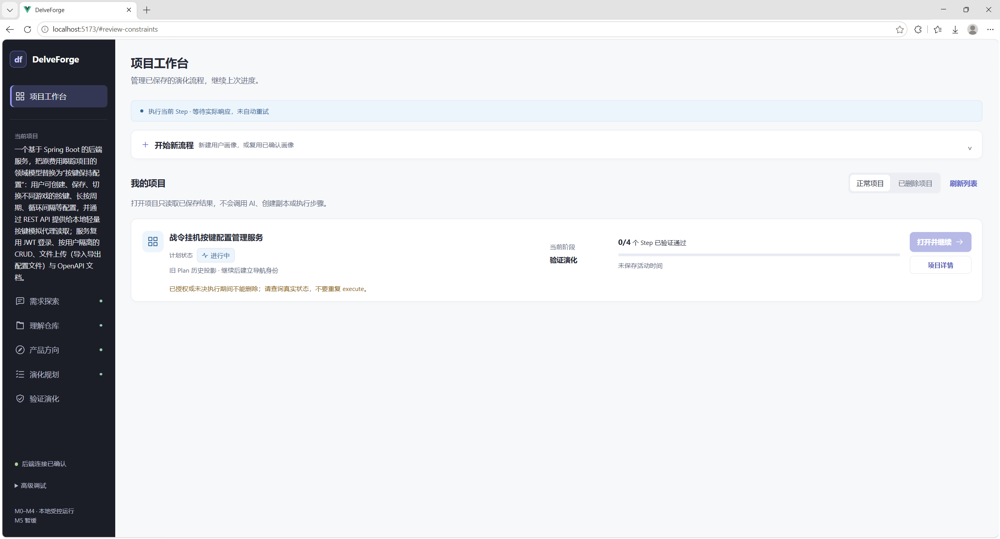
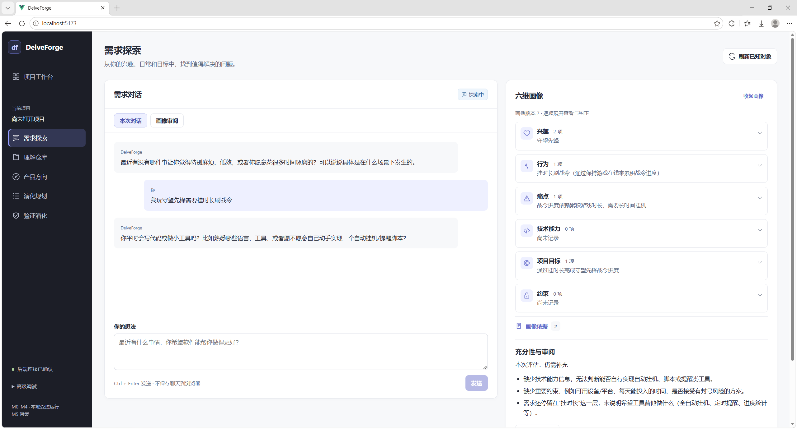
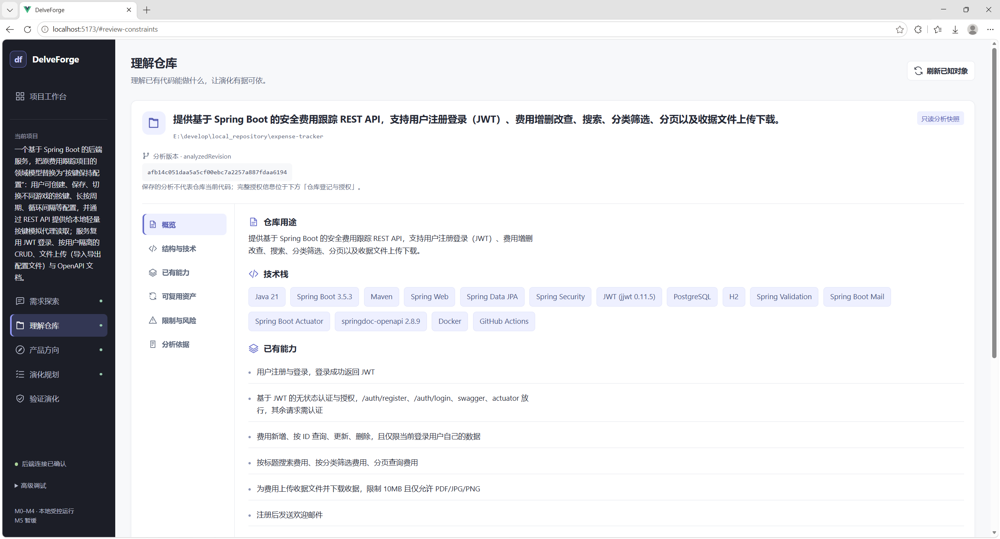
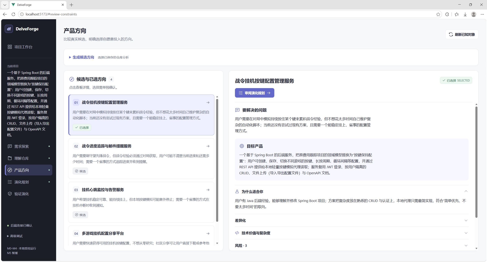
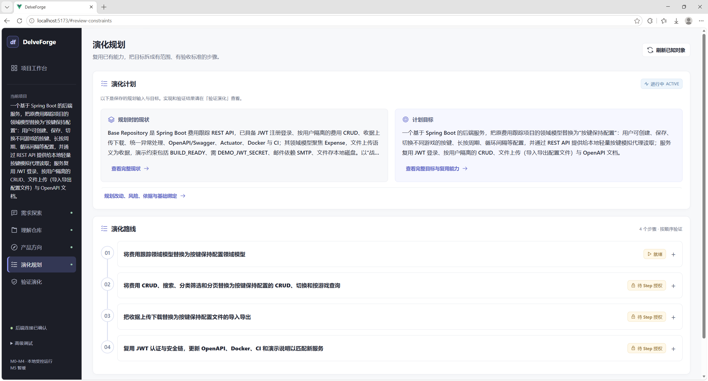
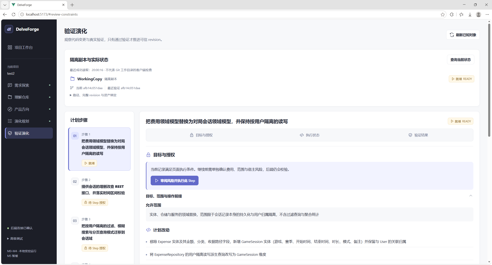

# DelveForge

**Personalized Project Discovery & Evolution Agent**

> 🔨 **Evolution Before Rewrite.**
>
> 从真实需求出发，发现值得做的项目，让已有代码成为新想法的起点。


## 🎯 About DelveForge

完成一个课程项目或教程项目后，下一个项目应该做什么？

热门项目清单可以提供题目，却很难回答：**这个项目为什么适合我？能否满足真实需求？我已经写过的代码有没有复用价值？**

DelveForge 是一个面向开发者的个性化项目探索与演化 Agent。

它通过 AI 对话理解用户的兴趣、痛点、技术能力和项目目标，分析已有 Git 仓库的功能与可复用资产，再提出个性化产品方向和演化计划。

在此基础上，DelveForge 还尝试通过 Agent 修改独立 WorkingCopy 中的代码，并使用构建、测试与 Git 检查验证结果。

**目前更适合体验需求探索、仓库理解、方向发现与演化规划。代码自动演化仍处于实验性阶段，不能保证稳定完成。**

## ✨ What Can It Do?

DelveForge 提供项目工作台，以及从需求探索到代码验证的五个业务阶段。

| 功能 | 说明 |
| --- | --- |
| 🗂️ **Project Workspace** | 管理不同项目、查看历史记录和已验证步骤，支持继续项目与重新规划 |
| 💬 **User Discovery** | 通过多轮 AI 对话探索需求，生成六维用户画像，由用户审阅、纠正并确认 |
| 🔍 **Repository Understanding** | 只读分析本地 Git 仓库，识别模块、技术栈、已有能力、可复用资产、限制和风险 |
| 💡 **Product Direction** | 结合用户需求与已有代码，生成个性化产品方向，展示依据与风险，由用户选择 |
| 📋 **Evolution Planning** | 为选定方向生成演化计划，拆分步骤、修改范围和验收标准 |
| 🧪 **Verified Evolution（实验性）** | 经用户授权后，尝试在独立 WorkingCopy 中修改代码并执行验证；提案或验证失败时可能无法完成 Step |

### 🧭 Workflow

```text
Explore Your Needs
        ↓
Understand Existing Repositories
        ↓
Discover Product Directions
        ↓
Plan Incremental Evolution
        ↓
Review & Confirm Steps
        ↓
Attempt Code Evolution
        ↓
Verify Candidate Changes
```

DelveForge 不会自动替用户决定产品方向，也不会在选择方向后直接修改代码。

**AI Proposes, Domain Decides.**

AI 提出建议，系统检查结构、依据、授权和状态。代码修改只有满足相应验证要求后，才能成为可信的 Verified Revision。

## 🖼️ Screenshots

### 🗂️ Project Workspace

管理项目流程、历史规划与已验证步骤。



### 💬 User Discovery

AI 对话、六维画像与人工确认。



### 🔍 Repository Understanding

Git 仓库分析、功能模块与可复用资产。



### 💡 Product Direction

个性化产品方向、推荐依据与潜在风险。



### 📋 Evolution Planning

演化路线、步骤范围与验收标准。



### 🧪 Verified Evolution

查看 Step、WorkingCopy、代码修改与实际验证结果。



## 🚀 Quick Start

推荐在 Windows 本地环境中使用 **Windows PowerShell 5.1 或 PowerShell 7**。
先安装 **JDK 21、Git CLI、Node.js（`^20.19.0` 或 `>=22.12.0`）和 pnpm 12.9.1**。
Maven Wrapper 已内置，SQLite 无需单独安装服务。

```powershell
git clone https://github.com/ayywl288/DelveForge.git
cd DelveForge
.\setup-delveforge.ps1
```

根据提示输入 DeepSeek API Key（必填、隐藏输入），在 `Customize configuration? [y/N]`
处直接回车即可使用应用默认配置。脚本检查依赖、构建最新后端、按锁文件安装前端依赖，
然后打开两个保留日志的服务终端。连通检查通过后显示访问地址：**http://127.0.0.1:5173**。
首次安装依赖需要联网。停止时在两个服务终端分别按 `Ctrl+C`，再关闭终端。

选择 `y` 可设置后端端口、DeepSeek Model / Base URL、SQLite 文件、WorkingCopy Root、
日志目录及历史 WorkingCopy Roots；每项留空使用应用默认值。历史 Roots 使用逗号分隔的绝对路径。
脚本会暂时忽略当前终端继承的应用配置覆盖项，结束后恢复；API Key 仅传给后端，不传给前端。
`SERVER_PORT` 与 Vite 的 `BACKEND_DEV_URL` 自动保持一致。端口被占用时脚本拒绝启动，不停止已有进程。

默认启用 `m4-local`：后端 `127.0.0.1:8080`，SQLite `./data/m4-local/delveforge.db`，
WorkingCopy 位于用户目录的 `.delveforge/m4-local/workspaces`，日志为 `./logs/m4-local`。
已有数据库不会被脚本覆盖；应用启动时仍会执行正常的 Flyway 迁移。
默认模型为 `deepseek-flash`，账号不支持时请在自定义配置中指定可用模型。
**该 Profile 使用 Streaming 和较高 Token 预算，AI 操作可能产生较多费用；启动连通检查不会调用 Provider。**

### Manual Startup / Troubleshooting

需要手动控制启动时，可在仓库根目录使用以下命令（API Key 安全输入示例需要 PowerShell 7）：

```powershell
.\mvnw.cmd -DskipTests package
$env:DEEPSEEK_API_KEY = Read-Host "DeepSeek API Key" -MaskInput
java -jar .\backend\delveforge-app\target\delveforge-app-0.1.0-SNAPSHOT.jar --spring.profiles.active=m4-local
```

另开一个不含 API Key 的终端启动前端：

```powershell
cd frontend
pnpm install --frozen-lockfile
# 后端改用其他端口时，在此设置对应地址，例如：
# $env:BACKEND_DEV_URL = "http://127.0.0.1:18080"
pnpm dev
```

手动启动时，`SERVER_PORT` 在后端终端中设置；前端地址以 Vite 输出为准。
更多配置及历史 WorkingCopy 说明见 [M4 Local Usage](docs/M4_LOCAL_USAGE.md)。

如果脚本被执行策略拒绝，这是 PowerShell 的安全策略，而非依赖缺失。
先确认脚本来源并审阅内容，再用 `Get-ExecutionPolicy -List` 检查策略。
若没有组织策略限制且确需调整，可自行在**当前会话**执行
`Set-ExecutionPolicy -Scope Process -ExecutionPolicy RemoteSigned` 后重新运行脚本；
这不会永久修改用户或系统策略。下载文件的来源标记或签名要求仍须按本机策略处理。

## 📦 Demo Repositories

DelveForge 准备了三个 Java / Maven 演示仓库，帮助体验项目探索与演化流程。

它们通过 **Git Bundle** 分发，可以恢复成独立的本地 Git 仓库。

| Demo | 主要功能 | 基线状态 |
| --- | --- | --- |
| **GS REST** | Spring REST Greeting 示例 | BUILD_READY · 3 tests |
| **TodoList API** | 用户与任务 CRUD、日期及任务归属 | BUILD_READY · 4 tests |
| **ExpenseTracker** | 费用管理、分类、检索和分页 | BUILD_READY · 12 tests |

### 📥 Download & Restore

下载入口：[GitHub Releases](https://github.com/ayywl288/DelveForge/releases)

计划提供的附件：

- `gs-rest-service.bundle`
- `todolist-api.bundle`
- `expense-tracker.bundle`

下载 Bundle 后，在文件所在目录打开 PowerShell。以 GS REST 为例：

```powershell
git -c core.autocrlf=false clone .\gs-rest-service.bundle .\gs-rest-service
```

这样便会从 Bundle 恢复一个独立的 Git 仓库。

如果想先确认基线能否正常构建：

```powershell
cd gs-rest-service

.\mvnw.cmd verify
```

首次执行可能需要联网下载 Maven 依赖，也有助于准备后续离线验证所需的依赖缓存。

其他两个 Demo 的操作方式相同，只需替换 Bundle 文件名及目标目录。

### 💡 How to Use

启动 DelveForge 后：

1. 在 **Project Workspace** 中新建项目。
2. 通过 **User Discovery** 探索需求，审阅并确认用户画像。
3. 在 **Repository Understanding** 中登记本地 Git 仓库，填写真实的读取权限、许可证信息与使用授权。
4. 运行仓库分析，查看已有功能、结构和可复用能力。
5. 在 **Product Direction** 中生成并选择感兴趣的方向。
6. 通过 **Evolution Planning** 生成并审阅演化计划。
7. 如果愿意继续实验，可以准备 WorkingCopy、确认 Step，并尝试执行代码演化。

**推荐先体验前六步。** 第七步对仓库、执行环境、模型提案和验收标准要求更高，目前不保证成功。

三个 Demo 均经过各自的基线构建验证，但 **BUILD_READY 不代表 AI 演化已经成功**。

Demo 的来源、固定 Git Revision、SHA-256 和许可说明见 [Demo Catalog](docs/demos/README.md)。

其中 GS REST 的代码为 Apache-2.0，教程文字为 CC BY-ND 3.0。DelveForge 记录用户的授权与许可声明，但不代替法律许可审查。

## 🧪 Experimental Code Evolution

DelveForge 曾完成过两次真实 Provider 驱动的受控代码演化：

| 案例 | 历史验证结果 |
| --- | --- |
| **DelveForge Self-Evolution** | 指定 Step 修改 2 个 Java 文件；BUILD、完整 TEST（1346 项）和 DIFF_CHECK 通过 |
| **GS REST Evolution** | 从 `e38e4a1` 演化到 `c822cc3`；新增 8 个 Java 文件、338 行代码，BUILD 与 10 项聚焦测试通过 |

对应验证报告：

- [DelveForge Self-Evolution](docs/validation/m4-real-provider-verified-evolution-smoke.md)
- [GS REST Evolution Evidence](docs/validation/task-f-project-workspace-history-recovery.md)

**这些都是特定版本、特定 Step 的历史成功案例，并不代表现在能够稳定复现。**

实际测试表明，即使仓库满足基本运行条件，模型生成的 CodingProposal 仍可能不符合领域契约，或者 Step 包含当前执行器无法自动验证的验收标准。

系统会对提案与执行条件进行校验，拒绝不满足约束的操作，但这种安全拒绝并不等于成功完成演化。

因此，目前代码演化主要用于实验与工程验证，**不应被视为可靠的通用 AI Coding 工具**。

## ⚠️ Current Limitations

- **Local Git Only**：目前使用用户明确授权的本地 Git 仓库，不支持自动搜索并获取任意在线项目。
- **Bounded Understanding**：仓库分析受材料预算、模型输出和代码覆盖范围限制，无法保证充分理解大型或复杂项目。
- **Analysis First**：需求探索、仓库分析、方向发现与规划是当前推荐体验的核心能力，但这些 AI 阶段也可能因领域校验失败而中断。
- **Experimental Evolution**：代码修改与验证主要针对受信任的小型 Java/Maven 仓库，即使是 Demo 或历史成功过的仓库也不保证再次演化成功。
- **Limited Verification**：当前主要支持 Maven 构建、Java 测试及 Git Diff 检查；无法自动验证的验收标准会阻止对应 Step 执行。
- **No OS Sandbox**：WorkingCopy 与原始仓库分离，但本机 Maven 构建和测试不是操作系统级沙箱。请仅使用可信仓库与测试数据。
- **No Automatic Repair**：M5 Repair / Retry / Recovery 尚未实现。失败或执行状态不确定时，应先查询实际状态，不要盲目重复提交 execute。

## 🛠️ Tech Stack

| Layer | Technologies |
| --- | --- |
| Backend | Java 21 · Spring Boot 3.5 · Maven |
| AI Gateway | DeepSeek HTTP API · Spring RestClient |
| Persistence | SQLite · Flyway · MyBatis-Plus |
| Frontend | Vue 3 · TypeScript · Vite · pnpm |
| Repository | Git CLI · Revision-pinned Analysis |
| Evolution | Isolated WorkingCopy · Maven/Git Verification |

DelveForge 使用 Maven 多模块架构，将领域规则、应用编排和外部基础设施实现分离。

工程设计重点包括：

- **Revision-pinned Understanding**：仓库分析绑定明确的 Git Revision，避免将旧分析结果误认为当前源码状态。
- **Explicit Authorization**：用户画像确认、资产使用授权、方向选择、Step 确认与代码执行保持独立。
- **Verification Before Trust**：模型提出的代码修改首先是 Candidate，只有满足相应验证要求，才会推进 Verified Revision。

### 📚 Documentation

- [Product Design](docs/PRODUCT.md) · [Architecture](docs/ARCHITECTURE.md) · [Domain Model](docs/DOMAIN_MODEL.md)
- [Roadmap](docs/ROADMAP.md) · [Architecture Decisions](docs/decisions/)
- [Local Usage](docs/M4_LOCAL_USAGE.md) · [Demo Catalog](docs/demos/README.md)
- [Frontend Guide](frontend/README.md) · [Validation Records](docs/validation/)
- [Task G UI Closeout](docs/validation/task-g-final-frontend-closeout.md)

---

**🔨 DelveForge — Evolution Before Rewrite.**