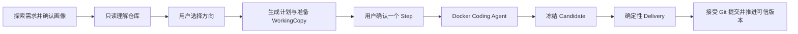

# DelveForge

**Personalized Project Discovery & Evolution Agent — Evolution Before Rewrite.**

DelveForge 面向已有一些 Java 项目经验、希望找到个人项目方向的开发者：
通过需求对话形成用户画像，只读理解已有 Git 仓库，提出产品方向与增量计划；
用户逐步授权后，由 Coding Agent 在 Docker 内编码、检查，冻结 Candidate，再正式交付到独立 WorkingCopy。

**当前状态：MVP 功能冻结，准备本地技术展示与实习面试。** 它是需要人工选择、授权、观察和验收的本地实验工具。
冻结依据是已有实现与可审计结果，不代表所有历史实验通过、生产就绪或任意仓库均兼容。
本轮不再新增功能、生成 EvolutionPlan、运行付费实验或修补目标应用。

## 实际能力

| 阶段 | 当前能力与边界 |
| --- | --- |
| User Discovery | 多轮需求探索、结构化画像、人工审阅与确认 |
| Repository Understanding | 读取获授权的本地 Git 固定 revision，分析模块、能力、证据与限制；不改原仓库 |
| Product Direction | 综合画像与仓库事实提出方向，由用户选择 |
| Evolution Planning | 生成 goal/scope/plannedChanges，准备独立 WorkingCopy，逐 Step 确认 |
| Coding Agent | 真实模型循环与六个受控工具，隔离编码、Maven 检查、按源码快照记录证据 |
| Candidate / Delivery | 冻结 diff/tree/测试事实，确定性 Git/SQLite 协调；接受正式提交后 Step 才成功 |
| 运行观察 | 持久化事件、工具活动、文件与测试摘要、用量、取消及独立交付状态 |



AI Proposes, Domain Decides。Run 成功、Candidate 冻结、Delivery 完成和产品可用性分别判断；
NOT_TESTED 不等于测试通过。后续 Step 不会自动确认或启动。

## 已有实验的真实结果

| 实验 | 正式交付与技术验证 | 实际使用验收 |
| --- | --- | --- |
| FinTrack | 两次真实 Delivery；展示版 Run07 最终 12 项测试通过 | JWT 登录、两用户 CSV 范围、文本转义与真实浏览器下载通过；范围有限 |
| Taskarium | 原四步 4/4 正式交付，最终测试依次 9/19/28/34 项通过；Plan COMPLETED | C4 启动成功，但 Step 4 引入表单/CSRF 不匹配，注册和登录 403；浏览器产品验收失败 |

FinTrack 复用已有真实 M1–M3，后续反馈计划有 Codex 辅助，不是完全无人干预全旅程。
Taskarium 的任务、笔记、日期、进度、浏览器重启保留和第二账户界面检查因认证阻塞未执行。
完整范围、失败历史、身份与证据入口见 [验证索引](docs/validation/README.md)。

## 技术栈与结构

Java 21、Maven Wrapper、Spring Boot 3.5.16；Spring AI 1.1.8 与 DeepSeek 适配器；
SQLite / Flyway（当前 V26）/ MyBatis-Plus；Vue 3 / TypeScript / Vite / pnpm；Git CLI 与 Docker。

后端由 domain、application、infrastructure、app 四个 Maven 模块组成。
Application 持有用例和 Port，Infrastructure 提供模型、Git、文件、SQLite、Docker 实现，App 负责装配与 HTTP。
详见 [架构与三张流程图](docs/release/ARCHITECTURE_OVERVIEW.md)。

## 本地启动

推荐 Windows / PowerShell 7；需要 JDK 21、Git、Node.js `^20.19.0 || >=22.12.0` 和 pnpm 12.9.1。
Coding Agent 另需 Linux Docker Engine API 1.48+；目标构建受控支持 JDK 17/21 与公开 Maven Central 依赖。
DeepSeek 功能需要用户自己的 API key 与额度；不在源码或前端中配置 key。

```powershell
git clone https://github.com/ayywl288/DelveForge.git
cd DelveForge
# 取得本地已审阅的发布候选后，再按下列文档构建、启动。
.\setup-delveforge.ps1
```

发布候选尚未推送，公共 clone 不会自动取得本地 `codex/mvp-freeze-release`。
启动器会交互获取 key、检查依赖、准备镜像，再启动前后端；
`.\setup-delveforge.ps1 -DisableAgent` 可关闭 Agent，探索阶段仍需真实模型。
**无密钥、无 Docker 的启动检查**与可复制的手动配置见 [本地运行](docs/release/LOCAL_SETUP.md)。
仅启动和读取历史不会自动运行付费实验，需求对话、分析、方向与规划也可能调用模型。

已有数据在首次启动前须一致备份数据库、全部 WorkingCopy 与 Agent 留存材料，不能只复制有 WAL 的主库文件。
不使用真实数据库演示迁移，不清理旧占用或未知恢复现场。默认后端和 Vite 只监听本机。

## 限制与当前交付

- 面向小型、受信任的 Java/Maven 本地仓库；不是任意语言、任意依赖与外部服务的通用编码平台。
- 模型输出需要审阅；凭据规则是有界的格式/直接字面量识别，不是通用源码秘密分析。
- 每次 Agent 启动仍需费用确认；无默认累计 tokens 或总时长硬停止。用量是供应商报告值，不是账单。
- 取消不是暂停，不支持断点续接；未知写入或外部修改会保留 RECOVERY_REQUIRED。
- 开发 HTTP 接口没有登录认证或多租户隔离，不作为公网部署方案。
- Windows 有完整后端历史验证；Linux x86-64 仅有局部原生交付验证，不宣称完整跨平台验收。

## 文档导航

- [冻结基线、发布候选与安全集成](docs/release/README.md)
- [架构、Agent 与 Git/SQLite Delivery 图](docs/release/ARCHITECTURE_OVERVIEW.md)
- [环境、构建、启动与排错](docs/release/LOCAL_SETUP.md)
- [演示路径与面试讲解](docs/release/DEMONSTRATION.md)
- [验证索引：新执行、历史成功和失败边界](docs/validation/README.md)
- [UX 改进记录与待办](docs/release/UX_BACKLOG.md)
- [Product](docs/PRODUCT.md) · [Architecture](docs/ARCHITECTURE.md) · [Domain](docs/DOMAIN_MODEL.md)
- [Roadmap](docs/ROADMAP.md) · [ADR](docs/decisions/) · [Agent 详细合同](docs/AUTONOMOUS_AGENT.md)
- [演示仓库固定基线与许可](docs/demos/README.md)

旧截图和 milestone 报告保留其版本含义；当前执行页参考
[Taskarium 正式交付截图](docs/validation/evidence/step4-final-delivery-ui.jpg)。
