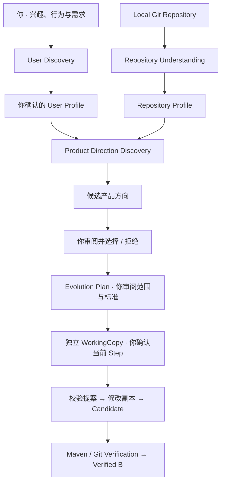

<div align="center">

# DelveForge

**Personalized project discovery and evolution.**

把真实需求与已有代码连接起来，找到你真正想做的下一个项目。

**Evolution Before Rewrite**


[了解功能](#features) · [快速开始](#getting-started) · [演示仓库](#demo-repositories) · [如何使用](#usage) · [文档](#documentation)

</div>

## 🎯 About

做完教程项目后，下一个项目做什么？热门项目清单能提供题目，却很难解释：
**为什么适合我、我会不会真的使用它、它和现有项目有什么不同？**

DelveForge 面向已有一定开发经验、希望找到个人项目方向的开发者。
它结合你的兴趣、行为、痛点、技术能力与现实约束，理解手边仓库的可复用能力，
提出值得继续探索的产品方向。

**Evolution Before Rewrite**：优先从已有软件出发，找到通往目标产品的演化路径。
目前后端已完成 M0–M4：用户探索、仓库分析、方向选择、演化规划，以及隔离副本中的代码修改和验证。
已有一次真实 Provider 驱动的 Verified B；M4 冻结，M5 失败恢复暂缓。

<a id="features"></a>

## ✨ Features

- **User Discovery · 理解你的需求**<br>
  探索兴趣、真实行为、痛点、技能、目标和约束。你可以查看、纠正并明确确认生成的画像。
- **Repository Understanding · 看懂已有资产**<br>
  只读分析本地 Git 仓库的固定 commit，整理用途、技术栈、核心能力、可复用资产、限制与风险。
- **Product Direction Discovery · 找到演化方向**<br>
  将已确认画像与一个或多个仓库画像结合，生成 3–5 个个性化候选方向。
- **Human Review & Selection · 由你作出选择**<br>
  查看每个方向的用户匹配、资产复用、差异化、技术价值、复杂度、风险与依据，再选择或拒绝。
- **Evolution Planning & Execution · 小步改造与验证**<br>
  审阅 Plan、准备独立 WorkingCopy、明确确认 Step；系统校验 CodingProposal，再修改副本并运行 Maven / Git 检查。验证通过后才推进可信 revision。

## 🧭 How It Works



**一个例子：**你想做数据由自己掌控的个人记账工具，而手边的后端项目已有
Elasticsearch 搜索与聚合能力。一个可能的方向是复用索引、筛选和聚合机制，
把商品检索演化为**账目检索与分析**。

这个例子来自已有验证中的方向建议，不代表每次都会生成相同结果，也不代表改造已经完成。
同一个需求配上不同的软件资产，可以得到不同的演化路径。

### 已完成的真实演化

DelveForge 已用自己的 Java/Maven 仓库完成一次真实 DeepSeek → CodingProposal → Candidate
→ Maven Verification。用户希望仓库分析能从 `shop_service.py`、`place_order_use_case.py`
这类 Python 文件名识别应用服务角色。模型修改了隔离 WorkingCopy 内的分类器与回归测试，
补充正例、Python 反例及其它语言保持不变的检查。

Candidate 的 **1346 项测试**与 BUILD / DIFF_CHECK 均通过后，Step 才成为 SUCCEEDED，
`lastVerifiedRevision` 从 A (`47ca448`) 推进到 B (`6dfdc12`)。原始仓库没有被演化修改。
执行器为 `9efee445`，其维护修复后来已整合至 main；Candidate 的业务补丁未合入 main。
完整 Plan、实际 diff 与排障过程见 [首次 Verified B](docs/validation/m4-real-provider-verified-evolution-smoke.md)。
这是一次受控功能 PASS，不是任意仓库都能演化成功的证明。

<a id="getting-started"></a>

## 🚀 Getting Started

### 准备环境

- **JDK 21**，配置好 `JAVA_HOME`；**Git CLI** 可从 `PATH` 调用。
- **Node.js `^20.19.0 || >=22.12.0` + pnpm 12.9.1**（启动前端时需要）。
- **DeepSeek API Key**，供用户探索、分析、方向发现、规划与代码提案使用。
- Maven Wrapper 已包含在仓库中；SQLite 无需独立数据库服务。

### 克隆并启动后端

```bash
git clone https://github.com/ayywl288/DelveForge.git
cd DelveForge
./mvnw -DskipTests package
export DEEPSEEK_API_KEY="<your-key>"
java -jar backend/delveforge-app/target/delveforge-app-0.1.0-SNAPSHOT.jar --spring.profiles.active=m4-local
```

Windows 上的 PowerShell 7 将 `./mvnw` 换成 `./mvnw.cmd`，并用不回显输入设置凭据：

```powershell
$env:DEEPSEEK_API_KEY = Read-Host 'DeepSeek API Key' -MaskInput
```

Key 仅注入**后端进程的环境变量**；不要放在前端 `.env`、浏览器存储或请求正文。
Endpoint / model 可用 `DELVEFORGE_AI_DEEPSEEK_BASEURL` / `DELVEFORGE_AI_DEEPSEEK_MODEL`
覆盖。数据库、Workspace 与日志可通过以下变量选择自己的运行目录：

```powershell
$localRunRoot = Join-Path $env:LOCALAPPDATA 'DelveForge\local-demo'
$env:DELVEFORGE_PERSISTENCE_DATABASE_FILE = Join-Path $localRunRoot 'data\delveforge.db'
$env:DELVEFORGE_WORKSPACE_ROOT = Join-Path $localRunRoot 'workspaces'
$env:DELVEFORGE_LOG_DIR = Join-Path $localRunRoot 'logs'
```

设置后再启动 JAR。若要体验全新环境，选择新的运行目录，不要删除原业务数据库。
重复启动同一路径会保留此前画像，且只能有一个应用实例使用该 DB / Workspace。

上述本地 profile 运行于 `http://127.0.0.1:8080`，SQLite 默认位于 `./data/m4-local/delveforge.db`，
Workspace 和日志位置可覆盖。不指定 profile 时数据库默认仍为 `./data/delveforge.db`。
未设置 Key 时仍可启动服务，但需要模型的请求会失败。真实凭据不要提交到仓库。
高级配置见 [application.yml](backend/delveforge-app/src/main/resources/application.yml)。

普通本地 M4 使用请按 [M4 本地使用说明](docs/M4_LOCAL_USAGE.md) 配置独立数据库、Workspace 和日志，
显式启用 `m4-local` profile。它复用首次 PASS 的 SSE 与有界高预算；默认非流式配置没有同等真实 M4
成功证明。这些预算影响所有 AI 阶段，并非已验证的最优默认值。当前仅面向授权、受信任且具备根
Maven Wrapper 与离线可运行测试的小型 Java Git 仓库；Windows 本机执行不是 OS 沙箱。

### 启动前端

在仓库根目录另开终端：

```bash
cd frontend
pnpm install --frozen-lockfile
pnpm dev
```

打开 `http://127.0.0.1:5173`；开发服务器会将 `/api` 代理到本地后端。
五阶段 Web 界面支持需求聊天、画像审阅、仓库分析、方向选择、计划准备与受控执行。
使用步骤与断线处理见 [Frontend README](frontend/README.md)。AI 操作产生 Provider 费用；
执行前还需独立授权 Step 并确认宿主运行风险，页面不会自动执行下一步。

<a id="demo-repositories"></a>

## 演示仓库

准备了三份固定来源、许可清晰的独立 Git Bundle，源码与历史在主仓库外。
**公开附件待发布**；当前没有下载链接。目录、SHA-256、还原与注册命令见
[Demo Catalog](docs/demos/README.md) 和 [manifest](docs/demos/manifest.json)。

| 演示 / 待发布文件 | 当前能力 | 许可 | 验证等级 |
|---|---|---|---|
| ExpenseTracker · `expense-tracker.bundle` | 费用 CRUD、用户范围、搜索/分类/分页 | MIT | BUILD_READY；12 测试通过 |
| TodoList API · `todolist-api.bundle` | 认证、任务 CRUD、日期及归属检查 | MIT | BUILD_READY；4 测试通过 |
| Spring REST · `gs-rest-service.bundle` | 官方 complete Maven 问候接口 | Apache-2.0 | BUILD_READY；3 测试通过 |

三份均已从 Bundle 还原，HEAD 和清单一致、工作树干净，JDK 21 下 Maven 测试可运行。
它们**尚未获得 AI 演化验证**。保留上游业务代码，只适配 Wrapper、本地测试及配置；每套
提供两个未预先实现的新方向。TodoList 的实体响应/更新限制、ExpenseTracker 的邮件依赖
等边界见 Catalog，测试通过不表示可直接投入生产。

<a id="usage"></a>

## 💡 Usage

启动服务后，优先通过 Web 页面按阶段体验；下列 API 顺序也适用于 HTTP 客户端。
表中的 `{id}` 分别使用前一步返回的画像、资产或方向 ID。

| 步骤 | 操作 | API |
| --- | --- | --- |
| 1 | 创建用户画像 | `POST /api/user-profiles` |
| 2 | 提交需求，按返回问题继续探索 | `POST /api/user-profiles/{id}/discovery-turn` |
| 3 | 查看画像，必要时纠正字段 | `GET /api/user-profiles/{id}`、`PATCH /api/user-profiles/{id}` |
| 4a | 用户主动进入画像审阅 | `POST /api/user-profiles/{id}/sufficiency-assessment`，`{"revision": N}` |
| 4b | 核对六区和依据，再确认当前版本 | `POST /api/user-profiles/{id}/confirm`，`{"revision": N}` |
| 5 | 登记本地 Git 仓库及授权信息 | `POST /api/software-assets` |
| 6 | 分析仓库，取得仓库画像 | `POST /api/software-assets/{id}/analysis` |
| 7 | 以确认后的用户画像和仓库画像发现方向 | `POST /api/product-directions/discovery` |
| 8 | 查看方向，再显式选择或拒绝 | `GET /api/product-directions/{id}`、`POST /api/product-directions/{id}/select` 或 `/reject` |
| 9 | 根据选择的方向和基础资产规划 | `POST /api/evolution-plans/planning` |
| 10 | 审阅 Plan，准备独立副本 | `POST /api/evolution-plans/{planId}/prepare` |
| 11 | 明确确认当前 Step | `POST /api/evolution-plans/{planId}/steps/{stepId}/confirm` |
| 12 | 生成并校验提案，执行与验证 | `POST /api/evolution-plans/{planId}/steps/{stepId}/execute` |
| 13 | 核对结果及可信 revision | `GET /api/evolution-plans/{planId}`、`GET /api/working-copies/{id}` |

Discovery turn 的请求形如 `{"input":"我想做自托管记账工具，主要会 Java，只有周末有时间。"}`。
按 `nextQuestion` 连续回答；`sufficient=true` 只表示可以审阅，仍可继续探索。
首次达到条件会提示选择，后续不逐轮弹窗。同一版本审阅优先复用服务端有效评估；内容变更
后旧结论失效。进入审阅后核对六区、依据与待核实内容，再显式确认实际版本 `N`。
确认后不会自动提问；需要时主动重新开启探索，历史方向仍绑定原画像版本。

登记仓库时提供 `location`、`readPermissionAllowed`、`licenseInfo` 与 `usageAuthorization`，
按真实权限填写。取得分析结果后，方向发现请求的形状如下：

```json
{
  "userProfileId": "<confirmed-user-profile-id>",
  "expectedRevision": 23,
  "repositoryProfileIds": ["<repository-profile-id>"]
}
```

将示例中的 ID 和 `23` 换成实际返回的值。选择新方向时，原先选中的方向会进入 `SUPERSEDED`；
系统不会替你选择，也不会在选择后自动修改代码。
详细操作记录见 [端到端使用示例](docs/validation/m2-product-direction-e2e-smoke.md#13-复现)。

### 当前使用范围

自定义授权仓库可以尝试分析、发现方向和规划；真实代码演化当前面向小型 Java/Maven Git
项目，要求根 Maven Wrapper、可运行的实际测试、干净的受校验 Git revision。先审查构建
脚本并运行 Wrapper 准备依赖缓存，生产 Verification 使用离线 Maven。JDK 21 是 DelveForge
运行要求，演示项目的 Java 编译目标可为 17 或 21。

当前技术验证支持 BUILD、完整/指定 Java 测试与 Git diff 检查；不支持的业务标准不会被算作
通过。**Windows 执行 Maven 不是 OS 级隔离**，仅使用受信任仓库和合成数据。模型输出、
Patch 与单次 PASS 都不能提供任意仓库的成功率或安全认证。M5 Repair / Retry / Recovery
尚未实现；执行失败或断线后先查实际状态，不能靠重发 execute、手工改库或 reset Candidate
恢复。详细边界见 [M4 本地使用](docs/M4_LOCAL_USAGE.md)。

## 🏗 Engineering & Architecture

- **AI Proposes, Domain Decides**：模型输出先经过严格解析、引用校验和领域规则，才能成为系统状态；方向整批保存，失败不留下半批结果。
- **Revision-pinned Understanding**：对固定 commit 做只读分析，在有界预算内选择材料，保留结果与仓库版本之间的联系。
- **Safe AI boundary**：Scout 只接收元数据；文件读取前排除高风险路径，内容交给外部 AI 前净化已识别凭据。规则不保证覆盖所有秘密格式。
- **Evidence-backed recommendations**：方向保留用户需求、匹配关系与可复用能力的依据，关联明确的画像版本与仓库快照，方便审阅与追溯。

Backend 采用 Maven 多模块的 Modular Monolith。App 负责装配，Infrastructure 实现外部 Ports：

```text
Frontend ──HTTP──▶ App
                    ├──▶ Application ──▶ Domain
                    └──▶ Infrastructure ──▶ Application / Domain
```

模块依赖和仓库理解的详细设计见 [ARCHITECTURE](docs/ARCHITECTURE.md) 与 [ADRs](docs/decisions/)。

## 🛠 Built With

| 层面 | 技术 |
| --- | --- |
| Backend | Java 21 · Spring Boot 3.5.x · Maven Wrapper |
| Persistence | SQLite · Flyway · MyBatis-Plus |
| 外部能力 | Git CLI · DeepSeek HTTP API |
| Frontend | Vue 3 · TypeScript · Vite |

核心流程有自动化测试与真实仓库验证覆盖。后端在根目录运行 `./mvnw clean verify`；
前端在 `frontend/` 运行 `pnpm test` 和 `pnpm build`，完成交互测试、类型检查与生产构建。

## 🗺 Roadmap

- ✅ **M0 — Foundation**
- ✅ **M1 — User Discovery + Repository Analysis**
- ✅ **M2 — Product Direction Discovery**
- ✅ **M3 — Evolution Planning & Working Copy**：DONE / FROZEN
- ✅ **M4 — First Verified Evolution Step**：DONE / FROZEN
- **M5 — Failure Safety & Recovery**：DEFERRED

完整计划见 [ROADMAP](docs/ROADMAP.md)，真实代码案例与故障过程见 [M4 报告](docs/validation/m4-real-provider-verified-evolution-smoke.md)。
一次受控 PASS 不证明任意仓库的稳定性或安全性；后端功能开发现已暂停。

<a id="documentation"></a>

## 📚 Documentation

- [PRODUCT](docs/PRODUCT.md) — 产品目标、用户与范围
- [ARCHITECTURE](docs/ARCHITECTURE.md) — 系统结构与技术边界
- [DOMAIN_MODEL](docs/DOMAIN_MODEL.md) — 领域语义、状态机与不变量
- [ROADMAP](docs/ROADMAP.md) — 开发计划与验收标准
- [M4 本地使用](docs/M4_LOCAL_USAGE.md) — 配置、API 顺序、确认与失败边界
- [M4 交付冻结](docs/validation/m4-delivery-closeout.md) — 合并、最终验证与证据归档
- [Minimal Web 验证](docs/validation/minimal-web-experience.md) — UI 契约、离线联通与交互边界
- [Demo Catalog](docs/demos/README.md) — 三套 BUILD_READY 基线、待发布附件及还原步骤
- [User Discovery 一致性修复](docs/validation/task-c1-user-discovery-consistency.md) — 同版本审阅、提示与会话保留
- [ADRs](docs/decisions/) — 关键设计决策与取舍
- Engineering notes — [开发复盘](docs/retrospectives/) / [验证记录](docs/validation/)

贡献时请参考 [AGENTS.md](AGENTS.md)；前端开发说明见 [Frontend README](frontend/README.md)。
