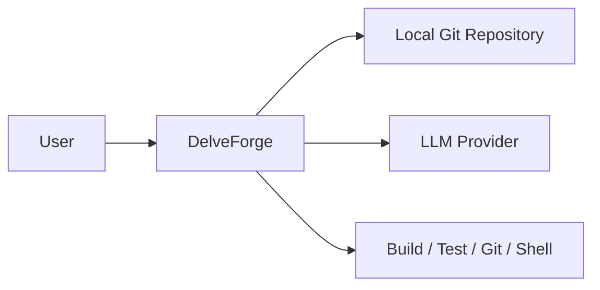
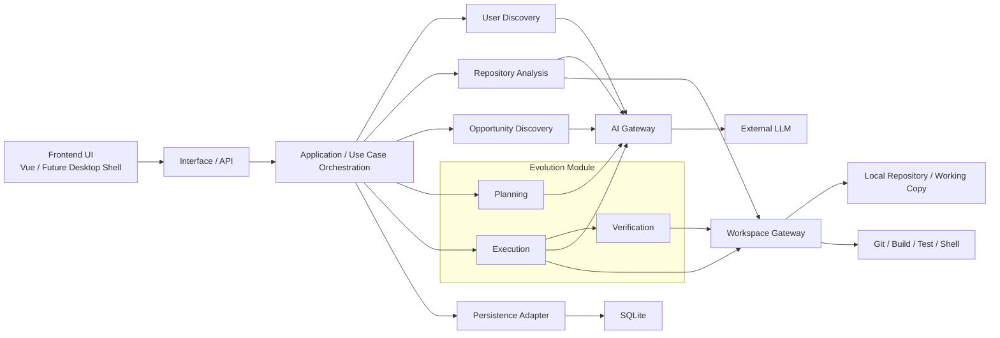
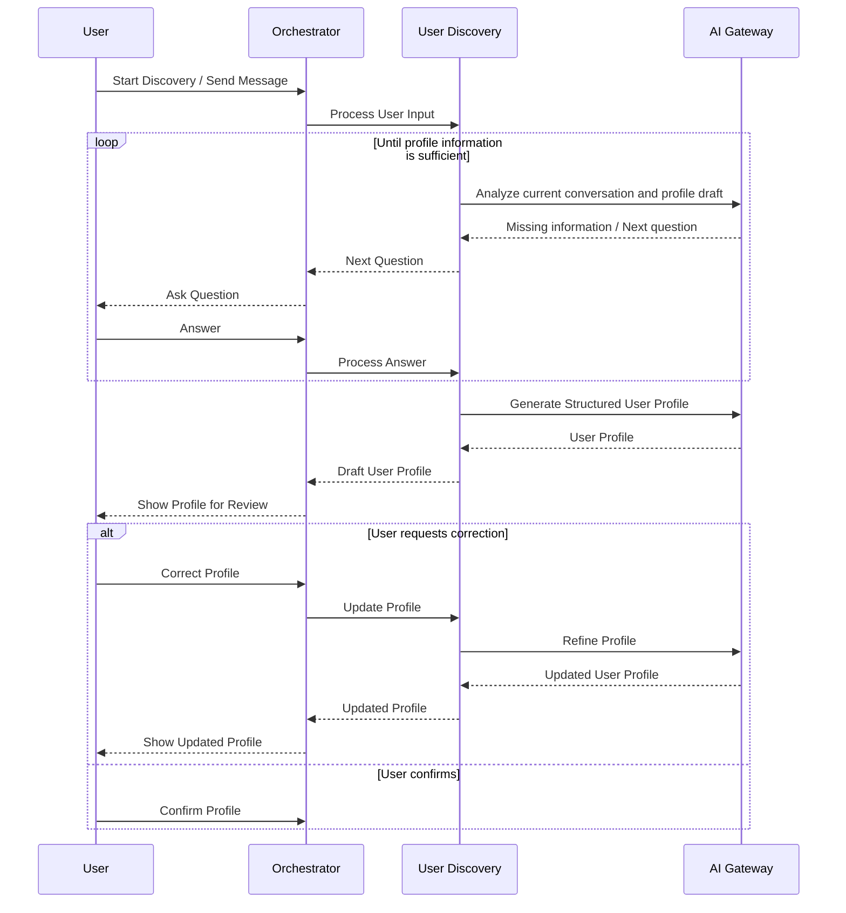
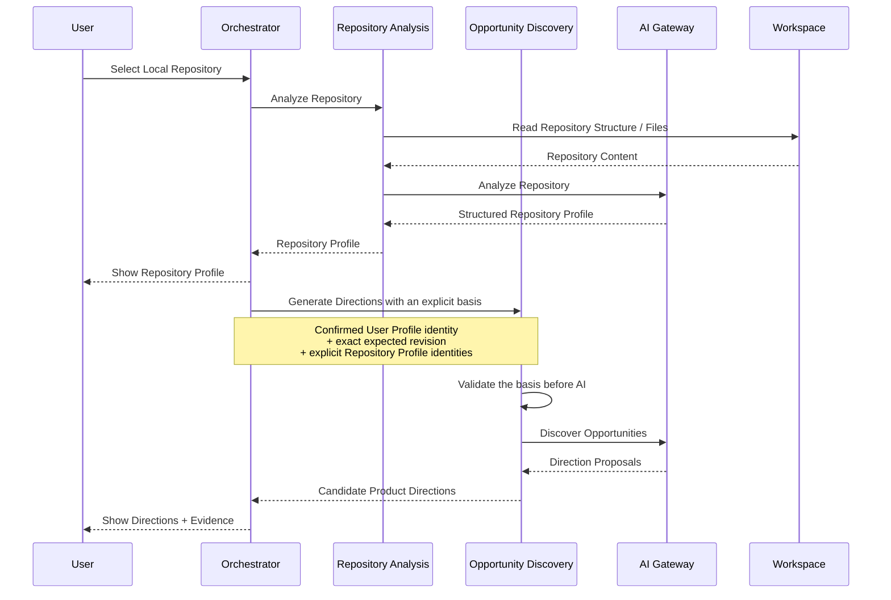
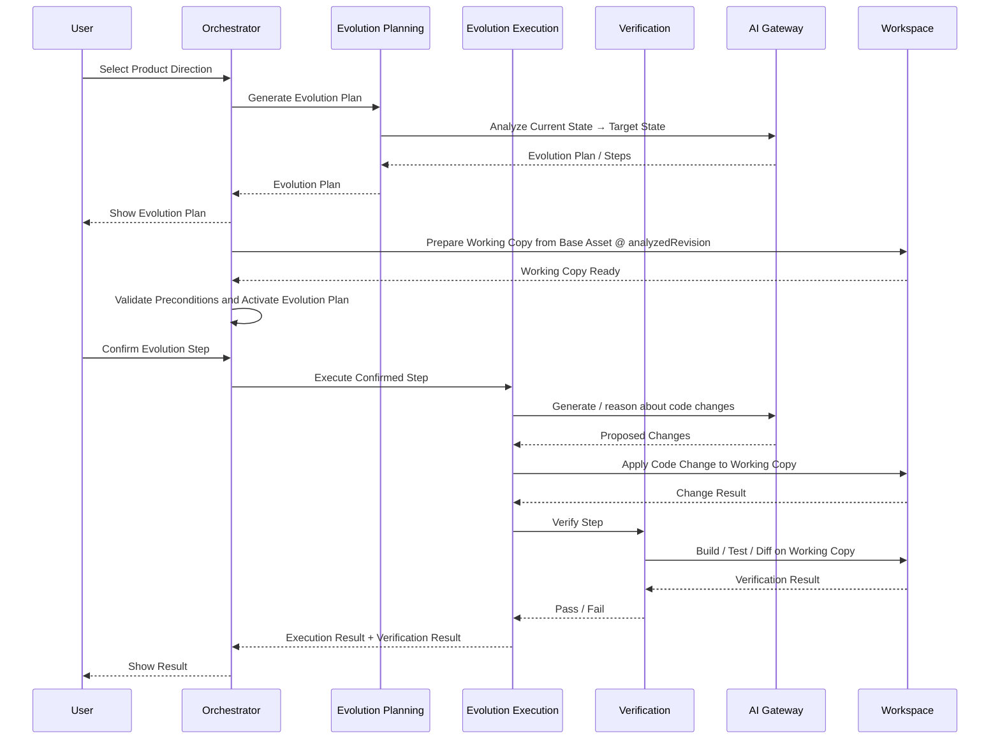

# ARCHITECTURE.md

> 本文档回答：系统准备如何实现，以及最重要的架构选择是什么。

**Status:** Stable
**Last Updated:** 2026-10-07

## 1. Architecture Goals

| Priority | Quality Attribute | Goal                                                         |
| -------- | ----------------- | ------------------------------------------------------------ |
| 1        | Modularity        | 用户探索、仓库分析、方向发现、演化执行能够独立演进           |
| 2        | Traceability      | Product Direction / Evolution Plan 能够追溯其依据的 User Profile、Repository Profile 和分析结果 |
| 3        | Safety            | Repository Analysis 对原始 Software Asset 保持只读；Evolution Execution 的代码修改必须限制在与当前 Evolution Plan 绑定的受控 Working Copy 内 |
| 4        | Verifiability     | 每个 Evolution Step 都能够产生明确的执行结果，并通过 build / test / diff 等方式验证 |
| 5        | Evolvability      | MVP 可以先采用简单架构，同时允许未来替换 LLM、Repository Analyzer 或 Coding Agent 实现 |
| 6        | Compliance        | 系统能够记录 Software Asset 的来源、许可证与使用授权信息，并在资产是否允许二次开发无法确认时给出风险提示或限制自动改造 |
| 7        | Transparency      | User Profile、Repository Profile 等关键中间产物对用户可见，并允许用户检查和纠正 |

---

## 2. Architecture Constraints

### 2.1 Project Constraints

- 当前主要由单人开发。
- MVP 优先完成完整闭环，而不是建设复杂基础设施。
- 当前 Software Asset 主要是本地 Git Repository。
- 系统需要读取用户提供的本地 Git Repository，并在隔离的 Working Copy 中执行允许的代码修改。
- 原始 Software Asset 不作为 Evolution Execution 的直接修改目标。
- MVP 不考虑多人协作。
- MVP 不考虑云端代码托管。
- MVP 不考虑长期自主运行的 Coding Agent。

### 2.2 Technology Constraints

- **Core Language / Runtime:** Java 21。MVP 核心业务、Application、Domain、AI Gateway、Workspace Gateway 与 Persistence 均以 Java 实现。
- **Optional Tool Language:** Python 不属于 MVP 必需 Runtime。未来只有在特定 Analyzer / Tool 明确依赖 Python 生态时，才允许作为独立 Tool Process 引入。
- **Application Framework:** Spring Boot 3.5.16。
- **Build Tool:** Maven + Maven Wrapper。
- **Root Java Package:** `com.ayywl.delveforge`。
- **Repository Strategy:** Monorepo。
- **Backend Module Structure:** Maven Multi-Module，初始拆分为 `delveforge-domain`、`delveforge-application`、`delveforge-infrastructure`、`delveforge-app`。
- **Code Organization:** Maven Module 负责主要 Architecture Layer Boundary，各 Module 内部优先按照 Feature / Domain Concept 组织代码。
- **AI / Agent Integration:** 业务模块只能依赖内部 AI Gateway 抽象；首个真实 Adapter 直接调用 DeepSeek 的 OpenAI 兼容 HTTP API，**不引入 Spring AI / Spring AI Alibaba**（[ADR-0003](decisions/0003-first-ai-adapter-uses-deepseek-http-api.md)）。
  - Adapter 使用 `RestClient`（`spring-web`）与 Jackson；两者本来就通过 `delveforge-app` 的 `spring-boot-starter-web` 存在于本项目，只是显式声明到真正使用它们的模块。
  - 不引入 AI Framework 的依据是当前需求与框架能力不匹配：业务只需要一次 `messages → 完整 completion`，Tool Calling、多模型路由、业务流式接口与通用 Agent 能力不在当前实现范围。M4 在 Provider Adapter 内可选地消费有界 SSE，Port 仍只返回完整文本（ADR-0003）。
  - **该选择被 AI Gateway Port 隔离**：更换 Provider 或改用 AI Framework 都只影响 Infrastructure 内的 Adapter。
  - 重新评估的条件见 ADR-0003：出现 Tool Calling / 多 Provider / Agent 需求，或升级到 Spring Boot 4.x 时。
  - 无论走哪条路线，业务模块都不得直接依赖具体 Provider SDK、Provider 专有 API 类型或 Spring AI Alibaba 实现类型。
- **Architecture Style:** Modular Monolith。
- **Database:** SQLite。
- **Persistence Access:** MyBatis-Plus。
- **Schema Migration:** Flyway。
- **Initial LLM Provider:** DeepSeek。
- **Initial Model:** Provider 为 DeepSeek API；默认 model id 为 `deepseek-flash`（配置默认值见 `delveforge-app` 的 `application.yml`）。具体 Model ID 与 Provider 参数必须配置化。
- **Working Copy:** 基于用户本地 Git Repository 创建独立 Local Git Clone，并从 Repository Profile 对应的 `analyzedRevision` 建立演化基线。
- **Frontend:** Vue 3 + TypeScript + Vite。
- **MVP User Interaction:** 开发与核心 MVP 验证阶段采用 localhost Web UI + Local Java Backend。
- **Final Product Form:** Local-first Desktop Application。
- **Desktop Shell:** Deferred。待 Core MVP 稳定后再选择具体技术，不作为当前 M0 Blocker。
- **Deployment:** MVP 优先本地运行。

---

## 3. System Context

描述系统外部世界。



---

## 4. Solution Strategy

```text
系统第一版采用单体应用组织核心业务能力，
内部按照用户理解、仓库理解、方向探索、演化规划和演化执行进行模块划分。

LLM 不直接承担系统状态管理，
结构化 User Profile、Repository Profile、Product Direction、Evolution Plan 和 Evolution Step 由系统维护。

所有 LLM 调用通过统一的 AI Gateway / Model Adapter 访问，
避免业务模块直接依赖具体模型供应商。

Repository Analysis
通过受控 Workspace 接口只读访问用户提供的本地 Repository，
不得修改原始 Software Asset。

进入 Evolution Execution 前，
系统基于 Evolution Plan 对应的 Base Software Asset 与确定 Revision
准备独立 Working Copy。

Evolution Execution
通过 Workspace 访问并修改该 Evolution Plan 对应的 Working Copy，
不得直接修改原始 Software Asset。

代码分析与修改分离：
分析阶段只读取原始 Repository；
执行阶段只有在用户确认具体 Evolution Step 后，
才允许在对应 Working Copy 中获得受限写能力。

每一个 Evolution Step 执行完成后，
必须进入 Verification 流程，
通过构建、测试、Diff 或其他验证方式确认结果。

未经 Verification 的 Candidate State
不得成为后续 Evolution Step 的可信执行基线。
```

---

## 5. High-Level Architecture

描述主要运行单元。



## 6. Module Design

| Module                | Responsibility                                | Does NOT             |
| --------------------- | --------------------------------------------- | -------------------- |
| User Discovery        | 对话探索用户并维护 User Profile               | 不负责推荐项目       |
| Repository Analysis   | 分析 Repository 并形成 Repository Profile     | 不修改代码           |
| Opportunity Discovery | 根据 User + Repository 发现 Product Direction | 不修改代码           |
| Evolution             | 生成 Evolution Plan、组织执行并验证           | 不直接访问模型供应商 |
| Workspace             | 文件、Git、Build、Test、Shell 等本地能力      | 不进行产品决策       |
| AI                    | 提供统一 LLM 访问能力                         | 不维护业务状态       |

### 6.1 Initial Project Structure

DelveForge 使用 Monorepo 管理 Backend、Frontend、Documentation 与未来 Desktop Integration。

```
DelveForge/
│
├── pom.xml
├── mvnw
├── mvnw.cmd
├── .mvn/
│
├── backend/
│   ├── delveforge-domain/
│   ├── delveforge-application/
│   ├── delveforge-infrastructure/
│   └── delveforge-app/
│
├── frontend/
├── docs/
├── AGENTS.md
└── README.md
```

Backend 使用四个 Maven Module。

```
delveforge-domain
    ↑
delveforge-application
    ↑
delveforge-infrastructure

delveforge-app
    ├── depends on delveforge-application
    └── depends on delveforge-infrastructure
```

职责如下：

| Maven Module                | Responsibility                                               |
| --------------------------- | ------------------------------------------------------------ |
| `delveforge-domain`         | Aggregate、Entity、Value Object、Domain Service、Domain Policy、Domain Event 与核心 Invariant |
| `delveforge-application`    | Use Case、Application Service、Orchestration，以及 AI / Workspace / Persistence Port |
| `delveforge-infrastructure` | DeepSeek、Persistence、Git、Filesystem、Shell、Build / Test 等外部能力 Adapter |
| `delveforge-app`            | Spring Boot Bootstrap、REST API、Configuration、Dependency Wiring 与 Interface Adapter |

Module Dependency Rules：

- `delveforge-domain` 不依赖其他 DelveForge Maven Module。
- `delveforge-application` 可以依赖 `delveforge-domain`。
- `delveforge-infrastructure` 可以依赖 `delveforge-application` 与 `delveforge-domain`。
- `delveforge-app` 负责组装 Application 与 Infrastructure。
- Domain / Application 不得通过间接方式访问具体 LLM Provider、Database、Git、Shell 或 Filesystem 实现。
- 不为每个 Architecture Module 建立独立 Maven Module。
- 不创建无明确业务语义的通用 `delveforge-common` Module。

Persistence 基础结构：

```
数据库位置     配置属性 delveforge.persistence.database-file
               （默认值与覆盖方式见 delveforge-app 的 application.yml）
DataSource     delveforge-infrastructure 的 SqliteDataSourceConfiguration
Mapper 位置    com.ayywl.delveforge.infrastructure.persistence 及其子包
Mapper 装配    由 delveforge-app 的 Composition Root 扫描
Migration      delveforge-infrastructure 的 src/main/resources/db/migration
               命名 V{版本}__{描述}.sql，已发布的迁移不可修改
```

SQLite、MyBatis-Plus 与 Flyway 只允许出现在 `delveforge-infrastructure` 内。
Domain / Application 不得出现这些技术类型的依赖。

具体业务表随 M1 及之后的对应领域对象以新增迁移的方式引入。
`delveforge-domain` / `delveforge-application` 不提供通用 Repository 抽象。

Maven Module 控制主要 Architecture Layer Boundary。

每个 Module 内部继续按照 Feature / Domain Concept 组织代码。

例如：

```
com.ayywl.delveforge.domain
├── user
├── asset
├── repositoryprofile
├── evidence
├── direction
└── evolution

com.ayywl.delveforge.application
├── userdiscovery                 按职责分子包，见下
│   ├── profile                   创建 / 读取 / 结构化更新
│   ├── exploration               一轮输入 → AI 建议 → Profile 更新
│   ├── sufficiency               信息是否足够进入 Review
│   ├── review                    确认 / 继续探索 / 重新开启探索
│   ├── workflow                  组合成面向产品的一轮 User Discovery
│   └── shared                    跨子包协作单元（Application 内部）
├── repositoryanalysis            按职责分子包
│   ├── asset                     软件资产的登记与读取
│   ├── map                       Repository Map 与候选通道
│   ├── scout                     File Scout：目录 → 校验过的 RF-* 引用
│   ├── region                    分层 Scout：超限目录的 Region 导航
│   ├── readplan                  定向读取的计划、预算与执行
│   ├── secret                    仓库源码凭据边界（ADR-0006）
│   ├── extraction                材料 → 结构化 Proposal
│   ├── profile                   已保存快照的读取
│   └── workflow                  组合成一次 Repository Analysis
├── opportunitydiscovery
│   └── direction                 一轮发现：建议 → 领域校验 → 持久化
├── evolution
└── port
    ├── ai
    ├── persistence
    └── workspace

com.ayywl.delveforge.infrastructure
├── ai
├── persistence
└── workspace

com.ayywl.delveforge.app
├── api
├── config
└── error
```

Architecture Module 与 Maven Module 不要求一一对应。

例如 User Discovery、Repository Analysis、Opportunity Discovery 与 Evolution 是业务 / 架构边界，但 MVP 中不分别建立独立 Maven Module。

### 6.2 Cross-Cutting Infrastructure

配置 / 错误处理 / 日志的约定如下。

**Configuration**

```
配置类命名     {Concern}Properties，使用 @ConfigurationProperties record
归属           由消费该配置的 Module 自己声明并通过 @EnableConfigurationProperties 启用
默认值         application.yml，不在代码中兜底
环境相关值     API Key / 数据库路径 / LLM Endpoint 与 Model / Workspace Root
               一律通过配置提供，不得硬编码进业务代码
```

技术配置按边界归属：SQLite / Provider 等专有配置留在 Infrastructure。
Domain / Application 不出现任何技术配置类型。

**Error Handling**

```
异常来源                                  HTTP       ApiErrorCode
IllegalArgumentException                 400        INVALID_REQUEST
UserProfileNotFoundException             404        NOT_FOUND
UserProfileStateException                409        CONFLICT
AiGatewayException                       502        EXTERNAL_CAPABILITY_UNAVAILABLE
WorkspaceException                       500        INTERNAL_ERROR
WorkingCopyNotFoundException              404        NOT_FOUND
EvolutionPlanStateException               409        CONFLICT
WorkingCopyBasisChangedException          409        CONFLICT
EvolutionLifecycleConflictException       409        CONFLICT
Spring MVC 协议层异常                      由框架决定   INVALID_REQUEST / INTERNAL_ERROR
  （405 / 415 / 400 请求体无法解析等）
其余未预期异常                             500        INTERNAL_ERROR
```

`UserProfileNotFoundException` 表示调用方的请求形态合法、但目标当前不存在，
与 `IllegalArgumentException`（请求本身不合法）区分开。

`UserProfileStateException` 是领域自己的状态冲突类型（例如对已经进入 REVIEWING 的
Profile 再次执行状态转移、修改 CONFIRMED 的 Profile）。**不要映射通用的
`IllegalStateException`**：它可能来自 JDK 或第三方库，一律当成 409 会把真正的
服务端故障伪装成可重试的客户端冲突。其它业务模块出现同类语义时各自提供自己的
异常类型，而不是共用一个通用基类。

映射集中在一处（`delveforge-app` 的 error 包），Controller 不承担异常分类与错误构造。

协议层异常的状态码与响应头由框架决定，映射层只替换响应体。
自行重建响应会丢失 `Allow`、`Accept` 等协议头。

响应体不携带异常 message、堆栈、原因链或框架生成的细节文本——
这些内容可能包含请求内容、用户数据或第三方 SDK 的原始返回。

**Logging**

```
日志格式      operation=<操作> path=<资源标识> result=<结果>
              exception=<异常类型链 + 堆栈位置>
默认级别      INFO；不使用 DEBUG 作为默认值
记录内容      异常类型链与堆栈位置（类名 / 方法名 / 文件名 / 行号）
不记录内容    异常 message 与原因链文本 —— 任何日志级别
固定级别的包  org.springframework.web / org.apache.tomcat / org.apache.coyote
禁止记录      API Key / Token / Credential、完整源码、完整 Prompt 或模型响应、成批用户数据
```

日志级别不是例外：`AGENTS.md` §8.8 禁止记录凭据的规则不区分级别，
因此不存在「DEBUG 下可以记录原始异常文本」的例外。

```
不记录异常文本的原因
    异常 message 与原因链可能是调用方输入、用户数据或第三方 SDK 的原始返回，
    无法在记录前可靠判定其中是否含凭据。
    异常类型链与堆栈位置是代码标识，不承载运行时数据，足以定位失败点。

不使用 DEBUG 作为默认级别的原因
    Mapper 位于 com.ayywl.delveforge.infrastructure.persistence，
    该包打开 DEBUG 会让 MyBatis 打印 SQL 与绑定参数值，其中可能包含用户数据。

固定框架包级别的原因
    这些包的 DEBUG 输出发生在应用代码之外，无法通过 @RestControllerAdvice 拦截：
      org.springframework.web     ExceptionHandlerExceptionResolver 输出
                                  "Resolved [<异常.toString()>]"
      org.apache.tomcat          DEBUG 下输出请求头，可能包含 Authorization
      org.apache.coyote
```

上述固定是最低保障，不是完整清单；引入新的技术组件时应确认其 DEBUG 输出内容。

本节规则的原因、代价与重新评估条件见 [ADR-0002](decisions/0002-structural-only-exception-logging.md)。

M0 不引入 ELK / OpenTelemetry / Tracing 等超出范围的观测能力。

### 6.3 Frontend / Backend 连接方式

**当前开发阶段采用的方式：**

```
Frontend 调用     使用相对路径 /api/...
转发              Vite dev server 将 /api 代理到本地 Backend
代理目标          .env.development 的 BACKEND_DEV_URL
Backend           不为开发环境开放 CORS
```

Task B 的本地 Web Experience 展示既有 REST 用例。Vue 负责表单与结构化展示，
`frontend/src/api/client.ts` 对齐 Controller DTO，`state/session.ts` 协调请求与 GET 恢复，
不增加后端领域状态。浏览器仅存储对象 ID 和执行等待标记，业务正文只留在页面内存。
同步 execute 无客户端或 Proxy 短期限；断线和刷新不重放命令。Web Locks 仅协调同 origin
标签页，不替代后端授权、revision 或 Workspace 检查。实际限制见
[Web 验证记录](validation/minimal-web-experience.md)。

目的是避免 Frontend 源码绑定具体 Backend 地址：

```
BACKEND_DEV_URL 刻意不加 VITE_ 前缀
→ Vite 只把 VITE_ 前缀的变量注入浏览器端产物
→ 该地址只用于 dev server 代理配置，不进入前端代码
```

**正式运行形态尚未决定。** 以下问题都是开放的，随 Desktop Shell 一并确定：

```
Frontend 产物如何托管
API 地址在运行期如何解析
是否需要同源
与 Desktop Shell 如何集成
```

当前实现不排除任何一种运行期形态。候选方式包括但不限于：前端产物由 Backend 托管、
本地 web server、custom protocol、IPC、运行期注入 API base。

Desktop Shell 选型时必须重新评估这套连接模型。

除业务端点（见 6.5）外，Backend 另提供一个不承载业务语义的连通性端点：

```
GET /api/system/connectivity
→ { service, status, timestamp }
```

该端点不探测数据库或 Provider 等下游依赖，避免把连通性检查变成对下游可用性的隐式承诺。

### 6.4 Build / Test 验证入口

```
Backend    ./mvnw verify      编译 + 模块依赖校验 + 全部测试 + 打包
Frontend   pnpm install --frozen-lockfile && pnpm test && pnpm build
           Vue / HTTP 交互回归 + 类型检查（含测试）+ 生产构建
```

两条命令链相互独立，都能在全新环境中重复执行，且不依赖真实 LLM、
开发数据库或用户本地数据。

测试按 Module 划分职责：

```
delveforge-domain           领域规则与状态语义，纯 JUnit
delveforge-application      Port 契约与 Use Case 编排，在 Port 边界使用 fake，不引入 Spring
delveforge-infrastructure   真实 SQLite / Flyway / MyBatis-Plus 集成
delveforge-app              上下文装配 / HTTP 端点 / 错误映射 / 配置绑定
```

需要数据库的测试使用 `target/test-databases/<uuid>/` 下的临时 SQLite 文件。

当前未引入 CI/CD、Coverage Gate、Failsafe 阶段拆分与 E2E 平台；
Frontend 采用 Vitest + jsdom 验证五阶段交互和长请求，夹具不依赖真实 LLM。
未引入独立 lint 或浏览器 E2E 平台，入口见 `frontend/README.md`。

### 6.5 Backend API Contract（当前范围）

下表是当前已经实现的业务端点。它随对应业务能力一起扩展，
不为尚未实现的领域能力预先定义接口。

| Method  | Path                             | 说明                                                       | 成功 | 失败 |
| ------- | -------------------------------- | ---------------------------------------------------------- | ---- | ---- |
| `POST`  | `/api/user-profiles`             | 创建一个空的 `EXPLORING` User Profile                      | 201  | —    |
| `GET`   | `/api/user-profiles/{id}`        | 返回当前（最新）revision 的 Profile                        | 200  | 404  |
| `PATCH` | `/api/user-profiles/{id}`        | 结构化 partial update，返回更新后的 Profile                | 200  | 400 / 404 |
| `POST`  | `/api/user-profiles/{id}/explore`| 提交一轮用户自然语言输入，由 AI 提出建议后更新，返回更新后的 Profile | 200  | 400 / 404 / 502 |
| `POST`  | `/api/user-profiles/{id}/sufficiency-assessment` | 评估当前 Profile 信息是否足够进入 Review 阶段 | 200 | 404 / 502 |
| `POST`  | `/api/user-profiles/{id}/confirm` | 用户确认 Profile（`REVIEWING → CONFIRMED`），请求体须携带所依据的 revision | 200 | 400 / 404 / 409 |
| `POST`  | `/api/user-profiles/{id}/continue-discovery` | 用户选择继续探索（`REVIEWING → EXPLORING`） | 200 | 404 / 409 |
| `POST`  | `/api/user-profiles/{id}/reopen-discovery` | 用户重新开启探索（`CONFIRMED → EXPLORING`） | 200 | 404 / 409 |
| `POST`  | `/api/user-profiles/{id}/discovery-turn` | 一轮 User Discovery：提取 → 更新 → 评估 → 必要时进入 Review | 200 | 400 / 404 / 409 / 502 |
| `POST`  | `/api/software-assets`           | 登记一个 Software Asset（只登记元数据，不访问文件系统）     | 201  | 400  |
| `GET`   | `/api/software-assets/{id}`      | 读取已登记的资产元数据                                     | 200  | 404  |
| `POST`  | `/api/software-assets/{id}/analysis` | 分析该资产的 Repository，形成一份新的 Repository Profile | 201 | 404 / 409 / 502 |
| `GET`   | `/api/repository-profiles/{id}`  | 读取一份已保存的分析快照                                   | 200  | 404  |
| `POST`  | `/api/product-directions/discovery` | 执行一次 Product Direction Discovery，保存并返回 3–5 个候选方向 | 201 | 400 / 404 / 409 / 502 |
| `GET`   | `/api/product-directions/{id}`   | 读取一条已保存的 Product Direction（含其依据与出处）        | 200  | 404  |
| `POST`  | `/api/product-directions/{id}/select` | 用户明确选择该方向（`CANDIDATE → SELECTED`），已有 `SELECTED` 时原方向同批进入 `SUPERSEDED` | 200 | 404 / 409 |
| `POST`  | `/api/product-directions/{id}/reject` | 用户明确拒绝该方向（`CANDIDATE → REJECTED`）              | 200 | 404 / 409 |
| `POST`  | `/api/evolution-plans/planning` | 从 Selected Direction、Base Asset 和 Base Profile 生成并保存 PROPOSED Plan | 201 | 400 / 404 / 409 / 502 |
| `GET`   | `/api/evolution-plans/{id}` | 读取完整的规划结果、按顺序的步骤及依据出处 | 200 | 404 |

**explore 语义**

```text
请求体    {"input": "<本轮用户输入的原文>"}
```

系统把「当前 Profile + 本轮输入」交给 AI Gateway，得到结构化 Proposal，再交给
Aggregate 决定是否接受。AI 只提出建议：

- 模型不能指定 Evidence 的来源：来源固定为本轮用户输入，`confirmed` 固定为 `false`；
- Proposal 里不合法的内容会被 Aggregate 拒绝，整个请求失败且不写入任何内容；
- `revision` 是否推进仍由 Domain 判断。

AI 调用失败或返回内容无法解析时返回 502，与其它外部能力失败一致。

**sufficiency-assessment 语义**

```text
请求体    无
响应体    {"sufficient": …, "missingAreas": [...], "nextQuestion": …, "profileStatus": "…"}
```

系统把「当前 Profile」交给 AI Gateway，得到一份充分性建议，再决定是否推进状态：

```text
insufficient   Profile 保持 EXPLORING，不写入、不推进 revision
sufficient     Application 调用 Domain 的状态转移，由 Domain 决定是否允许 EXPLORING → REVIEWING
```

模型输出里没有状态字段：AI 只表达「够不够、缺什么、下一问是什么」，
`profileStatus` 始终由 Domain 决定。模型输出自相矛盾（例如声明足够却列出缺失信息）
会被解析层拒绝，按 502 处理且不改变任何状态。

评估结果当前不持久化，每次调用都会重新评估。

**discovery-turn 语义**

面向产品的主要入口：一次请求完成一整轮 User Discovery。

```text
请求体    {"input": "<本轮用户输入的原文>"}
响应体    {"profile": {…}, "sufficient": …, "missingAreas": […], "nextQuestion": …}
```

```text
本轮用户输入
     ↓
提取      当前 Profile + 输入 → AI 提出建议 → 更新候选 Profile
     ↓
评估      对「本轮已经更新过的候选 Profile」判断信息是否足够
     ↓
insufficient  保存更新后的 Profile，返回 missingAreas + nextQuestion，仍为 EXPLORING
sufficient    执行 EXPLORING → REVIEWING，保存 Profile，返回 REVIEWING
```

- **`discovery-turn` 只能从 `EXPLORING` 开始**：`REVIEWING` 与 `CONFIRMED` 下调用直接 409，
  不调用 AI、不改动内容。这道校验由 Domain 提供
  （`UserProfile.requireExplorationAllowed()`）。若没有它，同一轮输入会因为模型恰好判断
  「足够」或「不足」而走向不同结局——「足够」时状态转移被拒、「不足」时内容被照常写入，
  等于让 AI 决定领域状态是否被接受。
- **一轮只保存一次**：整轮作用在同一个候选 Profile 上，只在最后写入。它不是把
  `explore` 与 `sufficiency-assessment` 串起来——那样会在探索结束后先落一次库，
  随后的评估失败就会留下「本轮只完成一半」的持久化状态。
- **评估针对更新后的候选 Profile**：用户这一轮说的信息必须先进入 Profile 再判断够不够。
- **失败原子性**：提取的 AI 调用/解析失败、内容更新被 Aggregate 拒绝、评估的 AI 调用/解析
  失败、`beginReview` 被拒绝——四个失败点都不会产生持久化副作用。
- **循环跨 HTTP 请求**：一轮返回 `nextQuestion`，调用方据此向用户提问，拿到回答后再发起
  下一轮。服务端不做 `while`、不等待用户、不保存对话记录。
- `sufficient` 为 true 时 `profile.status` 一定是 `REVIEWING`——由 Domain 决定，
  不是接口层写死的。

`explore` 与 `sufficiency-assessment` 保留为更细的步骤入口；`discovery-turn` 是它们的组合。
`explore` 保持原有行为：它只做提取与更新，`REVIEWING` 下仍可调用（状态保持不变）；
`REVIEWING` 起点限制只加在「整轮」入口 `discovery-turn` 上。

**Review / Confirm 语义**

Review 阶段复用已有的 `GET`：它已经返回完整的内容、`status` 与 `revision`，
不为「Review」另建一套读取模型。用户在这个界面上可以做三件事：

```text
PATCH  {id}                修正内容      状态保持 REVIEWING；实际变化才推进 revision
POST   {id}/continue-discovery  继续探索  REVIEWING → EXPLORING
POST   {id}/reopen-discovery    重新探索  CONFIRMED → EXPLORING
POST   {id}/confirm             确认      REVIEWING → CONFIRMED
       请求体 {"revision": <用户查看时所依据的 revision>}
```

- 三个动作都是**人类决策**，只能由调用方的显式请求触发；AI 流程（`explore`、
  `sufficiency-assessment`）没有通往 `CONFIRMED` 的路径。
- **确认必须绑定用户实际查看的版本。** 确认的意义是「用户同意了这一版内容」，
  而不是「确认服务端当前碰巧是什么版本」。请求体缺少 `revision` 是请求形状错误（400）；
  `revision` 与当前 revision 不一致说明内容在用户查看之后又变化过，此时确认不再代表
  用户的真实决定，返回 409 且不写入任何内容。继续探索与重新探索不表达对内容的认可，
  因此不需要绑定 revision。
- **`revision` 必须是 JSON 整数，小数不会被换算成一个版本。** `3.9` 一律 400：Jackson
  默认把浮点数有损地读成整数，若不在反序列化边界拦住，这个字段会在任何判断之前就变成
  `3`——一个与当前版本相等、看起来完全合法的取值，于是一次「用户确认了第 3.9 版」的请求
  会照着第 3 版成功确认，而用户从未认可过那一版。这与 `discovery` 的 `expectedRevision`
  是同一条规则、同一个实现。
- 状态转换本身不推进 `revision`（§6.1 的 Revision 触发规则只覆盖内容与 Evidence）。
  因此确认结果是「`CONFIRMED` @ 确认时的 `revision`」：该 revision 的内容快照已由
  Persistence 保留，确认之后内容修改被拒绝，这个组合构成 Product Direction Discovery
  可以稳定引用的基线。
- 非法起始状态一律 409 `CONFLICT`（例如在 `EXPLORING` 直接确认、在 `CONFIRMED`
  再次确认），不会落到 500。
- `UserProfileConfirmed`（`DOMAIN_MODEL.md` §9.1）是这一事实的领域表达。当前不引入
  事件机制，该语义由「状态被持久化 + revision 被保留」承载；事件如何传播仍属于
  §14.10 的未决问题。

**PATCH 语义**

```text
字段缺失或为 null   本次不更新该区，保持原值
字段存在（含 []）   该值是该区更新后的完整内容，整区替换——不是追加 / 合并
additionalEvidence  逐条新增的 Evidence，不是替换整个集合
```

`revision` 由 Domain 决定：只有实际内容发生变化才推进，接口不计算也不保证递增次数。
`status` 不能通过 PATCH 修改：状态转换各有自己的端点（`/confirm`、`/continue-discovery`、`/reopen-discovery`、`/discovery-turn`），由 Domain 决定是否允许。

本接口不提供历史 revision 查询，`GET` 始终返回当前 revision。
历史内容快照由 Persistence 保留，等出现真实消费者时再决定以何种形式暴露。

**响应体**

```json
{
  "id": "...",
  "status": "EXPLORING",
  "revision": 1,
  "interests": [],
  "behaviors": [],
  "painPoints": [],
  "technicalCapabilities": [],
  "projectGoals": [],
  "constraints": [],
  "evidence": [
    {
      "sourceType": "USER_INPUT",
      "sourceRef": "...",
      "claim": "...",
      "confidence": null,
      "confirmed": true
    }
  ]
}
```

`status` 与 `sourceType` 使用 Domain 的取值，接口层不引入同义词
（RULE-DOM-001）。未知取值会被反序列化拒绝，并映射为 400 `INVALID_REQUEST`。

DTO 定义在 `delveforge-app` 的 `api` 包，不暴露 Persistence 数据对象。

**Software Asset 注册语义**

```text
POST /api/software-assets
{
  "location": "...",
  "readPermissionAllowed": true,       必须显式给出
  "licenseInfo": "MIT",                可选，null 表示未知
  "usageAuthorization": "UNCLEAR"      必须显式给出，且只能用取值名称
}
```

- **`readPermissionAllowed` 必须显式给出。** 缺省它不会被当成 `false`——那等于用缺失的
  输入制造出一个「不允许读取」的授权事实（RULE-DOM-004）。字段缺失或为 `null` 一律 400，
  且不写入资产。
- **枚举只能用取值名称。** Jackson 默认允许用数字表示枚举（按序号），那会把
  `"usageAuthorization": 0` 静默解释成第一个取值，凭空产生一个授权事实。
  `spring.jackson.deserialization.fail-on-numbers-for-enums` 关闭了这种强转。
- 资产的标识、类型与来源都由服务端决定：请求体里给出这些字段不会生效。

**Repository Analysis 语义**

```text
POST /api/software-assets/{id}/analysis     请求体：无
响应体：RepositoryProfile（见下）
```

分析针对的东西全部由服务端决定，客户端不能指定：

```text
analyzedRevision   服务端解析一次 HEAD，之后所有读取固定在这个 commit 上
repository material 按 Application 层的读取规划从该 revision 的已提交内容中读取
Evidence           来自真实读到的文件，sourceRef 是材料中的相对路径
```

- **请求体不参与分析。** 客户端即使发送 `analyzedRevision`、`evidence` 或材料字段也不会
  被读取：它们不是这个端点的输入，服务端不会把客户端提供的值当作分析结果。
- **登记不校验位置。** `location` 只要求非空，任何取值都能登记成功；位置是否真的可用
  在分析时才见分晓，那时返回 409 而不是 400——登记请求与分析请求本身都没有写错。
- **每次调用产生一份新的快照**，不覆盖已有快照（`DOMAIN_MODEL.md` §10.4）。
  需要重新分析时再调用一次该端点，旧快照仍然可用。
- **失败不留下快照**：资产校验、仓库可读性、revision 解析、材料读取、AI 提取、
  领域创建任一失败都以异常结束，此时没有任何写入。
- 当前最终分析器对明确的模型输出格式、字段与 Evidence 引用契约违反最多重问一次，
  两次复用同一份已脱敏材料与请求，均完整校验；尝试次数及结果以无正文聚合日志记录。
  Provider 调用、Workspace、预算与领域失败不重试；Domain 接受与保存仍在提案通过后进行。
- **409 表示资产当前不能被分析**，与请求写法无关，调用方改请求也不会成功：

  ```text
  资产自身的 readPermission 不允许读取（INV-A01）
  资产位置当前不是可读取的本地 Git Repository
  该 Repository 在读取规划下没有任何可分析的材料
  源码目录超出当前分析方式的形状，分层 Scout 之后仍压不进本版本的预算（ADR-0005 的导航守卫）
  读不到一份能通过凭据边界的材料（ADR-0006，失败关闭）
  ```

  以上各条都与「请求不合法」（400）区分开：资产确实存在、请求也可以理解，需要改变的是
  资产或其所在仓库的状态，而不是请求写法。对外只有统一的 409 语义与通用报文，
  不会为了区分原因而回显路径或材料内容。Workspace 自身的操作失败（例如环境里找不到
  `git`）仍按本地能力失败处理，返回 500。
- AI 调用失败或模型输出无法解析时返回 502，不写入任何内容。
- 分析是只读的：它只通过 `WorkspaceReadPort` 读取，不修改源 Repository 的代码或 Git 状态。

**RepositoryProfile 响应体**

```json
{
  "id": "...",
  "assetId": "...",
  "analyzedRevision": "abc123...",
  "purpose": "...",
  "techStack": [],
  "modules": [],
  "capabilities": [],
  "reusableAssets": [],
  "limitations": [],
  "risks": [],
  "evidence": [
    { "sourceType": "REPOSITORY", "sourceRef": "pom.xml", "claim": "...",
      "confidence": null, "confirmed": false }
  ]
}
```

`analyzedRevision` 与内容属于同一个快照，一起返回；`evidence` 的 `sourceRef` 是
Repository 内相对于根目录的路径，接口不暴露宿主机文件系统布局。
`confirmed` 固定为 `false`、`confidence` 为 `null`：模型得出的结论属于系统推断，
其可信程度的口径尚未由领域模型规定。

**Product Direction Discovery 语义**

```text
POST /api/product-directions/discovery
{
  "userProfileId": "...",
  "expectedRevision": 3,                       必须显式给出，且不小于 1
  "repositoryProfileIds": ["...", "..."]       必须显式给出，至少一个
}
→ 201 {"directions": [ {…}, {…}, {…} ]}        本轮已经保存的候选方向，顺序与模型给出的一致
```

它是 Product Direction Discovery 能力对外的命令入口，面向系统外部调用、集成、
smoke 验证与前后端联调。当前 MVP 中，发现就是一个显式的 Application 操作：
完整的输入基线由调用方给出，Application 在调用 AI 之前校验它（§8.2）。

后端自动触发（`automatic discovery trigger`）当前不在 MVP 契约内——它需要为
Product Discovery 输入基线建立一个持久且明确的语义定义，而当前 MVP 缺乏支持
这一点的产品证据。状态与重新评估条件见 `ROADMAP.md` 的 M2。

- **方向标识、状态、内容、依据与候选资产都由服务端链路决定。** 请求体里给出这些字段不会
  生效（Jackson 忽略约定之外的字段），客户端无法通过它们凭空制造领域事实。
- **`expectedRevision` 必须显式给出，且必须是 JSON 整数。** 缺失不会被当成 0：0 不是一个
  版本，而「没给」说明调用方没有说出它依据的是哪一版。该字段用包装类型接收，正是为了让
  两者可区分。
- **小数不会被换算成一个版本。** `3.9` 一律 400：Jackson 默认把浮点数有损地读成整数，
  若不在反序列化边界拦住，这个字段会在任何校验之前就变成 `3`，一次针对「第 3.9 版」的
  请求会照着第 3 版执行并成功返回候选方向。同样拒绝指数写法、字符串与超出范围的取值。
  该约束只作用于本字段，不改变其它接口的宽松行为。
- **版本不匹配时返回 409，而不是改用当前版本。** 调用方声明依据的是哪一版 Profile；
  不是那一版就拒绝，由调用方重新读取后再发起（INV-D01、INV-D08）。
- **Profile 未 `CONFIRMED` 时返回 409**，且不在明知不可能成功时调用 AI（§8.4、INV-D08）。
- **失败原子性。** 加载失败、版本过期、状态不符、AI 失败、解析失败、领域拒绝——任何一种
  都不会留下已经写入的方向；整批保存本身也是原子的（§8.2）。
- **领域拒绝映射为 502。** 模型返回的方向数量、依据出处或候选资产不满足领域要求时，
  模型调用本身是成功的，只是这次拿不到可用的候选方向。它与 `AiGatewayException`
  （返回内容不符合约定）属于同一类失败，只是发生在更后一步。

**ProductDirection 响应体**

两个端点返回同一个资源：`discovery` 返回本轮保存的那一批，`GET` 按标识返回其中一条。

```json
{
  "id": "...",
  "userProfileId": "...",
  "userProfileRevision": 3,
  "repositoryProfileIds": ["..."],
  "title": "...",
  "problem": "...",
  "targetProduct": "...",
  "userFit": "...",
  "candidateAssetIds": ["..."],
  "differentiation": "...",
  "technicalValue": "...",
  "estimatedComplexity": "...",
  "risks": [],
  "status": "CANDIDATE",
  "evidenceSupport": {
    "userNeed": [
      {
        "evidence": { "sourceType": "USER_INPUT", "sourceRef": "...", "claim": "...",
                      "confidence": 0.8, "confirmed": true },
        "origin": { "kind": "USER_PROFILE", "userProfileId": "...",
                    "userProfileRevision": 3, "repositoryProfileId": null }
      }
    ],
    "userFit": [],
    "reusableCapability": [
      {
        "evidence": { "sourceType": "REPOSITORY", "sourceRef": "src/main/report",
                      "claim": "...", "confidence": null, "confirmed": false },
        "origin": { "kind": "REPOSITORY_PROFILE", "userProfileId": null,
                    "userProfileRevision": null, "repositoryProfileId": "..." }
      }
    ]
  }
}
```

`evidenceSupport` 保留三类关键判断的结构（§3.5、INV-D06），每条依据同时给出 Evidence
与它的出处：调用方据此才能回答「这条推荐理由凭的是谁的分析结论」。`origin.kind` 说明当前
是哪一类出处，不属于该类的字段为 `null`；两个 Repository Profile 拥有内容相同的依据时，
它们仍然是两条可以分辨的记录。

`repositoryProfileIds` 是这条方向**实际依据**的快照，不是本次发现可见的全部输入。

响应里不出现 `U-E1` / `R2-E3` 这类引用：它们只是一次 AI 调用内的临时编号，
在 Application 侧就已经被换成了真实依据与出处。

---

**Evolution Planning 语义（M3 Task 1）**

```text
POST /api/evolution-plans/planning
{
  "productDirectionId": "...",
  "baseAssetId": "...",
  "baseRepositoryProfileId": "..."
}
→ 201 EvolutionPlan

GET /api/evolution-plans/{id}
→ 200 相同的 EvolutionPlan 资源
```

请求只指定规划基线；Plan / Step 标识、状态、内容、Working Copy 关联和 Evidence
不能由请求制造。约定外的请求字段被忽略，与现有接口一致。

- Application 加载三个 Aggregate，先由 EvolutionPlanningService / AssetUsagePolicy
  校验 SELECTED、Candidate Asset、Profile 归属、确定 analyzedRevision 与使用许可。
  当前最小许可策略见 DOMAIN_MODEL.md §12.6；不满足时 409，未找到资源时 404。
- 一次 AI Gateway 调用仅使用已有 Direction 和 Repository Profile 的语义内容，
  不访问 Workspace、不重新读源码、不触发 Map / Scout。PlanningProposalParser 严格检查字段形状，
  返回保留临时引用的 AiPlanningProposal；PlanningProposalResolver 再将本次调用的 Evidence 引用
  换成既有 EvidenceBasis。得到的 PlanningProposal 仍是候选，由 Domain Service 决定是否接受。
  接受后的 Plan / Step 直接拥有正式领域内容，不保留 Proposal；SQLite 读取也直接重建正式值。
- 外部调用及解析完成后重新检查可变的方向状态与资产使用许可。SQLite 的实际插入语句
  再核对方向仍为 SELECTED，避免方向在 AI 调用期间切换后提交旧规划。
- AI 调用、结构解析、未知 Evidence 引用或提案领域校验失败时返回 502，且不留下 Plan。
  持久化的身份、内容、步骤与 Evidence 在同一事务中写入；任一失败整体回滚。
  第二次规划产生新的 Plan，不覆盖旧规划。
- 响应包含 id / productDirectionId / baseAssetId / baseRepositoryProfileId、currentState
  （summary / capabilities / modules / limitations）、targetState（problem / targetProduct /
  differentiation）、reusableCapabilities / changes / steps / risks / evidence / status。
  evidence 复用 EvidenceBasisPayload，保留真实依据、确认状态和出处，不暴露 AI 临时引用。
- 初始 status 为 PROPOSED，workingCopyId 为空；steps 保留顺序、id / planId、goal / scope /
  plannedChanges / verificationCriteria，status 为 PENDING_CONFIRMATION，
  baselineRevision 为空。它们只表达规划和待确认事实，不产生代码操作或执行授权。

---

当前 MVP 不包含 Step preconditions；Planning Parser 明确拒绝该旧字段，不静默丢弃模型提出的条件。
新持久化不写该分项。V12 保留历史分项及执行检查点，将含旧条件的 PROPOSED / ACTIVE Plan
标记 SUPERSEDED，正常 API 可读历史，但必须重新规划，不能将移除字段解释为满足旧条件。

**Working Copy preparation / Plan activation（M3 Task 2）**

```text
POST /api/evolution-plans/{id}/prepare   → 200 ACTIVE EvolutionPlan
GET  /api/working-copies/{id}           → 200 WorkingCopy 元数据
GET  /api/evolution-plans/{id}          → 复用规划资源的读取入口
```

prepare 只接受 Plan 身份，不接受客户端制造的 Working Copy 路径、状态、revision 或步骤授权。
Application 加载 Plan、Direction、Base Asset 与 Base Profile，经 PlanActivationPolicy / AssetUsagePolicy
校验后，将源位置、analyzedRevision 与服务端生成的目录名称交给独立 WorkingCopyProvisioningPort。
它不依赖 WorkspaceMutationPort，不调用 AI，也不重新分析源码。

Git Adapter 在 `delveforge.workspace.root` 下创建独立 Local Clone，使用完整 commit ID detached checkout，
并核对源 HEAD 未偏离分析基线、目标实际 HEAD 相符、checkout 干净。源仓库未提交内容不进入克隆。
根目录必须为绝对路径，可由 `DELVEFORGE_WORKSPACE_ROOT` 覆盖；默认位置见 app 的 application.yml。
Adapter 拒绝源仓库与托管根目录重叠、已有目标目录和不安全的目录名称。

外部候选成功后，Application 在隔离的领域候选上依次创建 READY WorkingCopy、绑定、由 Policy
判定并由 Plan.activate 转换状态。EvolutionLifecycleCommitPort 一次提交 READY 元数据与 ACTIVE
Plan；SQLite 条件更新再次核对 PROPOSED / 未绑定 / SELECTED、Profile revision 与当前资产授权依据。
持久化只保存 Working Copy 身份、源资产、位置、三个 revision 与状态，不保存代码或 Git 对象。
事务失败包含 COMMIT 失败；现有 SQLite transaction manager 的 rollbackOnCommitFailure 继续生效。

领域拒绝或提交失败时 Application 请求删除外部候选；provision 自身失败由 Adapter 清理已分配目录。
清理验证托管位置与本次准备凭据，绝不删除源仓库或采纳已有目录。清理失败以结构化类型记录，
原失败保留、清理失败作为 suppressed exception；残留目录不构成有效 WorkingCopy，不做残留协调。

显式方向切换还通过同一生命周期提交边界落实 INV-P08：领域操作使旧方向的 PROPOSED / ACTIVE
Plan 进入 SUPERSEDED，并与 Direction 切换一起提交。并发出现遗漏的新 Plan 时整批回滚；历史内容、
Evidence、步骤与已有 Working Copy 绑定都保留。新 Plan 的写入继续检查 SELECTED。
ACTIVE Plan 的步骤仍为 PENDING_CONFIRMATION，baselineRevision 仍为空；M3 不提供步骤确认或执行。

**Step Authorization / Execution Preparation（M4 Task 1）**

```text
POST /api/evolution-plans/{planId}/steps/{stepId}/confirm
→ 200 EvolutionPlan（仅当前 Step 为 READY）

POST /api/evolution-plans/{planId}/steps/{stepId}/execution-preparation
→ 200 { basis, proposal, modelVisiblePaths }
```

确认是明确用户动作，通过 Aggregate Root 与条件写入保存 READY。准备是独立的只读操作，
必须已经 READY；结果由 Application 返回给执行编排，不存储 Proposal 或 RepositoryProfile，
不增加用户 Proposal approval 生命周期。basis 保留 Plan / Step / WorkingCopy 身份及 expectedRevision。

Application 的 `evolution.preparation` 复用既有 Map、Region / File Scout、引用解析、ReadPlanner、
ReadExecutor 与 RepositorySecretPolicy。调用内查询加入 Step goal / scope / plannedChanges /
verificationCriteria 和最小 TargetState。读取明确使用 WorkingCopy 的当前
lastVerifiedRevision；历史 RepositoryProfile.analyzedRevision 不参与本次源码选材。
本调用将测试文件纳入源码候选；M2 Discovery 的分类与候选路由保持原语义。

`WorkingCopyInspectionPort` 是独立只读能力，由 GitWorkspaceAdapter 实现，核对托管直接子目录、
准备标记、独立 Git 目录、无 alternates、与原资产位置隔离、HEAD 与干净状态；不继承 mutation Port。
当前保守选择还拒绝 ignored / untracked 产物，以及会隐藏工作树差异的 assume-unchanged /
skip-worktree 索引标志；检查不清除标志或写入索引。提案路径检查拒绝逃逸、链接、子模块 / 嵌套仓库、
非目录父项和非普通文件。
准备在模型调用前后及最终返回前重读可变资格与实际基线；它不能替代 Task 2 mutation 前的再次核对。

Coding Gateway 返回 `CHANGE_PROPOSAL` 或 `NEED_MORE_CONTEXT`。后者必须说明具体依赖，
给出既有且未重复的最窄文件 / 目录范围；Application 在该范围重新 Scout / 读取，纯配置范围直接
复用基础材料规划。初始发现及扩展共用 Scout 次数、唯一文件数与原文字节额度，扩展轮数有上限。
每次 AI 消息内容与返回内容也有字节预算，配置位于 `delveforge.evolution.preparation`。
可见源码始终经过路径排除与内容净化；原文留在调用内，净化过的已有文件在本版本禁止提案修改。

Coding 输入当前把每份净化文件表示为单份编号行及末尾 LF 标记，替换原整段文本表示，
不重复发送源码；编号只辅助 hunk 定位，定位元数据也计入既有请求字节预算。该表示可逐字
还原完整原文，Session 原文、净化禁写规则与后续精确 blob / hunk 校验不变；不自动修正提案。
这是当前的输入表示选择，不是新的领域授权或补丁接受规则。

CodingProposal 是未信任的 Application 数据，包含 expectedRevision / summary /
declaredAffectedPaths / unifiedDiff / verificationStrategy。必要生产和测试改动在同一补丁中。
严格结构解析后，Application 校验规范安全路径、声明与实际 patch 路径一致、已有目标真实可见、
旧内容与 hunk 位置及行数精确一致、无重复/别名路径、无目标文件之间的祖先 / 后代冲突
（包含 Windows 大小写别名）、凭据边界、revision 和预算。
返回校验结果前，Workspace 的只读 `requireExactSourceText` 核对已有修改目标在 expectedRevision
中的真实 blob 可严格解码为 UTF-8，且与本调用使用的原文相同；当前版本对无法无损表示的目标
失败关闭。合法 UTF-8 与 CRLF 保持原样；M2 分析的宽松字符串读取不变。
当前只接受普通文本统一补丁的新建、修改、删除；不接受 rename、二进制和 mode 变更。
校验结果为调用内 `ValidatedExecutionProposal`，不会触达 WorkspaceMutationPort。

Verification strategy 只描述 HOW，动作限定 BUILD / TEST / FOCUSED_TEST / DIFF_CHECK，
测试 target 是有界名称而非命令；criterionIndexes 从 1 开始并覆盖所有既有标准。
这只是结构与引用覆盖校验，不能证明语义 scope、外部依赖或 Verification Criteria 已满足。
Task 1 不应用补丁、不生成 Candidate、不推进 revision、不开始执行或运行最终 Verification。

**Controlled Execution / Verification（M4 Task 2）**

`POST /api/evolution-plans/{planId}/steps/{stepId}/execute` 在同一调用中复用 Task 1
准备链路，再次核对 READY / ACTIVE、绑定、授权、前序 Step 与实际可信 revision。
客户端不能通过回传准备响应来制造 `ValidatedExecutionProposal` 或新的 Proposal approval。
内部编排也可消费由 Application 校验器构造的调用内提案，但必须重新核对其完整依据。

mutation 接收 `AuthorizedStepExecution`，绑定 EXECUTING 检查点、WorkingCopy、原资产位置、
可信基线和校验补丁。GitWorkspaceAdapter 只在托管副本中检查并应用该补丁，独立检查实际
路径与完整修改，再通过 `commit-tree` / `update-ref` 创建一个本地 Candidate B；不运行提交
hooks，不 push。物理 diff 由 A..B 保留，领域结果只存实际路径、变化统计和时间。

独立 `WorkspaceVerificationPort` 解析有限验证意图。当前实现选择支持真实 A..B
`DIFF_CHECK`，以及有根 pom.xml / Maven Wrapper 的离线 BUILD、TEST、FOCUSED_TEST；
不支持的仓库或 target 失败关闭。定向测试仅接受类名或类名#方法名，不能传入 shell / Maven 参数。
构建与测试在托管副本 `.git` 内本次独立 clone 的精确 B 上运行，检查前后核对 revision、
受跟踪内容和隐藏 index 标志。临时产物不进入 WorkingCopy 的领域状态；删除仅限本次私有目录。
这些运行目录不是新的 WorkingCopy Aggregate，也不改变 M3 的隔离副本策略。

验证动作数、单动作 / 调用时间及输出受 `delveforge.workspace.verification` 配置限制。
Maven 测试还要求本次产生非空、无失败的 Surefire 报告；旧报告、零测试或全 skipped 不能作为成功证据。
报告读取禁用外部 XML 引用，份数受 `max-test-reports` 限制（默认 100），超限失败关闭，
不截断报告集合；累计字节不超过输出预算。领域数据与日志不保存
完整 stdout / stderr、报告正文或源码。Domain 要求同一 B、所有检查通过以及全部既有 Criteria 的
可信对应事实。M3 规划 / API / M4 输入中的 VerificationCriterion 均包含 kind 与 description：
kind 是 WHAT，有限 action 是 HOW，具体测试 target 只由 M4 在本次源码理解后选择。
技术说明按 DOMAIN_MODEL §8.11 的当前受控含义验证，业务或历史未分类文本保留为 UNSUPPORTED。
索引映射由 AI 提议，领域按 kind 的证据适配独立核对
动作 / target；无法适配的业务标准在 mutation 前拒绝。定向测试还须从本次报告确认实际类 / 方法。
BUILD、DIFF_CHECK 或无关 TEST 的成功不能证明任意业务标准。
定向方法证据仅规范化支持的 Surefire Java 参数签名和数字调用后缀，保持准确的类 / 方法身份。
名义 TEST 不能单凭成功退出与非空报告证明全套语义。当前 Workspace 对 `.mvn/maven.config`
仅接受有限的显示 / 离线参数，对 `.mvn/jvm.config` 仅接受内存参数；选择器、reactor 缩小参数、
未知参数及 core extensions 拒绝全套证据，不改写配置。受控进程隔离 Maven / Java 注入变量并禁用
用户 mavenrc。TEST 在同一有界、离线 Maven 会话执行固定 Help 3.5.1 effective-pom 与 test；
Git 与验证子进程启动前移除 DeepSeek 凭据环境变量（含配置名别名）及可能携带凭据的
`SPRING_APPLICATION_JSON`；应用本身保留 Provider 配置。该过滤不是宿主文件系统权限沙箱。
生效 POM（含继承与活跃 profile）仅存于验证运行目录的 `.git` 内，限制字节 / 项目数并禁用 XML
外部引用。对实际 Surefire / execution 的选择、跳过、未知配置及测试编译筛选失败关闭。
当前只支持普通 Surefire test 生命周期；自定义 provider、Failsafe、extensions、非默认测试源码
路径等不能获得全套证据。全套证据要求每个项目的生效 `testSourceDirectory` 规范化后精确等于
该项目 `basedir/src/test/java`；不按目录后缀推断。当前从真实根 POM 和生效 modules 路径，以唯一、
可直接确定的 Maven 坐标关联各项目的 basedir；无法确定、坐标含未解析表达式、缺失 / 重复项目、
越界 / 路径别名或超出预算时拒绝全套证据。此限制不改变 FOCUSED_TEST 的定向测试证据资格。
离线 Help 插件不可用或生效配置无法确认时同样拒绝，不推进软件信任。

V11 为既有 evolution_step_section_item 增加 criterion_kind；value 继续保存 description。
迁移不重写历史文字、顺序或业务检查点；旧文本全部标为 UNSUPPORTED，不推断技术或业务类型。
Repository 恢复正式 Criterion 值，API 返回对象列表，M4 模型直接接收相同结构。
历史恢复仅验证完整检查点的结构一致性与记录的通过事实，不重新应用当前 Criterion 证据资格。
原有 SUCCEEDED / EXECUTING / VERIFYING 事实保持可读；UNSUPPORTED 不因历史可读而获得新的执行资格。

Candidate 发布前从固定 baseline 与已验证补丁在内部临时 index 生成预期 tree，核对即将提交的
不可变 tree 完全一致，并从该固定 tree 生成真实路径与变化摘要；早期共享 index 检查不构成发布依据。
Maven 启动参数在两个平台都先放 Wrapper 启动程序，再放公共参数及动作参数；测试动作显式启用测试。

SQLite 在三个事务检查点同时条件更新 Step 与 WorkingCopy：
READY → EXECUTING（冻结 A、EVOLVING）；EXECUTING → VERIFYING（ExecutionResult B、current B）；
VERIFYING → SUCCEEDED（VerificationResult B、lastVerified B）。提交前在隔离对象上完成领域转换，
事务比较当前生命周期、revision、Plan / Direction / Asset 授权依据。外部操作与数据库不形成一个事务；
异常保留最后完整检查点，未解决流程或物理 / 持久 revision 不一致会阻止继续执行。M5 实现完整失败转换。

## 7. Dependency Rules

本节描述代码模块之间允许存在的依赖方向，而不是系统运行时的调用顺序。

```
                    ┌──────────────> AI
                    │
User Discovery ─────┤

Repository Analysis ┼──────────────> AI
        │
        └──────────────────────────> Workspace (Read Only)

Opportunity Discovery ─────────────> AI

Evolution ──────────┬──────────────> AI
                    │
                    └──────────────> Workspace
```

### Rules

- 业务模块不得直接依赖具体 LLM Provider SDK，所有模型调用必须通过 AI 模块提供的抽象接口。
- 业务模块不得直接调用 Shell、Git、Build Tool 或直接操作本地文件系统，相关能力统一通过 Workspace 模块提供。
- Repository Analysis 只能依赖 Workspace 的只读能力，不得获得代码写入、删除或修改权限。
- Opportunity Discovery 不得直接修改 Repository，也不应依赖 Workspace 的写能力。
- Evolution Execution 是 MVP 中唯一允许请求 Workspace 写能力的业务流程。
- Workspace 在 Application 层使用互不继承的能力 Port：WorkspaceReadPort（只读）、WorkingCopyProvisioningPort（M3 环境准备）、WorkingCopyInspectionPort（只读检查）、WorkspaceMutationPort（受控步骤修改）、WorkspaceVerificationPort（有限验证）。GitWorkspaceAdapter 实现读取、准备、检查和修改；独立验证 Adapter 实现验证。只读流程仍只获得读取能力。授权作用域与 M3 / M4 refinement 见 [ADR-0001](decisions/0001-separate-workspace-read-and-mutation-capabilities.md)。
- Application / Agent Orchestrator 可以协调各业务模块，但业务模块不得反向依赖 Orchestrator。
- 跨模块协作应通过公开接口和明确的数据模型完成，不得通过直接读取或修改其他模块拥有的数据库表实现。
- 禁止循环依赖。

---

## 8. Runtime Flows

> Runtime Flow 为突出核心业务协作，省略 Interface / API 层的协议解析过程，请求均实际先经过对应 Interface Adapter 后进入 Application 层。

### 8.1 User Discovery



### 8.2 Repository Analysis & Opportunity Discovery

> MVP 中 Repository Source 仅支持用户选择的本地 Git Repository。Repository Analysis 不负责 Repository 的发现与搜索；未来可在其上游增加 GitHub 等 Software Asset Discovery 能力，而无需改变 Repository Analysis 的核心职责。
>
> 当前 MVP 中 Product Direction Discovery 是一个显式的 Application 操作：完整的 Product Discovery 输入基线由调用方给出（Confirmed User Profile 身份 + 确定的 expected revision + 一个或多个 Repository Profile 身份），Application 在调用 AI 之前校验该基线。系统不自行判断「什么时候该做发现」，也不自行决定该基线由哪些对象组成。
>
> 系统可以生成和推荐 Product Direction，但 Product Direction 的最终选择仍然必须由用户完成。



**一次 Discovery 的编排**

产品方向发现由调用方显式发起：调用方给出完整的输入基线，Application 按固定顺序做四件事，自己不新增领域判断：

```text
load      按标识加载 User Profile 与全部 requested Repository Profile
          （User Profile 必须处于 CONFIRMED，且仍是调用方依据的那一版）
     ↓
AI        Prompt → 模型 → 严格解析 → 把临时依据引用解析成真实依据
     ↓
Domain   交给 ProductDirectionDiscoveryService 校验并构造
     ↓
persist  一次整批写入
```

- **输入不成立时不调用 AI。** Profile 不存在、版本已过期、尚未确认、任何一份 requested
  Repository Profile 取不到——都在调用模型之前失败：既不该先付一次模型调用的代价，
  也不该拿到一份基于错误输入的结果。
- **版本不匹配时不改用当前版本。** 调用方声明依据的是哪一版 Profile；不是那一版就拒绝，
  由调用方重新读取后再发起。用户确认的是他当时看的那一版，拿之后的版本去推荐，得到的
  就不再是他认可过的那份画像所支持的方向。
- **失败原子性。** 整条链路只在最后写入一次，且是整批的：加载失败、AI 失败、解析失败、
  领域拒绝——任何一种都不会留下已经写入的方向；整批保存本身也是原子的，因此不会出现
  「只写进去一部分候选」的中间状态。用户看到的要么是这次发现的完整结果，要么什么都没有。

### 8.3 Evolution



该流程只展示 Evolution 的主要 Runtime Collaboration。

其中以下领域语义仍以 `DOMAIN_MODEL.md` 为准：

```text
Working Copy Preparation
Plan Activation
baselineRevision
Candidate State
lastVerifiedRevision
Verification Failure
Repair
Retry
Rollback
Recovery
UNRECOVERABLE
```

特别是：

```text
Generate Evolution Plan
        ↓
Prepare Working Copy
        ↓
Activate Evolution Plan
        ↓
Confirm Evolution Step
        ↓
Execute
        ↓
Verify
```

是进入实际代码修改的必要顺序。

Evolution Plan 被生成并不意味着系统已经获得代码修改权限。

只有：

```text
Evolution Plan = ACTIVE
+
Working Copy available
+
Evolution Step explicitly confirmed by user
```

时，Evolution Execution 才允许请求 Workspace 的代码修改能力。

---

上述执行与失败流程描述完整 MVP 目标架构。实现阶段以 `ROADMAP.md` 为准：
M4 实现成功路径与 fail-closed 安全，M5 实现完整失败 / 恢复流程；M4 异常时保留
最后完整持久化检查点并阻止后续 Evolution，不表示 Rollback / Recovery 已发生。

2026-10-10 交付状态：M4 DONE / FROZEN，真实受控 Verified B 已完成；M5 DEFERRED。
显式本地成功配置与默认配置的区别、Java/Maven 支持范围见 [M4 本地使用](M4_LOCAL_USAGE.md)，
合并及离线最终验证见 [交付关闭记录](validation/m4-delivery-closeout.md)。此状态不扩大上述失败语义。

## 9. Architecture Decisions

重大且长期的架构决策记录在 `docs/decisions/`，本节只维护索引。

| ADR | Decision | Status |
| --- | --- | --- |
| [0001](decisions/0001-separate-workspace-read-and-mutation-capabilities.md) | Workspace 读写能力在 Application 边界拆分 | Accepted |
| [0002](decisions/0002-structural-only-exception-logging.md) | 异常日志只记录结构信息，防止运行时数据泄漏 | Accepted |
| [0003](decisions/0003-first-ai-adapter-uses-deepseek-http-api.md) | 首个 AI Adapter 直接调用 DeepSeek HTTP API，不引入 Spring AI | Accepted |
| [0004](decisions/0004-two-stage-repository-understanding-with-validated-file-references.md) | Repository Analysis 演进为两阶段：Repository Map → LLM Scout → 校验引用 → 定向读取 | Accepted |
| [0005](decisions/0005-hierarchical-repository-scout-for-oversized-source-catalogs.md) | flat File Catalog 超限时改用分层 Scout：Region 导航 → 各终态分支的 File Scout | Accepted |
| [0006](decisions/0006-repository-source-secret-boundary.md) | 仓库源码在离开进程前过凭据边界：读取前按路径排除 + 交给模型前内容净化 | Accepted |

以下事项经过评审后**决定不建立 ADR**，结论保留在本文件或 `docs/ROADMAP.md` 中：

```text
AI Gateway 边界形态         「边界该不该存在、长什么样」已被 AGENTS.md RULE-DOM-003、
                            DOMAIN_MODEL 12.12 与 AiGateway javadoc 覆盖；
                            「首个真实 Adapter 走哪条技术路线」由 ADR-0003 记录

Frontend / Backend 连接方式  开发期实现细节，见 6.3
```

已延后、尚未形成决策的事项见 `docs/ROADMAP.md` §8.7。
