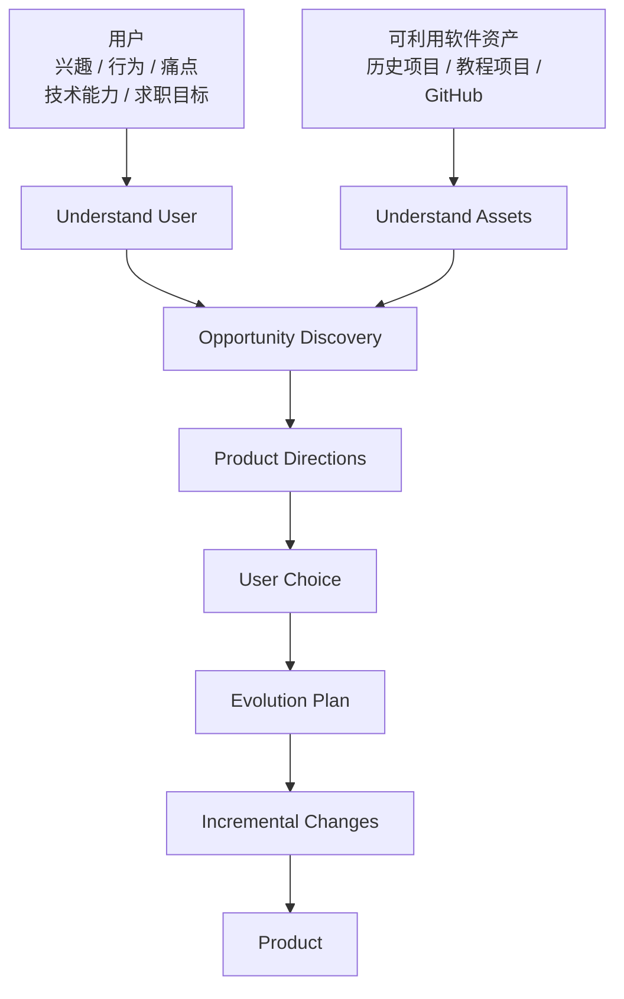

# PRODUCT.md

**当前入口（2026-10-28）：MVP 已冻结用于本地展示与技术交接。**
现行能力见下文；FinTrack / Taskarium 的历史验收材料可通过 Git History 查阅。
不新增功能、计划或付费实验；Taskarium C4 认证 403 保持失败事实。
下文早期探索假设与旧 M4/M5 产品描述保留为历史，不扩大当前已实现能力。

**2026-10-28 Plan 收尾：** 最后一个必需 Step 正式交付后，同一接受事务保存 Plan=COMPLETED、
WorkingCopy=CLOSED，两个 revision 保持已接受 C。既有已接受实例可通过显式、幂等的收尾命令补齐；
须重新证明最终 Git 状态、全部成功 Step 与同一可信 revision，不调用模型或制造交付事实。
见 [ADR-0013](decisions/0013-frozen-candidate-delivery.md#2026-10-28正式-plan-收尾)。

**2026-10-22 Task 2 当前产品流程：** 用户逐 Step 确认并启动 Agent。Agent 在一次性 Docker
沙箱中探索、修改和检查，冻结 Candidate；系统随后自动执行确定性 Delivery，接受正式 Git commit 后
才把 Step 标为 SUCCEEDED。失败的 Run 可由用户启动新尝试，不恢复旧对话，也不执行后续 Step。
用户可查看真实工具与 Maven 活动、文件变化、测试摘要和独立交付状态；刷新和重连读取持久化事件。
NOT_TESTED 不等于测试通过，已知未解决检查失败不能被接受。普通 Java/Maven 兼容范围仍受 Task 1
JDK、文件、公开 Central 依赖及隔离限制约束。
下文旧 M4/M5 一次性提案、独立 Repair/Retry/Rollback 是历史背景，已退出当前产品流程。

> 本文档回答：为什么做这个产品、给谁使用、解决什么问题，以及第一版到底做到哪里。

**Status:** MVP Frozen
**Last Updated:** 2026-10-28

## 1. Product Vision

### 1.1 Current Definition

> 帮助有一定开发能力、但缺少项目方向的开发者，从个人兴趣、真实需求、技术能力与可利用软件资产出发，发现值得开发的项目，并尽可能利用已有项目作为起点，从而找到一条走向目标产品的可执行演化路径。

当前产品形态暂定：Personalized Project Discovery & Evolution Agent

解决核心问题：帮助用户找到一个自己真正想做的项目，将真实想法落地，并在满足个人需求的同时形成具有个人特征的项目。

### 1.2 Core Idea

当前认为产品的核心闭环是：



---

## 2. Problem Statement

### 2.1 Observed Problem

当前主要基于个人开发经历提出以下假设：

```text
开发者拥有：技术能力 + 教程 / 开源项目 / 历史代码
但缺少：个人需求 → 产品方向 → 可利用软件资产 → 改造路线 之间的连接。
```

以上问题**目前仍属于产品假设，尚未经过真实用户验证。**


### 2.2 Current Value Hypothesis

如果上述问题成立，那么系统可以通过：

```
用户兴趣 / 目标 / 痛点 / 真实行为
        +
用户技术能力
        +
可利用软件仓库能力
```

共同生成：

```
适合该用户的项目候选方向
```

并进一步降低：从“我想做这个”到“我已经找到合适的起点，并逐步把它演化成目标产品”之间的成本。

相比一次性向通用 LLM 描述兴趣和仓库，系统通过结构化 User Profile、Repository Profile 以及二者匹配，能够产生更具有个人相关性和可实施性的方向。

---

## 3. Target Users

### 3.1 Primary User

当前第一版暂定面向：

```
角色：
具有一定开发经验的学生开发者 / 初级开发者，
已经完成过至少一个教程项目、课程项目或开源项目，

目标：
认为这些项目缺少个人需求、真实场景或差异化，
希望基于可利用软件资产开发一个更具有个人意义的项目。
```

### 3.2 Non-Target Users

MVP 暂不面向：

- 完全没有编程基础的普通用户
- 企业级软件团队
- 希望完全无代码生成生产系统的用户

---

## 4. Core User Scenarios

### Scenario 1 — Discover User

```text
Given

用户拥有一定技术基础，但没有明确的项目创意。

When

用户向系统提供自己的兴趣、真实行为、痛点、技术背景

Then

系统根据用户答案，并自建用户画像 包括但不限于用户的：

- 兴趣爱好
- 当前目标、痛点
```

达到最低条件后只显示轻量“可以审阅”提示，用户可继续交流或主动审阅，不自动弹窗或改变状态。
已接受对话及最后未回答问题会保存，刷新、后端重启和重开项目只读恢复，不额外调用 AI。
同版最低充分性及缺口保持稳定；新事实或纠正改变内容版本后重新评估。是否结束探索及确认由用户决定。
探索中的 Agent 先回应本轮意图，再按需要提出一个有针对性的问题；解释、接受跳过或澄清本身也可结束一轮。
充分性不是停止交流或强制追问的信号。不知道时可简化或换角度，拒答不推断为没有能力或没有约束。
明确纠正更新当前事实与依据；单纯换话题不清空既有事实，含糊纠正先澄清。
已有问题可直接回答；没有问题时用户可主动索取，不需要发送无意义的消息来触发。
主动索取应得到可用的新问题；无法生成时明确失败，不把空问题当作成功。
用户显式进入宽幅审阅页面，通过六张卡片检查和纠正内容，按需展开原始描述，再确认所查看的版本。
确认不会自动开启新探索；用户主动重新开启后才提问，新版本不覆盖既有方向的历史绑定。
明确的兴趣、学习或求职成果也可以支撑项目方向，
不要求每位用户必须有传统痛点，也不以六个维度填满作为理解完成的依据。


### Scenario 2 — Discover Repository

```text
Given

用户提供一个或多个可利用代码仓库。

When

系统探索可利用代码仓库结构和已有能力。

Then

系统形成代码仓库画像，包括但不限于：

- 项目技术栈
- 项目功能
- 项目模块构造
```


### Scenario 3 — Generate Product Directions And Choose

```
Given

系统已经形成并由用户确认一个 User Profile，
并理解一个或多个可利用软件仓库。

When

系统分析用户需求、技术能力、求职目标
与各可利用软件资产已有能力之间的潜在连接。

Then

系统生成多个 Product Direction，每个方向说明：

- 来源于用户的哪些兴趣 / 行为 / 痛点 / 目标
- 可利用的代码资产
- 相比原项目的主要差异
- 可体现的技术价值
- 大致改造成本
- 主要风险

用户从中选择一个目标方向。
```

### Scenario 4 — Generate Evolution Plan

```
Given

用户已经选择一个 Product Direction，
系统已经理解相关可利用软件资产。

When

系统选择或建议最合适的 Base Software Asset，
并分析 Current State → Target State 的差距。

Then

生成 Evolution Plan，包括：

- 当前状态
- 目标状态
- 可直接复用能力
- 需要删除 / 替换 / 修改的能力
- 新增能力
- 阶段划分
- 每阶段验证方式
- 主要技术风险
```

### Scenario 5 — 执行一次可验证改造

```
Given

系统已经生成 Evolution Plan，
并已经为本次演化准备独立的 Working Copy，
用户确认执行其中一个 Evolution Step。

When

系统执行该 Evolution Step。

Then

系统仅在与当前 Evolution Plan 绑定的 Working Copy 中修改相关代码，
不直接修改原始 Software Asset，

并通过构建、测试、Diff 或其他验证手段，
确认本次改造满足该 Evolution Step 的预定义验证要求，
且没有明显破坏已有项目能力。
```

### Scenario 6 — 保存项目并继续上次演化

用户从项目工作台新建流程，可以重新探索需求，或明确复用一个当前已确认的画像，再选择
已登记资产、已有分析或注册新仓库。复用不复制画像；重新探索共享画像会影响它的当前
状态，历史方向仍绑定原版本。

工作台按明确保存的对象身份显示历史项目；旧 Plan 沿已有引用展示。用户点击项目后读回
画像、分析、方向、Plan、WorkingCopy 和步骤结果，不重新调用 AI、创建副本或执行步骤。
阶段与进度来自真实业务状态，访问页面不代表完成阶段。需求对话按已接受记录恢复；
旧画像的空历史和未保存 CodingProposal 不会被编造为历史记录。

用户可以查看已成功步骤，并按现有授权、顺序和可信 revision 守卫继续尚未执行步骤。
目录缺失、授权变更、关联错误或执行结果未知须明确显示。每个稳定演化流程最多一个
SELECTED Direction；共享画像或仓库的不同项目互不废弃方向。相同流程切换方向仍使旧方向
及其 PROPOSED / ACTIVE Plan 失效。用户可查看旧计划，再明确创建关联的新规划轮次，
选择分析快照并请求重新规划；原 planId、副本和验证证据不被覆盖。

用户可将一个工作台项目记录移入「已删除项目」，并显式恢复。此操作仅隐藏对应导航记录
（包括独立规划轮次卡片），不删除共享资源、业务结果、本地代码或验证 Commit，也不恢复
已经失效的方向和计划。存在已授权或未决执行时不能删除，不用删除替代取消或恢复任务。

## 5. MVP Scope

2026-10-19 Reliability Hardening 的产品交付采用双层强制验收：Step / Plan 的技术成功
与独立业务验收分别报告，二者均通过且最终版本实际可运行，才可声明产品交付成功。
业务要求保留于所选 ProductDirection、TargetState 与 Step Goals；独立验收方在编码前冻结
业务合同，并绑定最终 Verified Revision 执行真实用户操作。技术检查或模型生成测试通过
不能替代业务正确性。历史 UNSUPPORTED 不删除或转换；领域边界见 ADR-0010。

### P0

自主编码每次启动或重试前，用户须明确确认拥有足够 API 预算并愿意承担实际费用。
执行中展示真实模型/工具/tokens 用量并可取消；只要仍有意义地推进，不因任意累计配额或固定总时长停止。
单次操作超时、隔离、有限错误恢复和重复无进展检测保持，详见 ADR-0018。

| 功能           | 验收标准                                                     |
| -------------- | ------------------------------------------------------------ |
| 探索用户       | 经过必要且有价值的交互后生成结构化 User Profile，至少包含兴趣 / 真实行为、当前痛点、技术能力、项目目标、重要约束；当信息足以支持 Product Direction Discovery 时停止无目的探索；用户能够查看、纠正并确认当前 Profile |
| 探索仓库       | 当前 Software Asset 主要以本地 Git Repository 形式输入，由此生成 `Repository Profile`，包含项目用途、主要模块、技术栈、核心能力、可复用资产和明显限制 |
| 项目方向生成   | 基于已确认的 User Profile 与 Repository Profile 生成 3–5 个明显不同的 Product Directions，每个方向说明需求来源、与用户的匹配点、可复用技术 / 项目资产、预计复杂度，供用户选择 |
| 生成改造方案   | 将选定的 Product Direction 转化为若干可独立验证的 Evolution Steps，并明确本次演化所基于的 Base Software Asset |
| 执行小规模改造 | 至少完成一个真实代码变更；修改仅发生在隔离的 Working Copy 中，不直接修改原始 Software Asset；并通过已有测试 / 新增测试 / 构建 / Diff / 人工验证之一证明本阶段目标完成 |

Task D 修复仓库授权的操作缺口：用户可先登记、只读分析许可证未知的授权仓库，但演化规划
仍要求明确的许可证记录与使用授权。用户在原资产上显式补充元数据，保留已有分析与已选方向，
不要求重做付费探索。系统不会因发现 LICENSE 自动授予权限，也不把许可证文字记录等同于法律判断。

Task E 提供 SPDX 名称及自定义/混合许可证声明入口，并提示该声明未经独立法律或权属验证。
规划被授权条件阻塞时，可按当前基础快照的精确资产 ID 跳转补充，再返回原规划选择。
执行页面区分客户端等待时长与后端已保存的状态，断线后只查询、不自动重复执行。
准备 WorkingCopy 前展示后端配置的存储 Root；用户通过后端环境变量换盘，前端不接受任意
目录授权。配置切换不移动或重写已有副本及其演化记录。
重复登记会提示复用既有记录；依据默认说明来源，单条原始确认标记放在技术详情，避免与整体确认混淆。

### P1 — MVP 后优先考虑

当前暂无。

MVP 完成第一轮真实验证后，
再根据用户反馈、实际开发过程和已验证的产品假设决定下一阶段优先能力，
避免在核心闭环尚未验证前提前扩大 Scope。

### P2 — Out of Scope

- 自动从 GitHub 搜索和筛选开源项目
- 从零生成完整项目
- 一次性自动完成整个项目演化
- 企业多人协作
- 云端代码托管
- 自动部署生产环境
- 项目商业价值预测
- 面向完全无编程能力的用户
- 长期自主运行的全自动 Coding Agent

---

## 6. MVP Validation

### 6.1 Hypotheses

#### H1 — Problem

具有一定开发能力的学习者确实存在：“有技术 / 有项目，但不知道做什么有个人特色项目” 的问题。

#### H2 — Discovery Value

相比直接让通用 LLM 生成项目创意，
结合用户长期兴趣、真实行为和可利用软件资产后，
系统能够产生用户认为更想真正开发的项目方向。

#### H3 — Evolution Value

在用户确定目标方向后，系统能够显著降低判断：

- 哪些代码可以复用
- 哪些代码需要修改
- 下一步先做什么

的认知成本。

#### H4 — Execution

系统生成的 Evolution Plan
至少可以成功指导完成一个可验证的代码改造。

### 6.2 Success Signals

- 用户看到推荐方向后明确认为：
  “这是我真的想做 / 会自己使用的东西。”
- 用户愿意选择其中一个方向继续开发。
- 用户认为推荐理由和自身真实经历有关，
  而不是通用项目推荐。
- 用户能够依据 Evolution Plan 开始实际开发，
  而无需重新自行分析整个仓库。
- 至少一个 Evolution Step 可以成功完成并验证。

---

## 7. Product Principles

### 7.1 Personal Before Generic

推荐必须能够追溯到用户的真实兴趣、行为、痛点或目标，
而不是生成泛化的软件项目列表。

### 7.2 Evolution Before Rewrite

优先寻找可利用软件资产与目标产品之间的演化路径，
而不是默认从零生成项目。

### 7.3 Evidence Before Recommendation

每个推荐方向都应该说明：
为什么适合该用户、依据是什么、哪些可利用软件资产能够支持。

### 7.4 Human Chooses Direction

系统负责发现和分析机会，
最终产品方向由用户确认。

### 7.5 Incremental & Verifiable

项目演化应拆成小规模、可验证的步骤，
而不是一次性大规模重构。

## Java/Maven 仓库的自动演化准备（2026-10-24）

用户可登记普通本地 Java/Maven Git clone，经既有分析、方向选择和规划后直接准备独立 WorkingCopy。
系统检查固定 Git 版本的 Maven 入口、模块、JDK、资源与安全限制，自动移除隔离副本中逐项证明的生成物，
保留业务源码、合法静态/二进制资源与原仓库。无需用户手工清理 target、改写历史或创建准备 commit。
界面展示兼容状态、自动动作、原始 A/准备 P 和实际阻塞；权限、许可证与使用授权仍需用户如实提供。
准备成功不承诺构建、测试或演化必定成功，也不触发付费模型、Step 确认或执行。
当前支持范围、预算和真实验收见兼容性报告；不承诺所有 GitHub 仓库可自动演化。
