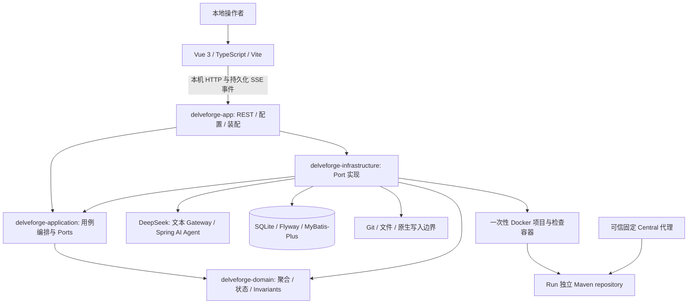
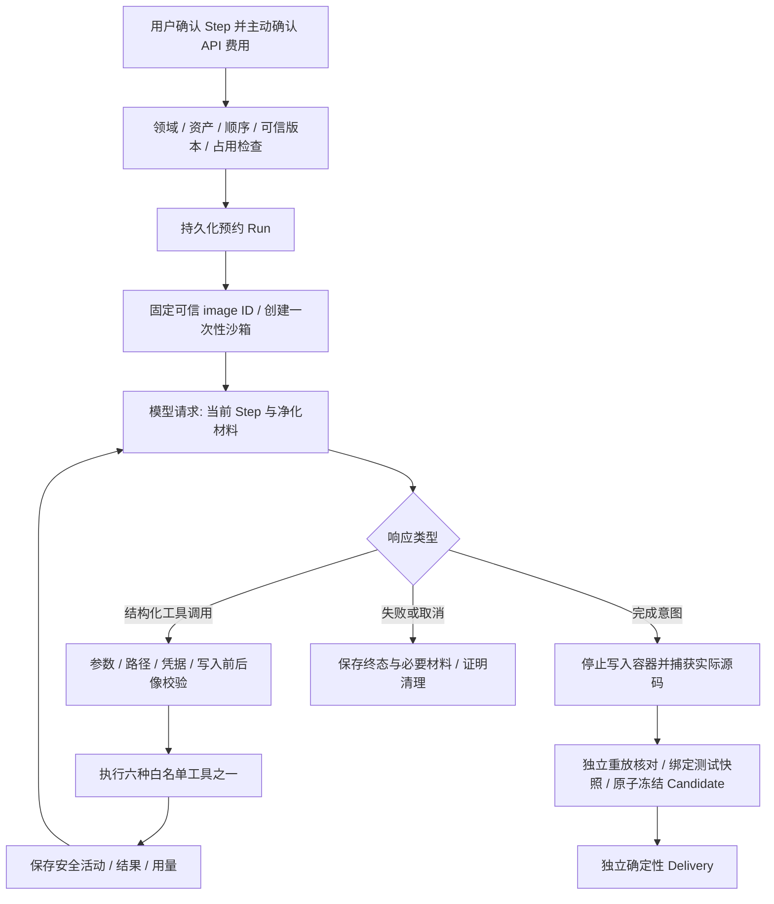
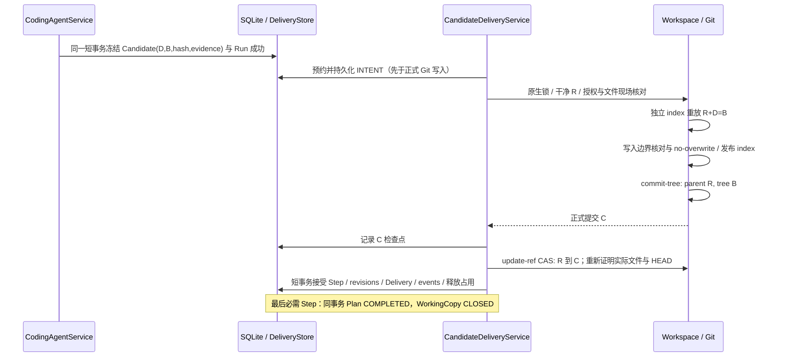

# 当前 MVP：架构与执行路径

基于运行代码 `1b9baa6` / 完整证据基线 `11c4aa3`。这里总结现行实现，不替代
[架构约束](../ARCHITECTURE.md)、[领域合同](../DOMAIN_MODEL.md) 与 ADR-0012～0018。
旧 M4/M5 的一次性 CodingProposal 和独立 Repair/Rollback 流程已退役。

## 1. 系统与模块

图中模块箭头表示调用或编译依赖，外部箭头表示适配器能力。Domain 不依赖 Spring、SQLite、Git 或模型 SDK。
Application 不直接实例化 Infrastructure；App 是装配入口。

| 责任 | 实际实现入口 |
| --- | --- |
| M1–M3 | User Discovery / Repository Analysis / Product Direction / Evolution Planning 用例；既有 AiGateway |
| Agent 编排 | `CodingAgentService`，通过 `AgentModelPort` / `AgentSandboxPort` / `AgentStore` |
| Provider | `SpringAiAgentModel`；模型、endpoint、key 均属配置与适配器 |
| 工具隔离 | `DockerAgentSandbox`、镜像内 `agent/sandbox.py`；不把正式副本挂给项目容器 |
| 正式交付 | `CandidateDeliveryService`、`DeliveryStore` / `SqliteDeliveryStore`、Workspace 的 `CandidateDeliveryPort` |
| 当前界面 | `frontend/src` 中的实施工作台、活动聚合、测试及文件摘要 |

源码入口：[Agent 编排](../../backend/delveforge-application/src/main/java/com/ayywl/delveforge/application/agent/CodingAgentService.java)、
[工具合同](../../backend/delveforge-application/src/main/java/com/ayywl/delveforge/application/agent/AgentTools.java)、
[Docker 适配器](../../backend/delveforge-infrastructure/src/main/java/com/ayywl/delveforge/infrastructure/agent/DockerAgentSandbox.java)、
[Delivery 编排](../../backend/delveforge-application/src/main/java/com/ayywl/delveforge/application/agent/CandidateDeliveryService.java)、
[SQLite 接受](../../backend/delveforge-infrastructure/src/main/java/com/ayywl/delveforge/infrastructure/agent/SqliteDeliveryStore.java)。

原始分析版本为 A，自动准备后的可信版本为 P（无需准备时 P=A）；某 Step 的基线为 R，
首次 R=P，后续 R 是上一步已接受的 C。候选目标树为 B，正式提交为 C，满足 parent(C)=R、tree(C)=B。

## 2. Agent 与工具调用

六个工具：`list_files`、`search_code`、`read_file`、`edit_file`、`apply_patch`、`run_checks`。
模型没有任意 shell、Docker 或交付工具；Maven goal/directory/module/test selector 受控。
源码材料先完整净化再切片；净化内容不能伪装成可精确覆盖原文。

项目容器非 root、只读根、无网络、无 Docker socket，有 CPU/内存/PID 限制；
不传 Provider key 或宿主 Maven settings。依赖准备通过另外的隔离副本和固定 Central 代理，
再回到离线正式检查。正式检查使用独立 check-source 副本，实际源码前后必须保持一致。
只允许已识别 H2 MVStore 内容及配对 trace 的受限追加等明确运行数据副作用，不做目录豁免。

测试事实保存范围与源码 snapshot；修改后旧检查可变 stale。无测试构建不能冒充正向测试。
无默认累计调用/tokens 或总时长停止门槛；短重复循环、连续冲突、单操作超时、取消和未知写入拒绝仍有效。
调用量不等于语义进展，也不等于完整供应商账单。

## 3. Candidate 与 Git/SQLite Delivery

Git 与 SQLite 之间没有分布式事务。持久化意图、精确前后状态检查、CAS 与启动协调共同处理跨系统窗口。
Candidate 不可变，Delivery 不调用模型，也不依赖原沙箱继续存活。

| 故障窗口 / 现场 | 处理 |
| --- | --- |
| INTENT 后、仍是干净 R | 重新证明后继续 |
| HEAD=R、完整文件/index=B，且无未完成标记或外部冲突 | 不再次应用，创建/复用已记录 C 后发布 |
| HEAD=已记录 C、父/树/文件均正确，SQLite 尚未接受 | 重新证明后接受已有提交 |
| SQLite 已 COMPLETED | 返回同一结果，不制造第二个 commit |
| 干净 R 上已知拒绝 | DELIVERY_BLOCKED；处理原因后显式核对 |
| 部分写入、外部修改、未知 ref 或数据库 | RECOVERY_REQUIRED，保留预约与材料，不 reset/clean |

现有已接受最终交付可通过幂等 complete-plan 命令重新证明并补齐 Plan 收尾；
这不是重跑成功 Step 或创建新 Delivery。技术测试与产品使用验收仍是不同维度，见 [ADR-0010](../decisions/0010-separate-technical-verification-and-product-acceptance.md)。
