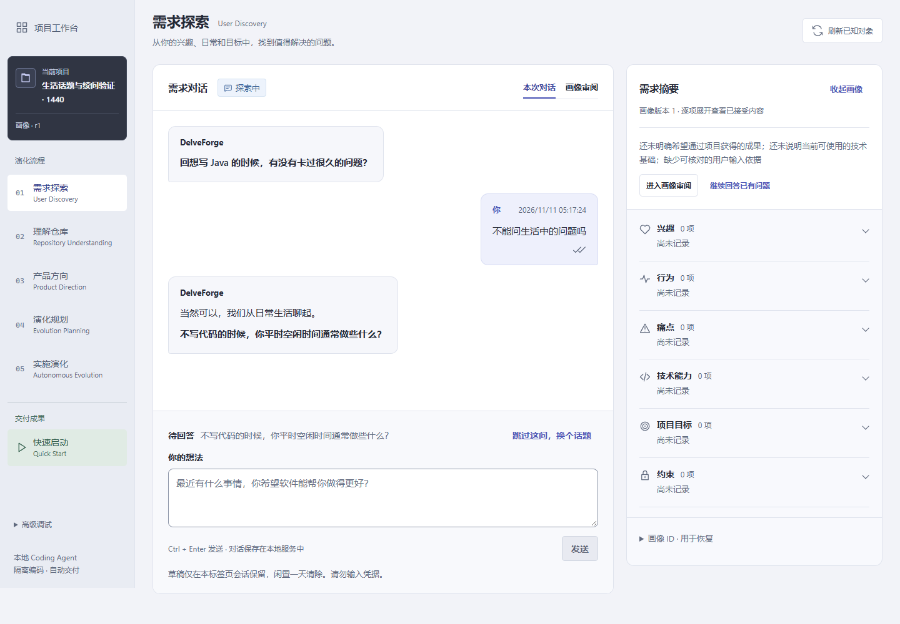
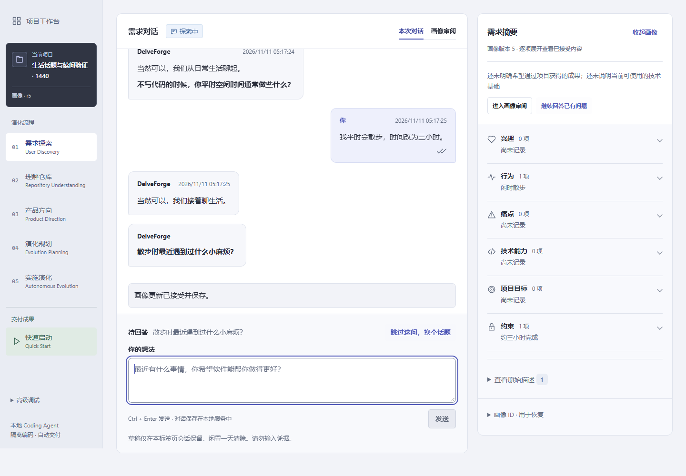

# 对话输出与续问衔接修复

基线：`codex/discovery-conversation-stability` / `968777dcb6e9b0d625f2b7eb751b497cb5bd07df`。
首次实现与本地验证阶段未额外付费调用或重启用户应用，也未合并或推送。
后续用户已授权更新与真实复测，结果及补充修复见[追加验证](discovery-dialogue-direct-20261111.md)。

## 截图对应的真实记录

“不能问生活中的问题吗”的首次请求 `afa2e045-ab4d-4fee-a996-10e4f2320287` 于04:34:52开始，
04:35:00在 DIALOGUE_PLANNING 失败，结果版本为空。第二次请求
`e6b11bff-bb75-4070-bce2-7572ef355bcb` 于04:35:26完成，两次输入指纹相同、基准版本均为19。
随后单独的 QUESTION `d4915457-a7ab-4da2-b9bd-39628f08a8af` 于04:35:37完成，造成又一次相近开场。
时间为2026-11-11 UTC−8。用户数据库只读核对，没有回填成功、修改历史或重发该请求。
见[请求证据](discovery-dialogue-20261111/incident-evidence.json)。

旧异常指向收到 DONE 时的同一判断：缺少已识别的 stop，**或**正文全空白。
旧日志没有分别记录这两个条件，原始流也未保留，因此不能断定是供应商缺终止、空白正文还是其他上游问题，
不能把它直接说成网络断线、token用尽或已经证明的本地 SSE 兼容错误。

[DeepSeek JSON 模式说明](https://api-docs.deepseek.com/guides/json_mode/)明确说明，不可识别的非 JSON 输出
可能被替换为空格；建议提供 JSON 示例。这是一个有依据的可能路径，不能据此认定就是该历史请求的根因。

## 本轮具体修复

- 普通回应、待批和独立提问均提供完整规划 JSON 示例，移除末尾孤立的普通聊天示例，避免与严格 JSON 输出要求混用。
  请求改聊生活等话题明确作为对话操作，不仅据此添加个人行为或项目约束。
- 独立提问发送 operation=QUESTION，不把合成指令写成本轮用户原话。生成有效问题时正文置空，
  只呈现并持久化新问题；即使模型再次生成相同开场，也不会再展示。没有可用问题时保留必要说明。
  普通 TURN 的回应和用户要求的长解释继续保留，刷新读取同一保存结果。
- stop和DONE均正常但正文全空白时归为 EMPTY_OUTPUT，缺少正常结束仍归为 INCOMPLETE_OUTPUT。
  增加 stopSeen、doneSeen、blankContent 三个固定诊断布尔值，不记录模型正文、思考、密钥或其他私人内容。
  真正截断、EOF、其他 finish_reason、非法 JSON、无效分区仍失败关闭，没有自动重试或额外模型阶段。

没有变更六区完整建议、精确前缀追加、人工保护、整轮批准、原子事务、来源、乐观版本、原请求恢复、
单个待批提案或单个未答问题，没有新增迁移，也没有改变 Coding Agent、Docker、Candidate、Delivery。

## 实际验证

修复前合成回归：Application 10项中2项失败，SSE接收12项中1项失败；不声称重建历史原始返回。
修复后针对性检查117项通过。前端24文件/388项通过，typecheck和生产build通过。

完整后端回归先执行 `mvnw.cmd -o verify`，其中1项旧测试仍用独立QUESTION承载长解释，断言与新职责冲突。
将其输入改为真实的详细解释TURN，保留2048字符全文和完整历史断言，仅相应调整新增用户消息的计数。
随后重跑该SQLite套件41项和全部app模块248项，并完成全部模块与可执行Jar打包，命令退出0。
未重复运行已通过且不受该测试数据修正影响的仓库测试。以下是两次命令的最终套件结果，不把首个失败命令说成成功：

| 模块 | 总数 | 通过 | 跳过 | 最终失败 / 错误 |
| --- | ---: | ---: | ---: | ---: |
| domain | 209 | 209 | 0 | 0 / 0 |
| application | 952 | 952 | 0 | 0 / 0 |
| infrastructure | 658 | 606 | 52 | 0 / 0 |
| app | 248 | 245 | 3 | 0 / 0 |
| 合计 | **2067** | **2012** | **55** | **0 / 0** |

55项为未启用或前置假设不满足的Docker/live/仓库条件测试。逐类原因、命令及源码一致性核对见
[验证统计](discovery-dialogue-20261111/verification-evidence.json)。独立副本构建避免改动用户正在运行的产物。

真实Chrome、生产Vue、SQLite和本地SSE模拟服务在1440、390两个宽度完成**55项检查**，20次本地模拟请求，付费0次。
生活话题一次接受且不制造画像事实，旧技术问题被替换；批准后只显示新问题，刷新不恢复重复开场。
分别注入完整终止但全空格、缺stop但有DONE两种返回，确认分型正确、不自动重试、不提交半轮，
原文保留，已有画像、依据和问题状态不受损。提取8192、规划16384的预算与当前生产默认配置一致。
测试浏览器和独立后端均已关闭，无脚本异常。见[浏览器记录](discovery-dialogue-20261111/browser-evidence.json)、
[诊断记录](discovery-dialogue-20261111/diagnostic-evidence.json)。

## 首次交付时的生效与剩余边界（历史）

首次交付时用户后端没有重启，需使用新构建重新启动才会生效。已保存历史保留原貌。
本轮未重新调用真实DeepSeek，无法证明历史那次首发失败已由这些调整消除，也不保证上游总会正常结束。
真实效果和具体故障触发条件仍需另行授权复测；不能把本地模拟通过等同于真实服务验收。

