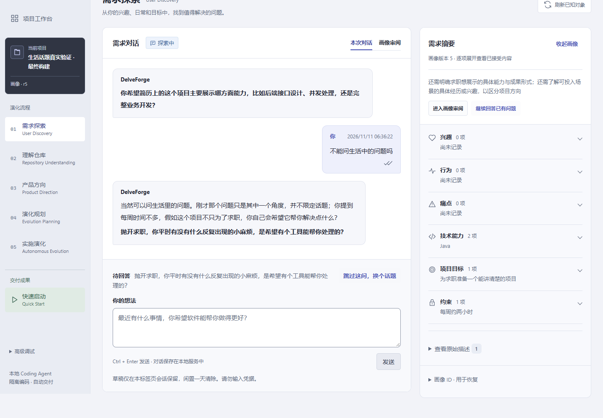
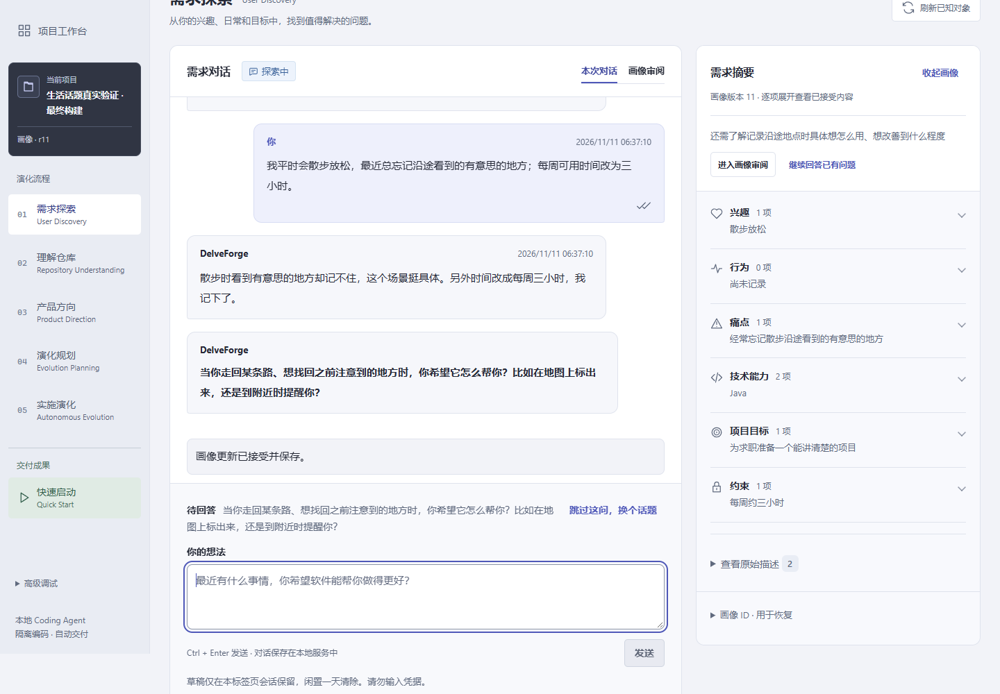
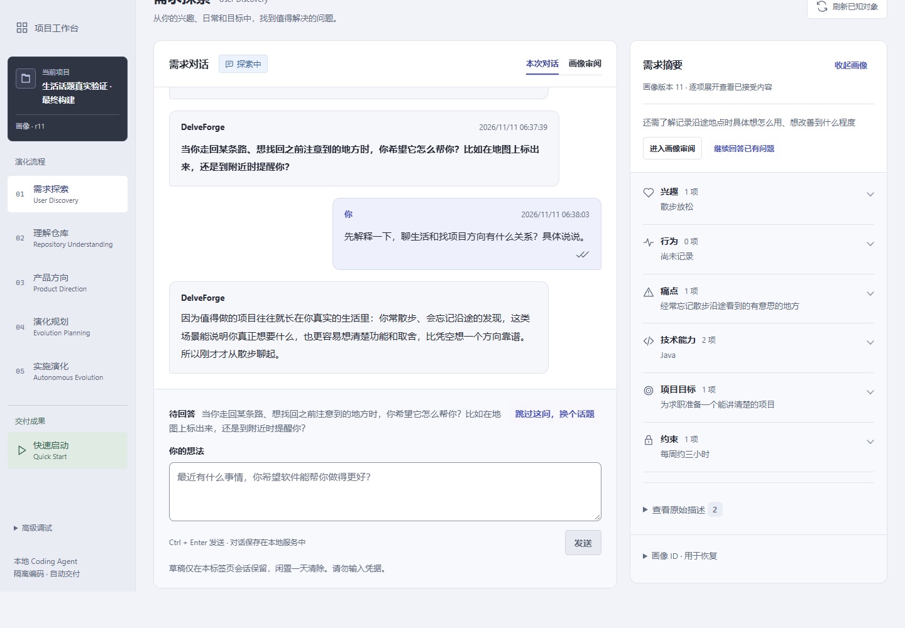

# 更新授权后的真实对话复测

用户追加授权：“更新并实测吧，不限制调用次数”。基线为 `8edce00`。
本轮只验证 Guided Discovery；使用独立 SQLite、测试画像及真实 Chrome，没有启动真实 Coding Agent Run。

## 实际发现与补充修复

先更新并启动基线构建，原有3份画像、52条对话以及其余6张画像相关表与一致性备份逐行相同。
最初10次真实 DeepSeek 返回中，前9次有正文；第10次在回答照片场景时再次失败：
HTTP 200、`finish_reason=stop`、DONE 均正常，content 长度为0，completion_tokens 与 reasoning_tokens 同为462。
画像、已接受对话和待答问题均未变化。没有将后续成功覆盖为“首次就成功”，也没有推断这就是截图那次失败的确切原因。

普通 TURN / QUESTION 规划现在显式关闭思考，直接生成既有 JSON 契约；事实提取仍关闭思考。
该参数由[官方思考模式接口](https://api-docs.deepseek.com/guides/thinking_mode/)支持。
AiRequest 分别标记既有 EXTRACTION / DIALOGUE 阶段，输出预算继续为8192 / 16384，
不再由思考开关猜测预算。没有更换模型、端点、提供者或新增阶段、自动重试、迁移和批准流程。
空白、缺少终止、非法 JSON 仍明确失败，不将思考文字作为回复或接受半轮事实。

## 真实验证结果

| 阶段 | 真实返回数 | 结果 |
| --- | ---: | --- |
| 基线构建 | 10 | 9次有正文，1次只有思考用量、无正文 |
| 补充修复，相同画像与已接受历史 | 2 | 原失败输入一次提交完成 |
| 最终可执行 Jar，新建测试画像完整对话 | 12 | 全部正常完成 |
| 合计 | **24** | 最终版本14次均有合法 JSON 正文及完整终止 |

另有1次测试中继连接尝试未取得 Provider HTTP 响应，本机公开连接检查返回 ConnectionRefusedError / 10061；
换用允许联网的测试进程后继续。它单独保留，不混入真实模型返回质量统计。
测试浏览器也曾因启动权限和测试脚本使用了不存在的项目详情接口而未能进入页面，均修正后才开始计数。

最终 Jar 验证了：

- “不能问生活中的问题吗”一次接受，旧技术问题被替换，画像版本与依据保持不变，没有制造行为或约束。
- 将每周两小时改为三小时时整轮待确认，确认前没有局部写入；接受后才更新内容与依据。
- 两次“接受更新并继续”都只保存和显示新的独立问题，正文为空，没有再次开场或回应上一句话。
- 用户明确索取解释时保留完整解释及原待答问题，不添加事实或推进版本。
- 连续补充照片场景后能继续确认、续问；“不知道”一轮只调用规划，不新增事实或强迫用户选定答案。
- 两次刷新不增加模型调用，画像和已保存消息完全相同；没有未决请求、待批提案或浏览器脚本异常。

共35项状态及交互核对通过。真实测试使用的588个编译类与最终可执行 Jar 中的类逐字节一致。
Jar SHA-256：`4b1f4b29b56b0eb59bd1fecbfae6cb756e96ba4f719abc1cf3a7f17ec3b95716`。
完整输入、已接受回复、提案核对、用量与终止元数据见[真实测试证据](discovery-dialogue-direct-20261111/real-provider-evidence.json)。
没有保存原始模型思考、完整 Provider 响应或密钥。

## 回归与构建

新增调用设置回归先在旧实现失败：期望 disabled，实际 enabled。修复后完整 `mvnw.cmd -o verify` 退出0：

| 模块 | 总数 | 通过 | 跳过 | 失败 / 错误 |
| --- | ---: | ---: | ---: | ---: |
| domain | 209 | 209 | 0 | 0 / 0 |
| application | 953 | 953 | 0 | 0 / 0 |
| infrastructure | 662 | 610 | 52 | 0 / 0 |
| app | 248 | 245 | 3 | 0 / 0 |
| 合计 | **2072** | **2017** | **55** | **0 / 0** |

第一次受限执行因 Git 无法创建通信管道（Win32 error 5）产生3项失败和63项错误，未将其报告为成功。
允许测试进程正常创建管道后重跑完整回归及全部模块打包，得到上表结果。
测试替身改按真实阶段选择输出，保留人工保护并发冲突的全部原断言。
55项仍为未启用或前提不满足的 Docker/live/仓库条件测试。见[构建记录](discovery-dialogue-direct-20261111/verification-evidence.json)、
[源码一致性](discovery-dialogue-direct-20261111/source-evidence.json)。前端代码未变化，上一轮388项、typecheck和生产构建结果仍单独记录，未重复运行。

## 已观察到的表达限制

相同上下文测试中，一项待批建议推断用户“很少回看或整理”照片，超出了原话。测试中忽略该建议，
核对画像没有改变，没有批准已知缺乏依据的描述。最终新画像测试使用明确说明经常回看的输入后正常处理。
普通 TURN 偶尔仍会在正文中用相近问句承接独立问题；这属于已有的非阻塞表达限制，未将其当作新请求失败。
本轮不声称模型建议全部准确，也不以有限次数成功保证上游永不空白；人工审阅和严格失败边界保留。

