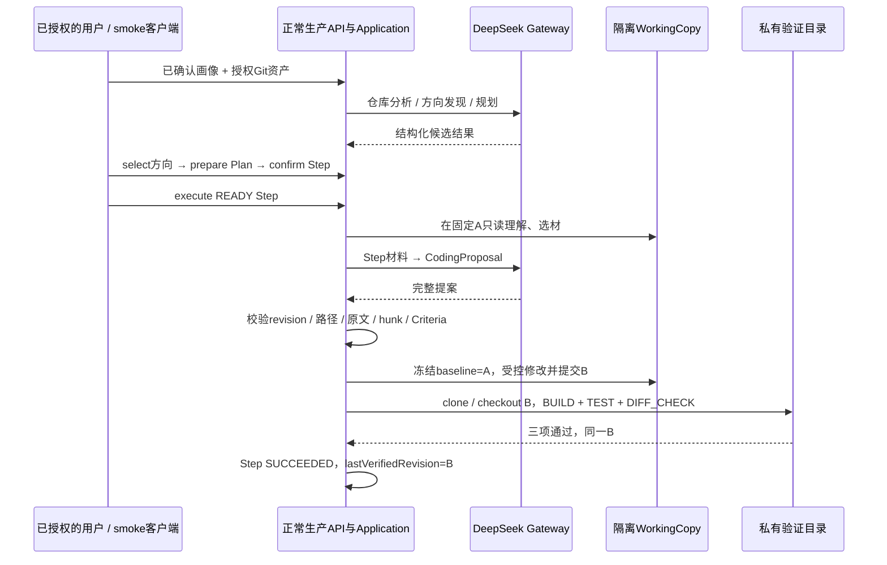

# M4 真实执行案例：Python 命名角色提示与首次 Verified B

**记录日期：** 2026-10-10（Asia/Shanghai）。**结果：PASS，一次真实 Verified B。**

用户想改进的行为很具体：`app/shop_service.py` 这样的 Python 文件没有 `service/` 目录段时，仓库分析应仍能从文件名给出 APPLICATION_SERVICE 提示；其它语言与已有规则保持不变，正负回归测试与代码一起提交。2026-10-10 13:56:56，正常 execute 接口完成代码修改和 Maven 验证，Step 成为 SUCCEEDED。

下面先展示需求怎样进入画像、方向和 Plan，再展示最终代码及验证；第二部分解释每个排障实验如何引出下一步。A 表示本次演化的源版本，B 表示隔离 WorkingCopy 生成的版本，完整标识集中在附录。

本文是验证与复盘记录，**不是架构或领域语义的 Source of Truth，也不单独宣布 M4 里程碑完成**。此次重写只读既有 API JSON、停止后的 SQLite、Git 和测试报告，没有新调用 Provider、启动 Smoke 或执行 Maven。报告的文档提交与历史演化 A→B 是不同事件。

## 1. 真实业务执行案例

此案例复用了前序已确认画像、已选择方向，以及已经准备并确认的单步 Plan。以下按业务调用顺序连接这些真实对象；并不把多次失败运行改写成一次从零到成功的调用。方向的历史发现快照与最终规划的 A 快照分别保留。



正文区分**保存的正常 API 字段**、**源码定义的契约**与**明确标注的事后表示示例**。它们都不会冒充原始 Provider 响应。完整用户来源文本、原始日志等继续留在受控外部目录。

### 1.1 UserProfile：用户提出的是哪一个改进

**实际输入。** 已保存的 USER_INPUT Evidence.sourceRef 中有以下业务原句：

> 当前目标是在我自己的 DelveForge 仓库中完成一个小而有意义的仓库分析行为改进，补对应的确定性回归测试，然后经真实 M3 规划、独立 WorkingCopy 和 M4 验证形成一个可信 revision。

> 首步需要独立可执行的小改进和同一个补丁里的正负回归测试；不要引入嵌入/RAG/Go验证/M5/重构。

这是 Evidence 保存的用户来源文本摘句，**不是恢复出的完整 M1 对话或 Provider prompt**。本次续跑没有重新探索用户。

**实际输出。** [profile-response.json](E:/df-m4-smoke/20261009-stabilization/attempt4/evidence/api/profile-response.json) 的相关六区如下，条目逐字保留、按原顺序摘录；省略其余条目与整份 Evidence：

```json
{
  "status": "CONFIRMED",
  "revision": 29,
  "interests": [
    "Java 后端",
    "Agent 工程",
    "源码理解"
  ],
  "behaviors": [
    "围绕现有仓库进行增量改进",
    "阅读实际源码并进行回归测试"
  ],
  "painPoints": [
    "Repository Understanding 对文件命名的角色提示仍有小范围覆盖缺口",
    "RepositoryPathClassifier 当前注释说明 Python 下划线文件命名未参与角色推断，例如 shop_service.py 可能无法提示 APPLICATION_SERVICE"
  ],
  "technicalCapabilities": [
    "正在学习 Java 后端",
    "能阅读实际源码并编写、运行回归测试",
    "使用现有 Windows JDK 21、离线 Maven Wrapper 和完整 Maven test"
  ],
  "projectGoals": [
    "在自己的 DelveForge 仓库中完成一个小而有意义的仓库分析行为改进",
    "为改进补对应的确定性回归测试",
    "经真实 M3 规划、独立 WorkingCopy 和 M4 验证形成一个可信 revision",
    "首步需要独立可执行的小改进和同一个补丁里的正负回归测试"
  ],
  "constraints": [
    "这是工程功能 smoke，不是商业方向扩展",
    "使用现有 Windows JDK 21、离线 Maven Wrapper 和完整 Maven test",
    "测试不能依赖外部服务",
    "不得新增依赖，不修改 POM/Wrapper/验证策略规则/领域生命周期/安全边界",
    "不改原仓库，只通过产品在 WorkingCopy 修改",
    "保持其它语言和已有规则",
    "不要引入嵌入/RAG/Go验证/M5/重构",
    "技术验证要求实际完整测试套件通过",
    "不能以 diff 或构建通过替代测试，也不声称这些技术检查能证明任意业务价值",
    "首步需要独立可执行的小改进和同一个补丁里的正负回归测试"
  ]
}
```

**系统如何处理。** GET 返回 CONFIRMED、revision=29；方向发现请求提交整数 `expectedRevision:29`，锁定这版画像。用户确认与资产授权是两回事：正常 [asset-response.json](E:/df-m4-smoke/20261009-stabilization/attempt4/evidence/api/asset-response.json) 另行返回：

```json
{
  "type": "GIT_REPOSITORY",
  "source": "USER_SPECIFIED",
  "readPermissionAllowed": true,
  "licenseInfo": "自有项目，维护者明确授权本次受控本地分析和WorkingCopy改进，不声称额外的开源许可证",
  "usageAuthorization": "ALLOWED"
}
```

系统获得的是“已确认的小步目标 + 明确可读、可用于演化的本地 Git 资产”，不能用画像确认推断资产许可。下一阶段可以读取仓库并发现方向，仍不能修改原资产。

### 1.2 RepositoryProfile：系统对现有仓库的实际理解

**实际输入。** 授权资产是 DelveForge 自身。最终规划前的 Repository Analysis 在固定 A 做只读理解，而不是分析随开发变化的 HEAD。

**实际输出。** [analysis-response.json](E:/df-m4-smoke/20261009-stabilization/attempt4/evidence/api/analysis-response.json) 返回201。以下保留实际字段和值；capabilities / reusableAssets / limitations 摘录与本次演化有关的条目：

```json
{
  "analyzedRevision": "47ca4487210505529d6f4b4082052530c33c33d3",
  "purpose": "DelveForge 帮助已有开发经验的开发者结合个人兴趣、行为与技术能力，只读理解手边 Git 仓库的可复用资产，发现、生成并选择个性化的产品演化方向。",
  "techStack": [
    "Java 21",
    "Spring Boot 3.5.x",
    "Spring Boot Starter Web",
    "Maven 多模块 + Maven Wrapper",
    "SQLite",
    "Flyway",
    "MyBatis-Plus",
    "Jackson（AI 输出解析）",
    "SLF4J",
    "JUnit 5",
    "Vue 3",
    "TypeScript",
    "Vite",
    "Git CLI",
    "DeepSeek HTTP API"
  ],
  "modules": [
    "backend/delveforge-app：Spring Boot 启动类（Composition Root）、REST Controller、Configuration、Interface Adapter",
    "backend/delveforge-application：Use Case、Application Service、流程编排，以及 AI / Workspace / Persistence Port",
    "backend/delveforge-domain：Software Asset / User Profile / Product Direction 等领域对象与 Domain Policy",
    "backend/delveforge-infrastructure：SQLite / MyBatis-Plus 持久化实现与 Flyway 迁移脚本",
    "frontend：Vue 3 + Vite 前端，目前只有 Backend 连通性检查页面"
  ],
  "capabilities": [
    "Repository Understanding：对用户指定的本地 Git 仓库在固定 commit 上做只读分析，产出 Repository Profile",
    "Product Direction Discovery：依据已确认 User Profile 与 Repository Profile 生成 3–5 个候选方向，并保留 Evidence 依据、选择与拒绝",
    "Evolution Planning：代码中已装配生成 Evolution Plan、准备 Working Copy、读取 Working Copy 的 Use Case 与领域对象",
    "证据可追溯：Product Direction 的关键判断（userNeed / userFit / reusableCapability）关联 Evidence 及其 User Profile / Repository Profile 来源",
    "模块依赖约束：通过 maven-enforcer-plugin 的 bannedDependencies 阻止 Application 依赖 Infrastructure / App"
  ],
  "reusableAssets": [
    "AssetUsagePolicy：以显式使用许可、readPermission 与 licenseInfo 作为 Evolution Base 前置条件的策略",
    "AiGateway / WorkingCopyProvisioningPort 等 Port 抽象，把外部能力挡在 Application 之外",
    "maven-enforcer-plugin bannedDependencies 配置，可在其他模块复用为架构依赖守卫",
    "Maven Wrapper（mvnw.cmd）与 .gitattributes 的跨平台换行符与脚本可执行性约定"
  ],
  "limitations": [
    "前端当前仅用于 Backend 连通性检查，完整业务流程仍需通过 REST API 使用",
    "Software Asset 在 MVP 中只支持 GIT_REPOSITORY 类型与 USER_SPECIFIED 来源",
    "AssetUsagePolicy 不从 license 文本自动推断法律许可，只依据显式声明"
  ]
}
```

这些结果让规划可复用 Repository Understanding、Ports、Wrapper 和依赖守卫。业务流程当时经 REST 使用；Python 命名增强落在 Application 的既有分类器，不需要新分析器或模块依赖。

**系统如何处理，以及分析中的错误。** 结果经解析成为 RepositoryProfile；结构合法不保证每句分析正确。原结果还有一句“Roadmap 中 M3 未开始”，Plan 也沿用了它。但 A 的 `docs/ROADMAP.md` 已把 M3 标为 DONE / FROZEN。完整 Plan 保留这句历史输出，本文明确其事实错误，没有改写数据库。

下一阶段获得有 revision 绑定的能力、限制快照。执行时仍须读取 A 的源码，不能只凭模型摘要决定改动。

### 1.3 ProductDirection：五个候选与最终选中的完整业务定义

**实际输入。** [Discovery 请求](E:/df-m4-smoke/20261009-stabilization/attempt1/evidence/api/04-discovery-request.json) 携带画像29与历史 RepositoryProfile。该发现快照与 §1.2 的 A 快照属于同一资产，但不是同一次分析。

**实际输出。** [Discovery 响应](E:/df-m4-smoke/20261009-stabilization/attempt1/evidence/api/04-discovery-response.json) 返回201、五个 CANDIDATE。下面的目标与复杂度是原字段值：

| 实际 title | 实际 targetProduct | 实际 estimatedComplexity |
|---|---|---|
| Python 下划线命名角色提示补全（单点规则扩展 + 同补丁正负回归测试） | DelveForge 仓库分析能力的单点增强：让 Python 下划线命名（如 *_service.py）参与角色推断并给出对应角色提示，同时保持其它语言与已有规则不变，并在同一补丁内附正负回归测试。 | 低（一次有界 smoke 量级的单点规则扩展，加一组正负回归测试） |
| 角色提示依据的 Evidence 化（把命中的命名规则作为可审阅依据输出） | 在仓库分析输出中为命名角色提示附带依据内容与依据出处，让「为什么这个文件被提示为这个角色」可解释、可审阅，且不改变任何推断规则本身。 | 中低（复用已有证据表达结构，主要是把命名规则命中结果映射为证据，不新增证据模型） |
| 资产使用授权与仓库分析前置校验的正负回归基线 | 一组只读的领域/应用层回归测试资产（含正负用例），覆盖授权取值、许可证信息缺失与读权限不足等组合，锁定仓库分析前置校验与演化起点资格，规则语义本身保持不变。 | 低到中（以测试为主，不新增依赖，但需要覆盖取值组合与边界） |
| 文档与实现漂移的只读自查（README 声明 vs 已装配的演化规划组件） | 一个只读的产品状态自查能力：比对文档声明与当前实际装配、迁移状态，输出差异清单，不改变任何业务规则与生命周期。 | 中（要读多份装配与迁移来源并定义比对口径，容易超出一次有界 smoke） |
| 前端最小证据审阅页：显示证据出处并以 expectedRevision 确认 | 一个最小的、以只读为主的审阅页面：列出证据内容与出处，并允许用户以自己的 revision 显式触发确认；复用现有 Vite /api 代理，前端不持有后端地址。 | 中（跨前端与接口消费，而前端目前仅有一页连通性检查，范围容易膨胀） |


**选择与完整结果。** 已授权 smoke 客户端调用无 body 的 [select POST](E:/df-m4-smoke/20261009-stabilization/attempt1/evidence/api/05-select-request.json)。随后 [selected-direction-response.json](E:/df-m4-smoke/20261009-stabilization/attempt4/evidence/api/selected-direction-response.json) 的全部业务定义如下。仅 evidenceSupport 来源集合留在外部；标题、问题、目标、适配、价值、复杂度、风险及绑定字段没有改写：

```json
{
  "id": "ef65f8f2-a3bc-4db4-8bd4-559cc14fdc6d",
  "userProfileId": "d5ba0573-8832-4bfd-afb8-5e45e6f13667",
  "userProfileRevision": 29,
  "repositoryProfileIds": [
    "36bd30c9-4932-4953-81f0-591202c01ce7"
  ],
  "title": "Python 下划线命名角色提示补全（单点规则扩展 + 同补丁正负回归测试）",
  "problem": "Repository Understanding 对文件命名的角色提示仍有小范围覆盖缺口：用户描述 RepositoryPathClassifier 的注释明确说明 Python 下划线文件命名未参与角色推断，shop_service.py 这类文件可能无法提示 APPLICATION_SERVICE，需要结合实际代码判断是否适合作为第一个独立小步。",
  "targetProduct": "DelveForge 仓库分析能力的单点增强：让 Python 下划线命名（如 *_service.py）参与角色推断并给出对应角色提示，同时保持其它语言与已有规则不变，并在同一补丁内附正负回归测试。",
  "userFit": "用户的目标正是在自己的 DelveForge 仓库完成一个小而有意义的仓库分析行为改进并补确定性回归测试，首步要求独立可执行、正负测试在同一补丁里；他已在读实际源码并写回归测试，且使用现有 JDK 21 与离线 Maven Wrapper 走完整 Maven test。",
  "candidateAssetIds": [
    "c6c27043-6d99-4463-9875-77bc073bab7c"
  ],
  "differentiation": "方向直接落在「命名 → 角色提示」这一分析行为本身，改动面最窄；不引入嵌入/RAG/Go 验证/M5/重构，不改 POM/Wrapper、验证策略规则与领域生命周期，与其它候选在改动对象上完全不同。",
  "technicalValue": "需要先读实际源码定位命名推断规则与注释里的已知缺口，再处理与已有语言规则的边界，最后用确定性正负回归测试锁定行为，正好覆盖用户想练的「读源码 + 回归测试」路径。",
  "estimatedComplexity": "低（一次有界 smoke 量级的单点规则扩展，加一组正负回归测试）",
  "risks": [
    "命名启发式天然可能误判：并非所有 *_service.py 都是应用服务，需要负例覆盖并保持其它语言与已有规则不变。",
    "约束禁止新增依赖、禁止改 POM/Wrapper，方案必须落在现有 JDK 21 与离线 Maven Wrapper 的构建内。",
    "验证要求完整测试套件实际通过，不能用 diff 或构建成功代替测试。",
    "这是工程功能 smoke，不应据此声称任何业务价值。"
  ],
  "status": "SELECTED"
}
```

evidenceSupport 的 userNeed / userFit / reusableCapability 分别含3 / 5 / 4条来源，绑定具体画像 revision 或仓库快照；方向本身不是授权。

选择第一项符合“直接补命名缺口、同补丁测试”的目标；其它候选分别改变证据表达、授权测试、文档对照或前端。这是本文根据真实字段作的范围比较。**只保存了正常 select 调用，没有额外人工淘汰理由或 UI 点击记录，也不声称其它四项均为 REJECTED。**

下一阶段在同一资产的新 A 快照上规划；Direction 的旧发现来源没有被覆盖成新快照。

### 1.4 EvolutionPlan：最终成功 Plan 的完整业务结构

**实际输入。** [planning-request.json](E:/df-m4-smoke/20261009-stabilization/attempt4/evidence/api/planning-request.json) 是正常 POST `/api/evolution-plans/planning`，body仅选方向、资产和 Base Profile：

```json
{
  "productDirectionId": "ef65f8f2-a3bc-4db4-8bd4-559cc14fdc6d",
  "baseAssetId": "c6c27043-6d99-4463-9875-77bc073bab7c",
  "baseRepositoryProfileId": "9fa490fe-7145-41f3-9c1a-e232aee97cc7"
}
```

**实际输出。** [planning-response.json](E:/df-m4-smoke/20261009-stabilization/attempt4/evidence/api/planning-response.json) 返回201，保存计时值为20.942秒。下面是响应 body 的**完整业务定义**：currentState、targetState、全部 reusableCapabilities、changes、唯一 Step 的全部 goal / scope / plannedChanges / verificationCriteria、全部 risks 和当时状态均逐字段保留。仅大体积 evidence 来源集合单列于 §3.2，不重复发布五份完整用户来源文本。

```json
{
  "id": "0c53adcd-ed64-499f-a784-d14136541756",
  "productDirectionId": "ef65f8f2-a3bc-4db4-8bd4-559cc14fdc6d",
  "baseAssetId": "c6c27043-6d99-4463-9875-77bc073bab7c",
  "baseRepositoryProfileId": "9fa490fe-7145-41f3-9c1a-e232aee97cc7",
  "workingCopyId": null,
  "currentState": {
    "summary": "DelveForge 后端是 Maven 多模块 Modular Monolith，App 负责装配、Infrastructure 实现外部 Ports（R-E3、R-E4），Application 层按 userdiscovery / repositoryanalysis / opportunitydiscovery / evolution / port 等 Feature 包组织，且不得依赖 Infrastructure 与 App（R-E5、R-E6）。仓库已具备 Repository Understanding 能力：对用户指定的本地 Git 仓库在固定 commit 上做只读分析并产出 Repository Profile，Repository Analysis 流程对原始 Software Asset 只读、只能请求 Workspace 读能力（R-E33）。以选定方向审视，命名到角色提示的推断仍存在小范围覆盖缺口（D-E1、D-E2），适合以「单点规则扩展 + 同一补丁内正负回归测试」的方式在现有构建与依赖不变量内闭环。",
    "capabilities": [
      "Repository Understanding：对用户指定的本地 Git 仓库在固定 commit 上做只读分析，产出 Repository Profile",
      "模块依赖约束：通过 maven-enforcer-plugin 的 bannedDependencies 阻止 Application 依赖 Infrastructure / App"
    ],
    "modules": [
      "backend/delveforge-application：Use Case、Application Service、流程编排，以及 AI / Workspace / Persistence Port",
      "backend/delveforge-infrastructure：SQLite / MyBatis-Plus 持久化实现与 Flyway 迁移脚本"
    ],
    "limitations": [
      "Application 层尚未建立统一的 Use Case / Command / Handler 抽象，Use Case 逐个建立",
      "README 声明「演化规划与代码执行尚未实现」、Roadmap 中 M3 未开始，但代码中已存在 Evolution Planning 相关装配与迁移列，文档与实现状态不一致"
    ]
  },
  "targetState": {
    "problem": "Repository Understanding 对文件命名的角色提示仍有小范围覆盖缺口：用户描述 RepositoryPathClassifier 的注释明确说明 Python 下划线文件命名未参与角色推断，shop_service.py 这类文件可能无法提示 APPLICATION_SERVICE，需要结合实际代码判断是否适合作为第一个独立小步。",
    "targetProduct": "DelveForge 仓库分析能力的单点增强：让 Python 下划线命名（如 *_service.py）参与角色推断并给出对应角色提示，同时保持其它语言与已有规则不变，并在同一补丁内附正负回归测试。",
    "differentiation": "方向直接落在「命名 → 角色提示」这一分析行为本身，改动面最窄；不引入嵌入/RAG/Go 验证/M5/重构，不改 POM/Wrapper、验证策略规则与领域生命周期，与其它候选在改动对象上完全不同。"
  },
  "reusableCapabilities": [
    "Repository Understanding：对用户指定的本地 Git 仓库在固定 commit 上做只读分析，产出 Repository Profile",
    "模块依赖约束：通过 maven-enforcer-plugin 的 bannedDependencies 阻止 Application 依赖 Infrastructure / App",
    "Maven Wrapper（mvnw.cmd）与 .gitattributes 的跨平台换行符与脚本可执行性约定"
  ],
  "changes": [
    "在现有 Repository Understanding 的角色推断规则中扩展命名到角色提示的映射，使 Python 下划线命名（如 *_service.py）参与角色推断。",
    "在同一规则内加入负向边界处理，避免非应用服务的下划线命名文件被误判，并保持其它语言与已有规则不变。",
    "在同一补丁内新增确定性正负回归测试，覆盖新命名规则与既有语言规则的不变性。",
    "不新增依赖、不修改 POM 与 Maven Wrapper、不修改验证策略规则、领域生命周期与安全边界；变更只在 Working Copy 落地，原仓库与 Software Asset 保持只读。"
  ],
  "steps": [
    {
      "id": "5cb42254-cdfd-4933-849e-c09f9bf5d12d",
      "planId": "0c53adcd-ed64-499f-a784-d14136541756",
      "goal": "让 Python 下划线文件命名参与角色提示推断并给出对应角色提示，在同一补丁内补齐确定性正负回归测试，同时保持其它语言与已有规则不变。",
      "scope": "Repository Understanding 中命名到角色提示的推断规则这一单点行为的扩展与回归测试；不涉及 Workspace 读能力、持久化、验证策略规则、领域生命周期、安全边界与依赖/构建配置。",
      "plannedChanges": [
        "先阅读实际源码，定位现有命名到角色提示的推断规则及注释中记录的 Python 下划线命名缺口。",
        "扩展该推断规则，使 Python 下划线命名（如 *_service.py）能提示 APPLICATION_SERVICE 一类角色。",
        "为同一规则补充负向边界处理，避免非应用服务的下划线命名文件被误判，并确认其它语言路径与已有规则行为不变。",
        "在同一补丁内新增确定性正负回归测试，正向覆盖新命名规则、负向覆盖误判边界与既有语言规则的不变性。",
        "保持无新增依赖且不改动 POM / Maven Wrapper / 验证策略规则 / 领域生命周期 / 安全边界；验证使用现有 Windows JDK 21 与离线 Maven Wrapper。",
        "测试不得依赖外部服务，避免引入嵌入 / RAG / Go 验证 / M5 / 重构等范围外内容。"
      ],
      "verificationCriteria": [
        {
          "kind": "BUILD_SUCCEEDS",
          "description": "项目构建成功"
        },
        {
          "kind": "FULL_TEST_SUITE_PASSES",
          "description": "项目完整自动化测试套件通过"
        },
        {
          "kind": "DIFF_CHECK_PASSES",
          "description": "本次代码差异无空白错误或冲突标记"
        }
      ],
      "status": "PENDING_CONFIRMATION",
      "baselineRevision": null,
      "executionResult": null,
      "verificationResult": null
    }
  ],
  "risks": [
    "命名启发式天然可能误判：并非所有 *_service.py 都是应用服务，需要负例覆盖并保持其它语言与已有规则不变。",
    "约束禁止新增依赖、禁止改 POM/Wrapper，方案必须落在现有 JDK 21 与离线 Maven Wrapper 的构建内。",
    "验证要求完整测试套件实际通过，不能用 diff 或构建成功代替测试。",
    "这是工程功能 smoke，不应据此声称任何业务价值。",
    "演化执行涉及在 Working Copy 中修改代码，存在误改原始 Software Asset 或验证结果不可信的风险。",
    "Application 不得依赖具体实现这一约束依赖构建期 bannedDependencies 配置，若构建被跳过则失去保护。"
  ],
  "status": "PROPOSED"
}
```

此 Plan 只有一个 Step；API以 steps 数组表达顺序，没有 order 字段。SQLite position=0 对应第一步，也是唯一一步。它不是历史 Windows smoke §9 的两步 Plan。

**系统如何处理。** 这是 AI 规划经解析、引用校验和 Domain 接受后返回的 PROPOSED Plan，**不是原始 AI JSON**。当时 workingCopyId=null，Step=PENDING_CONFIRMATION，baseline / ExecutionResult / VerificationResult 为空。生成 Plan 没有授权执行。

[prepare 响应](E:/df-m4-smoke/20261009-stabilization/attempt4/evidence/api/prepare-response.json) 为200 / 3.655秒：准备隔离副本，Plan变ACTIVE，Step仍PENDING_CONFIRMATION。[confirm 响应](E:/df-m4-smoke/20261009-stabilization/attempt4/evidence/api/confirm-response.json) 为200 / 0.706秒：Step才变READY；目标、范围、六项 plannedChanges、三项验收标准没有改动。

| 调用结束点 | Plan.status | Step.status | workingCopyId | baselineRevision |
|---|---|---|---|---|
| planning | PROPOSED | PENDING_CONFIRMATION | null | null |
| prepare | ACTIVE | PENDING_CONFIRMATION | 已绑定隔离副本 | null |
| confirm | ACTIVE | READY | 同一副本 | null |

下一阶段取得已准备、已确认的独立步骤。完整测试是 Plan 的要求，不能用构建或 diff 代替。错误的“M3 未开始”描述不会成为执行授权或 revision 依据。

### 1.5 WorkingCopy：执行获得的是 A 的独立副本

**实际输入。** prepare 用 Base Profile.analyzedRevision=A、资产许可与 Plan 绑定创建副本，原资产只读。

**实际输出。** [working-copy-before-response.json](E:/df-m4-smoke/20261010-m4-provider/run9/evidence/api/working-copy-before-response.json) 记录READY，sourceRevision、currentRevision、lastVerifiedRevision 都为A。物理HEAD一致，工作区干净；Step.baselineRevision仍null。路径和完整SHA见§3.1。

**系统如何处理。** Provisioning 是 clone（不checkout、无模板）→ 禁用hooks的detached checkout → HEAD校验 → `git status --porcelain` 洁净校验。执行前还重查授权、方向、实体绑定、revision、路径隔离及index隐藏标志。第二部分解释为什么checkout exit0不证明文件完整物化。

下一阶段只能从该副本的lastVerified=A读取材料。准备提案不会冻结baseline、创建Candidate或修改代码。

### 1.6 Step-specific Understanding 与 CodingProposal：看到什么、接受什么

**实际输入。** 最终 [execute-request.json](E:/df-m4-smoke/20261010-m4-provider/run9/evidence/api/execute-request.json) 为无body的正常Step execute；没有提交旧预览或手写diff。Application在调用内重新理解固定A。

**实际范围及表示。** 运行提交 `9efee44` 的 StepRepositoryUnderstanding / PrepareEvolutionStepUseCase 经 Map、Region / File Scout、定向读取和净化建立材料。已有目标须本调用可见、未被净化，并能核对A的精确blob。最终每文件是一份 numberedLines + endsWithLf；§2.5展示转换代码。

最终十条Gateway COMPLETE中，最后Coding请求289,827B。实际改动的Classifier和测试通过可见性与精确旧内容核验，因此这两个目标的范围可由严格链和diff核对。**全部选材清单、Scout响应及最终prompt未保存，不能补出全部读取文件或relatedPaths，也不能把离线三文件夹具冒充选材。**

**实际输出及不可恢复部分。** Provider完整响应进入解析校验，但CodingProposal为调用内对象，没有单独持久化。summary原文、原unifiedDiff、hunk数及完整策略对象不能从SQLite恢复。下表是源码契约与接受结果，**不是重构模型JSON**：

| 提案字段 | 可确认内容 | 证据边界 |
|---|---|---|
| type | CHANGE_PROPOSAL才进入解析分支 | CodingProposalParser契约 |
| expectedRevision | 等于本调用A | Validator；baseline及B父提交一致 |
| summary | 通过非空校验 | 原文未保存，不能代写 |
| declaredAffectedPaths | 与实际patch路径集合相同，落地两个路径 | Validator + ExecutionResult |
| unifiedDiff | 严格LF、行数、位置、旧正文校验；没有自动修补 | 原文缺失；规范A..B diff可读 |
| verificationStrategy | 覆盖三项标准；实际BUILD / TEST / DIFF_CHECK对应索引1 / 2 / 3 | Validator + VerificationResult，不重构原对象 |

**系统如何处理。** 校验调用依据、路径大小写别名及文件/目录冲突、净化禁写、旧正文、hunk、精确blob、预算和Criteria覆盖。它不自动证明自然语言Scope；本次真实差异经代码审阅确实只补命名提示及测试。

下一阶段得到校验后的提案；正常链才冻结baseline=A、持久化EXECUTING并受控修改WorkingCopy。

#### CodingProposal格式示例：行号属于输入，不写进补丁正文

给模型看的源码输入由 content 改为 numberedLines + endsWithLf；**输出仍是标准 unifiedDiff**。模型用行号键确定 oldStart，补丁正文只含原文和新增代码，不带行号或 JSON 字段。

下面这个完整字段示例由本文整理生成：expectedRevision、路径、差异取自真实 A→B，策略取自真实 VerificationResult；summary 是本文所写。**它不是当时的模型响应，没有经生产 API 接受或执行。** 为符合现有文本补丁契约，仅从规范 Git diff 去掉 index 元数据行，未改代码、上下文或 hunk。

<details>
<summary>展开完整 CodingProposal 文档示例（含真实 A→B 文本补丁）</summary>

```json
{
  "type": "CHANGE_PROPOSAL",
  "expectedRevision": "47ca4487210505529d6f4b4082052530c33c33d3",
  "summary": "为 Python 下划线应用服务文件名补角色提示，并增加正例、反例及其它语言不变的回归测试。",
  "declaredAffectedPaths": [
    "backend/delveforge-application/src/main/java/com/ayywl/delveforge/application/repositoryanalysis/map/RepositoryPathClassifier.java",
    "backend/delveforge-application/src/test/java/com/ayywl/delveforge/application/repositoryanalysis/map/RepositoryPathClassifierTest.java"
  ],
  "unifiedDiff": "diff --git a/backend/delveforge-application/src/main/java/com/ayywl/delveforge/application/repositoryanalysis/map/RepositoryPathClassifier.java b/backend/delveforge-application/src/main/java/com/ayywl/delveforge/application/repositoryanalysis/map/RepositoryPathClassifier.java\n--- a/backend/delveforge-application/src/main/java/com/ayywl/delveforge/application/repositoryanalysis/map/RepositoryPathClassifier.java\n+++ b/backend/delveforge-application/src/main/java/com/ayywl/delveforge/application/repositoryanalysis/map/RepositoryPathClassifier.java\n@@ -45,9 +45,12 @@ import java.util.Set;\n  * 并对其它语言保持可表示：不认识的扩展名仍然是源码或 OTHER，只是角色提示为\n  * {@link RepositoryRoleHint#UNKNOWN}。\n  *\n- * <p>已知未覆盖：文件名采用下划线惯例的语言（例如 {@code shop_service.py}）不会从文件名\n- * 得到角色提示——但路径段规则（{@code service/}、{@code controllers/}…）与语言无关，\n- * 对这些文件仍然有效。这是当前选择的边界，不是本类无法表达的东西。\n+ * <p>Python 的下划线命名会从文件名参与推断：{@code shop_service.py} 提示\n+ * {@link RepositoryRoleHint#APPLICATION_SERVICE}。这条规则只覆盖应用服务这一类角色——\n+ * 下划线命名的其它角色（例如 {@code shop_mapper.py}）当前仍不参与文件名推断。\n+ * 路径段规则（{@code service/}、{@code controllers/}…）与语言无关，对这些文件仍然有效；\n+ * 看不出来的部分保持 {@link RepositoryRoleHint#UNKNOWN}，这是当前选择的边界，\n+ * 不是本类无法表达的东西。\n  */\n public final class RepositoryPathClassifier {\n \n@@ -251,6 +254,20 @@ public final class RepositoryPathClassifier {\n     private static final List<String> SERVICE_STEMS = List.of(\n             \"Service\", \"ServiceImpl\", \"UseCase\", \"UseCaseImpl\", \"Manager\");\n \n+    /**\n+     * Python 的下划线命名惯例：模块名以 {@code _} 分隔单词，因此「这个模块是应用服务」表现为\n+     * {@code shop_service.py}，而不是 {@code ShopService.java}。\n+     *\n+     * <p>这条规则只对 Python 成立：{@code ShopService.java} 一类大小写命名由\n+     * {@link #SERVICE_STEMS} 覆盖，其它语言的下划线文件名不因此得到提示——\n+     * {@code internal/shop_service.go} 仍然是 {@link RepositoryRoleHint#UNKNOWN}。\n+     *\n+     * <p>后缀自带分隔符 {@code _}，因此 {@code shop_services.py}、{@code shop_microservice.py}\n+     * 都不会命中：它要求 {@code service} 是一个独立的下划线单词。\n+     */\n+    private static final List<String> PYTHON_SERVICE_STEMS = List.of(\n+            \"_service\", \"_use_case\", \"_usecase\", \"_manager\");\n+\n     private static final List<String> DOMAIN_STEMS = List.of(\n             \"Entity\", \"Aggregate\", \"ValueObject\", \"Dto\", \"Vo\", \"Model\");\n \n@@ -337,7 +354,7 @@ public final class RepositoryPathClassifier {\n             return new Classification(\n                     RepositoryMaterialKind.SOURCE_CODE,\n                     languageOf(extension),\n-                    sourceRoles(segments, fileName));\n+                    sourceRoles(segments, fileName, extension));\n         }\n         if (isDocumentation(lowerFileName, extension)) {\n             return plain(RepositoryMaterialKind.DOCUMENTATION, languageOf(extension));\n@@ -489,7 +506,8 @@ public final class RepositoryPathClassifier {\n      *\n      * <p>结果按枚举声明顺序返回，因此对同一个路径是确定的。\n      */\n-    private static List<RepositoryRoleHint> sourceRoles(List<String> segments, String fileName) {\n+    private static List<RepositoryRoleHint> sourceRoles(List<String> segments, String fileName,\n+                                                        String extension) {\n         EnumSet<RepositoryRoleHint> hints = EnumSet.noneOf(RepositoryRoleHint.class);\n         String stem = stemOf(fileName);\n \n@@ -511,6 +529,12 @@ public final class RepositoryPathClassifier {\n         addIfStemEndsWith(hints, stem, INTEGRATION_STEMS, RepositoryRoleHint.INTEGRATION);\n         addIfStemEndsWith(hints, stem, UTILITY_STEMS, RepositoryRoleHint.UTILITY);\n \n+        // Python 用下划线分隔单词，文件名规则因此按语言判断（见 PYTHON_SERVICE_STEMS）。\n+        if (\".py\".equals(extension)) {\n+            addIfStemEndsWith(hints, stem, PYTHON_SERVICE_STEMS,\n+                    RepositoryRoleHint.APPLICATION_SERVICE);\n+        }\n+\n         if (hints.isEmpty()) {\n             // 看不出来就是看不出来。这里不猜一个「最像」的角色。\n             return List.of(RepositoryRoleHint.UNKNOWN);\ndiff --git a/backend/delveforge-application/src/test/java/com/ayywl/delveforge/application/repositoryanalysis/map/RepositoryPathClassifierTest.java b/backend/delveforge-application/src/test/java/com/ayywl/delveforge/application/repositoryanalysis/map/RepositoryPathClassifierTest.java\n--- a/backend/delveforge-application/src/test/java/com/ayywl/delveforge/application/repositoryanalysis/map/RepositoryPathClassifierTest.java\n+++ b/backend/delveforge-application/src/test/java/com/ayywl/delveforge/application/repositoryanalysis/map/RepositoryPathClassifierTest.java\n@@ -163,6 +163,45 @@ class RepositoryPathClassifierTest {\n                 RepositoryPathClassifier.classify(\"web/src/components/ShopList.vue\").roleHints());\n     }\n \n+    /**\n+     * Python 的下划线命名同样参与文件名推断：{@code *_service.py} 是应用服务。\n+     *\n+     * <p>这条规则填补的是本类此前明确记录的缺口：{@code shop_service.py} 不会命中\n+     * {@code *Service.java} 那种大小写惯例，因此必须按 Python 自己的下划线惯例判断。\n+     */\n+    @Test\n+    void classifiesPythonApplicationServiceByUnderscoreName() {\n+        assertRole(\"app/shop_service.py\", RepositoryRoleHint.APPLICATION_SERVICE);\n+        assertRole(\"shop/order_service.py\", RepositoryRoleHint.APPLICATION_SERVICE);\n+        assertRole(\"app/place_order_use_case.py\", RepositoryRoleHint.APPLICATION_SERVICE);\n+        assertRole(\"app/task_manager.py\", RepositoryRoleHint.APPLICATION_SERVICE);\n+    }\n+\n+    /**\n+     * 反向边界：下划线命名只有整段以 {@code _service} 一类后缀结尾时才是应用服务。\n+     *\n+     * <p>{@code shop_services.py} 与 {@code shop_microservice.py} 并不以 {@code _service}\n+     * 结尾，{@code service.py} 则完全没有前缀——三者都不是应用服务的命名证据。\n+     */\n+    @Test\n+    void doesNotInventApplicationServiceForOtherUnderscoreNames() {\n+        assertRole(\"app/shop_mapper.py\", RepositoryRoleHint.UNKNOWN);\n+        assertRole(\"app/user_profile.py\", RepositoryRoleHint.UNKNOWN);\n+        assertRole(\"app/shop_services.py\", RepositoryRoleHint.UNKNOWN);\n+        assertRole(\"app/shop_microservice.py\", RepositoryRoleHint.UNKNOWN);\n+        assertRole(\"app/service.py\", RepositoryRoleHint.UNKNOWN);\n+    }\n+\n+    /**\n+     * 下划线规则只对 Python 成立：其它语言的下划线文件名不因此得到应用服务提示。\n+     */\n+    @Test\n+    void doesNotApplyPythonUnderscoreNamingToOtherLanguages() {\n+        assertRole(\"internal/shop_service.go\", RepositoryRoleHint.UNKNOWN);\n+        assertRole(\"web/src/shop_service.ts\", RepositoryRoleHint.UNKNOWN);\n+        assertRole(\"src/main/java/com/acme/shop_service.java\", RepositoryRoleHint.UNKNOWN);\n+    }\n+\n     /**\n      * {@code test_} 前缀之外的 Python 测试命名也是测试代码。\n      */\n",
  "verificationStrategy": [
    {
      "action": "BUILD",
      "target": "",
      "criterionIndexes": [
        1
      ]
    },
    {
      "action": "TEST",
      "target": "",
      "criterionIndexes": [
        2
      ]
    },
    {
      "action": "DIFF_CHECK",
      "target": "",
      "criterionIndexes": [
        3
      ]
    }
  ]
}
```

</details>

示例中 Python 分支的实际 hunk 摘录如下。显示时用 `␠` 标出仅含一个前缀空格的 context 行；完整 JSON 保留真实空格：

```diff
@@ -511,6 +529,12 @@ public final class RepositoryPathClassifier {
         addIfStemEndsWith(hints, stem, INTEGRATION_STEMS, RepositoryRoleHint.INTEGRATION);
         addIfStemEndsWith(hints, stem, UTILITY_STEMS, RepositoryRoleHint.UTILITY);
␠
+        // Python 用下划线分隔单词，文件名规则因此按语言判断（见 PYTHON_SERVICE_STEMS）。
+        if (".py".equals(extension)) {
+            addIfStemEndsWith(hints, stem, PYTHON_SERVICE_STEMS,
+                    RepositoryRoleHint.APPLICATION_SERVICE);
+        }
+
         if (hints.isEmpty()) {
             // 看不出来就是看不出来。这里不猜一个「最像」的角色。
             return List.of(RepositoryRoleHint.UNKNOWN);
```

oldStart=511定位A，newStart=529定位B；此前同文件的修改累计增加18行。@@ -511,6 +529,12 @@ 是位置及数量，前缀空格 / + / - 之后才是原文。不能把“511:”写进context，也不能因编号输入而取消delta或原文校验。

此文档示例用提交后的规范多hunk布局，**不代表最终模型的hunk布局**。最后采用的局部单hunk是生成指引，Validator仍能校验合法多hunk；§2.5解释那些实际失败为何被拒绝。


### 1.7 Candidate B：AI 要求的行为最终怎样落到代码

**实际输出。** [candidate-B.diff](E:/df-m4-smoke/20261010-m4-provider/run9/evidence/candidate-B.diff) 只有分类器及测试：68行新增、5行删除；没有POM、Wrapper、依赖、领域或验证策略改动。B唯一父提交为A。规范Git差异的hunk数不能反推模型补丁。

两条实际路径分别为：

- `backend/delveforge-application/src/main/java/com/ayywl/delveforge/application/repositoryanalysis/map/RepositoryPathClassifier.java`
- `backend/delveforge-application/src/test/java/com/ayywl/delveforge/application/repositoryanalysis/map/RepositoryPathClassifierTest.java`

以真实 A / B 说明行为：

**修改前。** 原后缀是大小写惯例；app/shop_service.py没有服务目录段，小写_service不命中：

```java
private static final List<String> SERVICE_STEMS = List.of(
        "Service", "ServiceImpl", "UseCase", "UseCaseImpl", "Manager");
```

由A源码可得此例UNKNOWN。本次整理没有重新运行分类器，也不声称仓库有此Python文件；它是用户问题及测试示例路径。

**修改后。** B另加Python后缀，把扩展名传给sourceRoles：

```diff
-                    sourceRoles(segments, fileName));
+                    sourceRoles(segments, fileName, extension));
```

```java
private static final List<String> PYTHON_SERVICE_STEMS = List.of(
        "_service", "_use_case", "_usecase", "_manager");
```

```java
if (".py".equals(extension)) {
    addIfStemEndsWith(hints, stem, PYTHON_SERVICE_STEMS,
            RepositoryRoleHint.APPLICATION_SERVICE);
}
```

既有helper仍要求 `stem.length() > suffix.length()` 与 `stem.endsWith(suffix)`。service.py无前缀；shop_services.py不以_service结尾；shop_microservice.py无此下划线单词边界。其它语言不进入新分支，旧目录规则、SERVICE_STEMS、其它角色和EnumSet顺序保持。

**三个实际新增测试。** 方法正文直接来自B的RepositoryPathClassifierTest：

```java
@Test
void classifiesPythonApplicationServiceByUnderscoreName() {
    assertRole("app/shop_service.py", RepositoryRoleHint.APPLICATION_SERVICE);
    assertRole("shop/order_service.py", RepositoryRoleHint.APPLICATION_SERVICE);
    assertRole("app/place_order_use_case.py", RepositoryRoleHint.APPLICATION_SERVICE);
    assertRole("app/task_manager.py", RepositoryRoleHint.APPLICATION_SERVICE);
}

@Test
void doesNotInventApplicationServiceForOtherUnderscoreNames() {
    assertRole("app/shop_mapper.py", RepositoryRoleHint.UNKNOWN);
    assertRole("app/user_profile.py", RepositoryRoleHint.UNKNOWN);
    assertRole("app/shop_services.py", RepositoryRoleHint.UNKNOWN);
    assertRole("app/shop_microservice.py", RepositoryRoleHint.UNKNOWN);
    assertRole("app/service.py", RepositoryRoleHint.UNKNOWN);
}

@Test
void doesNotApplyPythonUnderscoreNamingToOtherLanguages() {
    assertRole("internal/shop_service.go", RepositoryRoleHint.UNKNOWN);
    assertRole("web/src/shop_service.ts", RepositoryRoleHint.UNKNOWN);
    assertRole("src/main/java/com/acme/shop_service.java", RepositoryRoleHint.UNKNOWN);
}
```

| 测试 | 实际输入覆盖 | Candidate XML结果 |
|---|---|---|
| classifiesPythonApplicationServiceByUnderscoreName | 4正例；_service / _use_case / _manager | 通过 |
| doesNotInventApplicationServiceForOtherUnderscoreNames | 5个Python反例 | 通过 |
| doesNotApplyPythonUnderscoreNamingToOtherLanguages | Go / TypeScript / Java三个同形文件名 | 通过 |

_usecase虽然加入代码，但没有独立新增正例；不能把4个输入说成4种后缀全覆盖。文件名仍是角色提示，不证明真实业务职责。

**下一阶段获得什么。** ExecutionResult保存B和两个affectedPaths，warnings / errors为空。此时Step=VERIFYING、current=B，**lastVerified仍A**；提交代码不等于下一步可用的可信输入。

### 1.8 Verification：具体执行什么，何时才信任 B

**实际输入。** 验证器在私有 `.git/v` 中clone / checkout精确B，动作前后核对Candidate。这是验证副本，不是原资产或另一演化分支。

**实际输出。** 模型动作意图映射到受控命令，没有任意shell：

| Plan标准 | 实际动作 | 结果 |
|---|---|---|
| BUILD_SUCCEEDS | Wrapper，`--batch-mode --no-transfer-progress -o -DskipTests package` | exit0 |
| FULL_TEST_SUITE_PASSES | Wrapper离线TEST，同会话effective POM后test | exit0；1346项，0 failures / errors / skipped |
| DIFF_CHECK_PASSES | `git diff --no-ext-diff --check A B --` | exit0 |

TEST的实际参数：

```text
--batch-mode --no-transfer-progress -o
-DskipTests=false -Dmaven.test.skip=false -DfailIfNoTests=true
-Doutput=.git/delveforge-effective-pom.xml
org.apache.maven.plugins:maven-help-plugin:3.5.1:effective-pom test
```

122份XML与effective POM在生产清理前保存到 [verification/](E:/df-m4-smoke/20261010-m4-provider/run9/evidence/verification/)。汇总与保存的VerificationResult一致：

```json
{
  "candidateRevision": "6dfdc121fe2f61f1542d060fe56718ea6c3bb57e",
  "checks": [
    {
      "action": "BUILD",
      "target": "",
      "criterionIndexes": [
        1
      ],
      "passed": true,
      "summary": "BUILD COMPLETED with exit 0"
    },
    {
      "action": "TEST",
      "target": "",
      "criterionIndexes": [
        2
      ],
      "passed": true,
      "summary": "TEST COMPLETED with exit 0; executed=1346, failures=0"
    },
    {
      "action": "DIFF_CHECK",
      "target": "",
      "criterionIndexes": [
        3
      ],
      "passed": true,
      "summary": "DIFF_CHECK COMPLETED with exit 0"
    }
  ],
  "passed": true,
  "failures": [],
  "summary": "All requested checks passed",
  "verifiedAt": "2026-10-10T05:56:56.102669100Z"
}
```

**系统如何处理。** [checkpoints.jsonl](E:/df-m4-smoke/20261010-m4-provider/run9/evidence/checkpoints.jsonl)显示：

```text
READY       current=A  lastVerified=A  baseline=null
EXECUTING   current=A  lastVerified=A  baseline=A
VERIFYING   current=B  lastVerified=A  baseline=A
SUCCEEDED   current=B  lastVerified=B  baseline=A
```

验证期间lastVerified=A，后续演化不能提前从B开始。三项通过且指向同一B后，Domain操作和SQLite检查点才同时保存SUCCEEDED与lastVerified=B。Plan仍ACTIVE、WorkingCopy为EVOLVING；没有额外调用Plan completion。

**1346与1376的区别。** B是A加三个生成测试，生产执行BUILD + TEST + DIFF_CHECK，**没有声称执行verify goal**。维护分支另外完整 `mvnw.cmd verify`，1376项通过；诊断、SSE、表示回归不在B，两组结果不能混用。

原资产在smoke窗口保持A及583个tracked文件不变；后续归档报告的文档提交推进main，是另一事件。没有继续下一Step或M5。

## 2. 故障怎样一步步被发现和缩小

这些问题不是一串“修完即成功”的提交。Windows 文件物化先挡住 prepare；之后 Provider 读取失败挡住提案；取得完整响应后，补丁的行位置和原文匹配才成为首个失败。验证目录的路径问题则在离线预检和维护构建中与 Provider 调查交错出现。

| 时间 | 新证据引出的下一步 |
|---|---|
| 最早 Windows smoke | 客户端字段错 → Discovery 400；改正后到 prepare 的 cleanliness 拒绝 |
| 10月9日11:33—12:49 | 最小 status 诊断 → 缺5个长路径文件 → clone / checkout 局部 longpaths |
| 10月9日17:40及晚间 | dfv- 探针通过；完整嵌套布局仍失败 → 23:13改 .git/v |
| 10月9日22:33起 | Provider阶段诊断 → 60s / 120s客户端期限对照 |
| 10月10日11:23—11:56 | 字节进度只有空白 → 有界SSE；16K输出全用于reasoning |
| 10月10日12:22—13:43 | 完整提案 → hunk诊断 → 单hunk仍不匹配 → 单份编号输入 |
| 10月10日13:56 | 接受提案，生成B，真实Maven验证通过 |

### 2.1 入口协议与较小的历史阻塞

[Windows smoke §8](m4-windows-local-functional-smoke.md#8-第四次尝试step-contract-simplification) 的 Discovery 返回400。客户端发 `expectedUserProfileRevision:29`，DTO 要 `expectedRevision`；请求在 Controller 反序列化处拒绝，没有进入 Provider。外部客户端改正后，用固定 JAR 的 DTO / Jackson 离线核对整数 revision、旧字段、字符串 revision、空列表及无 body 路由。这不是生产修复提交；邻近 `56b63aa` 的 Step 契约修改不能冒领该根因。

较早安全门槛与诊断转发工具 chunked 不兼容见 [Self-Hosting](m4-real-provider-self-hosting-smoke.md) 和 [Windows 历史记录](m4-windows-local-functional-smoke.md)，不能计作 Provider 已执行失败。稳定化尝试2 / 3又遇到 JsonParse / 缺少 candidateAssetIds，系统拒绝不完整方向；后续复用已有有效 SELECTED 方向，没有人工补字段。

这些入口问题先被修正，调用才到达 Workspace 与 Provider。下面区分客户端错误、离线探针、维护构建和真实业务失败。

### 2.2 故障链 A：checkout 成功，为什么 WorkingCopy 仍不干净

#### 原始失败没有足够证据，先补诊断

[Windows smoke §9](m4-windows-local-functional-smoke.md#9-第五次尝试corrected-client--workingcopy-preparation) 已完成 Analysis、Discovery、Planning，prepare 返回500。在 GitWorkspaceAdapter.provision 的 post-checkout guard 抛出：

```java
GitCommandResult status = execute(target, "status", "--porcelain");
if (!status.succeeded() || !status.stdoutText().isBlank()) {
    throw new WorkspaceException("Working Copy checkout is not clean");
}
```

同一异常覆盖“status命令失败”和“status成功但dirty”。原退出码 / 输出未保存，补偿删除了失败目录，无法区分。CRLF、autocrlf、外部修改等当时只是可能解释，不能从异常推出。

[离线诊断](E:/df-m4-smoke/20261009-provisioning-diagnosis/diagnosis.md) 重放命令、调用真实 Java 都成功，正确结论是“未复现”，不是“生产一定正确”。短目录没有充分覆盖生产 UUID 深度；历史输出与环境仍不可恢复。

`e5c9671`（10月9日11:33）保留 guard，只增加固定类别和计数：

```java
log.warn("operation=workspace.provision phase=POST_CHECKOUT_STATUS result={} "
        + "exitCode={} stdoutBytes={} stderrPresent={}",
        status.succeeded() ? "STATUS_OUTPUT_NONEMPTY" : "STATUS_COMMAND_FAILED",
        status.exitCode(), status.stdout().length, !status.stderr().isEmpty());
```

非零退出优先归为 STATUS_COMMAND_FAILED，不输出 Git自由文本、路径或源码。五组状态回归及完整1342项通过。它让**下一次**失败可分类，没有修复已遗失证据的历史根因。

#### 新的真实失败揭示文件没有完整物化

稳定化尝试1采到 status exit=0、stdout=859B、stderrPresent=false，才可排除“本次status非零”，继续查 tracked 文件。

[同路径重放](E:/df-m4-smoke/20261009-stabilization/evidence/path-length-replay.json) 的 clone、checkout、rev-parse、status 都 exit0，HEAD也正确；UUID根下5个tracked测试文件却没落盘，status为 ` D`（工作树缺文件）。完整路径260–265字符，涉及 SQLite ProductDirection / RepositoryProfile 集成测试。**checkout exit0、HEAD正确、文件存在是三个不同事实。**

离线重放保存的具体缺失文件如下（状态字段保留前导空格，长度包含真实 UUID 根目录）：

| tracked 文件名 | status.xy | 完整路径字符数 |
|---|---|---|
| SqliteProductDirectionBatchRollbackIntegrationTest.java | ` D` | 263 |
| SqliteProductDirectionRepositoryIntegrationTest.java | ` D` | 260 |
| SqliteProductDirectionSwitchRollbackIntegrationTest.java | ` D` | 264 |
| SqliteProductDirectionWriteContentionIntegrationTest.java | ` D` | 265 |
| SqliteRepositoryProfileRepositoryIntegrationTest.java | ` D` | 262 |

只给后续 status 加 longpaths，stdout仍859B：读取状态不会补回之前没物化的文件。有区分力的是 [路径对照](E:/df-m4-smoke/20261009-stabilization/evidence/path-length-controls.json)：

| 同一 e5c9671 revision | 原先缺失的5文件 | status |
|---|---|---|
| 短目录，默认longpaths | 全存在 | exit0 / stdout0B |
| 同深度UUID目录，物化过程启用longpaths | 全存在 | exit0 / stdout0B |

这确认了**本轮复现的 Windows Git 长路径物化缺陷**。最早 §9 输出丢失，仍不能断言一定同因。

#### 配置必须覆盖物化阶段，guard继续严格执行

`7d33812`（12:49）在 GitWorkspaceAdapter 命令局部加入配置，覆盖 clone / checkout / 核验，不写宿主全局或共享 Git 配置：

```diff
-        List<String> command = new ArrayList<>(arguments.length + 3);
+        List<String> command = new ArrayList<>(arguments.length + 5);
         command.add(GIT_EXECUTABLE);
         command.add("-C");
         command.add(repository.toString());
+        // 与受控写入执行器一致：Windows 长路径必须实际落盘，不能依赖宿主 Git 的默认值。
+        command.addAll(List.of("-c", "core.longpaths=true"));
         command.addAll(List.of(arguments));
```

[longpaths-before-fix.log](E:/df-m4-smoke/20261009-stabilization/evidence/longpaths-before-fix.log) 保存真实 Git 红测；修复后 >260字符物化、cleanliness、源不变及discard通过，聚焦34项、完整1343项。后来路径长度夹具计算纠正，另重跑11项，没有再改生产行为。

**为什么还没完成。** 这项修复解决文件落盘。随后两次方向错误发生在更早的 Discovery；复用有效方向并成功 prepare / confirm 后，调用又在 CodingProposal 正文读取失败。不能把后一个故障说成 longpaths 修复没有生效。

可复用的定位方式是先分 status 失败与dirty，再用同 revision、不同长度、相同物化命令对照；短名字探针不能代替真实 UUID 布局。

### 2.3 故障链 B：验证器的私有目录为什么改成 .git/v

#### 缩短随机前缀有帮助，但第一轮探针少算了一层

WorkingCopy 准备成功以后，验证器还要 clone Candidate，再运行被验证项目自身的 Git / Maven 集成测试。路径预算必须算到内层测试。

原实现与 `47ca448`（10月9日17:40）的修正：

```diff
-            run = Files.createTempDirectory(copy.resolve(".git"), "delveforge-verification-");
+            run = Files.createTempDirectory(copy.resolve(".git"), RUN_DIRECTORY_PREFIX);
```

RUN_DIRECTORY_PREFIX 为 `dfv-`，清理归属同步使用该前缀。旧探针224字符时 clone exit128，含 GIT_DIR too big；缩到204后成功。聚焦16项、完整1343项通过，见 [稳定化报告](E:/df-m4-smoke/20261009-stabilization/report.md)和 [prefix preflight](E:/df-m4-smoke/20261009-stabilization/evidence/final-prefix-preflight.json)。

**不足在哪里。** 探针没有覆盖真实双 UUID 深度。当晚 Provider 诊断修正的完整构建在深工作树出现 Git 测试7失败、3错误；同代码换短构建副本得到1346项通过，进一步指向宿主路径影响，而不是 AI提案问题。

[exact-nested-path-preflight.json](E:/df-m4-smoke/20261009-m4-continuation/evidence/exact-nested-path-preflight.json) 按“外层验证目录 + App测试双UUID + 内层clone”重放：根长74、内层目标235，init / add / commit / fixture copy均成功；**nested-verification-clone仍exit128、FilenameTooLong=true**。前一轮204字符成功不能推导235字符也成功。

#### 生产深度对照引出原子创建的短名称

[short-private-name-control.json](E:/df-m4-smoke/20261009-m4-continuation/evidence/short-private-name-control.json) 只将外层改为 `.git/v`，根长51、内层目标212，命令全通过。内层仍是A的旧dfv实现，不需修改Candidate。

`a0a7784`（23:13）的实际差异：

```diff
-    private static final String RUN_DIRECTORY_PREFIX = "dfv-";
+    private static final String RUN_DIRECTORY_NAME = "v";

-            run = Files.createTempDirectory(copy.resolve(".git"), RUN_DIRECTORY_PREFIX);
+            run = Files.createDirectory(copy.resolve(".git").resolve(RUN_DIRECTORY_NAME));

-                || !run.getFileName().toString().startsWith(RUN_DIRECTORY_PREFIX)) {
+                || !run.getFileName().toString().equals(RUN_DIRECTORY_NAME)) {
```

Files.createDirectory 原子创建，不是复用已有目录。同名文件或目录即拒绝；run只有创建成功后才获得归属，失败不会删除不属于该调用的路径。清理要求精确.git父目录和名称，既有symlink / 边界检查保持。

[private-directory-before.log](E:/df-m4-smoke/20261009-m4-continuation/evidence/private-directory-before.log) 中 `refusesPreExistingPrivatePathWithoutRemovingIt(boolean)` 两种参数先红后绿；目录归属回归、聚焦40项、最终完整1349项通过。

#### 路径修完时，Provider还没给出可接受提案

22:38的60秒读取失败与23:21的120秒对照仍发生在准备阶段，没有Candidate。因此当时 .git/v 仅有离线真实Git和自动化证据；直到最终B才实际跑过生产验证目录并清理。它解决路径条件，不能解决响应读取。

该轮最初完整验证还有两个Infrastructure子Maven exit1，原原因未保存，App未执行；这轮不是PASS。当时空闲物理内存约0.5GB，另有进程启动OutOfMemoryException。资源压力是合理假设，但不是子Maven失败的确认根因。释放内存、外层堆限512MB后，先查4个参数化测试，再完整1349项通过；失败证据留在 [昨夜报告](E:/df-m4-smoke/20261009-m4-continuation/report.md)。

经验是按“验证器 + 被验证项目的集成测试”算总深度，同时保持目录独占和清理归属；一次较浅布局成功不证明真实布局。

### 2.4 故障链 C：从 HTTP 200 读取失败到有界 SSE 与 reasoning 预算

#### 整体API耗时不能证明Provider有60秒超时

稳定化最后两次在 preparation / execute 的提案准备返回502，耗时110.091 / 125.791秒。异常类型链为 AiGatewayException → RestClientException → IOException，位置是读取 Provider 正文；当时没有保存 Provider HTTP status、正文进度或服务端原因。Application 的502映射不表示Provider返回502。

当时Gateway走 `retrieve().body(String.class)`，整份非流式JSON读完才提取内容；HttpClient.connectTimeout 与 JdkClientHttpRequestFactory.setReadTimeout 都用properties.timeout，默认60秒。**整体API还包含Repository Understanding、多次AI选材，不能从总时长倒算单次Provider期限。**

客户端期限、长时间生成 / 排队、网络停滞或连接终止当时都可疑。直接加超时没有说明是否拿到头、正文是否在传输，无法区分它们。

#### 第一轮阶段诊断与唯一120秒对照

`f8e8827`（10月9日22:33）新增 phase、稳定code、duration、已知status及异常类型；不记message、原始响应、prompt、源码、请求头或凭据，HTTP错误仍拒绝。[diagnostics-before.log](E:/df-m4-smoke/20261009-m4-continuation/evidence/diagnostics-before.log) 三项诊断先红，随后聚焦10项、短副本完整1346项通过。

新的 [尝试1](E:/df-m4-smoke/20261009-m4-continuation/evidence/attempt1-result.json) 采到Coding HTTP200、RESPONSE_BODY / PROVIDER_RESPONSE_READ_FAILED、60,009ms，类型仍RestClientException → IOException。头已到，正文没在期限内读完。

[尝试2](E:/df-m4-smoke/20261009-m4-continuation/evidence/attempt2-result.json) 仅将期限改120秒：API170.463秒，Coding120,013ms同类失败。**失败随客户端期限移动，不证明服务端固定60秒终止，也没有证明120秒解决问题。** 调查因此从“再等久些”转向正文进度。

#### 第二轮字节进度：只有空白；心跳不重置绝对期限

`dc598f4`（10月10日11:23）记录请求字节、headers、首尾字节、body和非空白计数。`recordsCompletedResponseSizeWithoutContent` 与 `recordsPartialReadProgressWithoutRuntimeText` 先红；[read-progress-verification.json](E:/df-m4-smoke/20261010-m4-provider/evidence/read-progress-verification.json) 为聚焦12项、完整1351项。

[尝试3](E:/df-m4-smoke/20261010-m4-provider/evidence/attempt3-result.json) 可整理为以下安全字段投影，不是日志原行：

```json
{
  "phase": "RESPONSE_BODY",
  "code": "PROVIDER_RESPONSE_READ_FAILED",
  "httpStatus": "200",
  "requestBytes": "244558",
  "headersMs": "283",
  "firstByteMs": "60283",
  "bodyBytes": "1",
  "nonWhitespaceBytes": "0",
  "elapsedMs": "120017",
  "exceptionTypes": "org.springframework.web.client.ResourceAccessException>java.io.IOException"
}
```

283ms收到头；60,283ms只有1B空白，直到120,017ms仍无非空白正文。可以排除“本次没收到头”，请求244,558B也没有超过786,432B应用预算；但不能证明Provider拒绝大prompt或某种网络根因。

本地真实Spring / JDK [heartbeat-probe.jsonl](E:/df-m4-smoke/20261010-m4-provider/evidence/heartbeat-probe.jsonl) 做了小期限对照：

| deadlineMs | elapsedMs | lastByteMs | bodyBytes | HTTP / completed |
|---|---|---|---|---|
| 600 | 753 | 736 | 6 | 200 / false，IOException |
| 2200 | 1210 | 1210 | 14 | 200 / true |

空白字节持续到来仍被绝对期限终止。这支持当前客户端语义，不是远端失败重现；前晚1.5秒心跳对照也在历史报告中保留。

#### 第三步：SSE改善可观察性，但仍有总期限和大小上限

`1c34eb1`（11:56）增加可选内部SSE。此前等待整份JSON，之后读事件增量；只有content进入提案，reasoning_content仅计数。配置把总期限与空闲监督分开：

```diff
-        requestFactory.setReadTimeout(properties.timeout());
+        // JDK factory 的期限覆盖完整读取；SSE 另在 Adapter 监督空闲时间，不能让增量延长总期限。
+        requestFactory.setReadTimeout(properties.streaming() ? properties.streamTimeout() : properties.timeout());
```

Adapter另监督idle，限制所有raw字节、单事件、token和应用提案大小。严格UTF-8、正常stop、非空content和[DONE]都须满足；EOF、半段JSON、单独stop或单独DONE不能成为完整提案。真实读取代码节录：

```java
if (data.equals("[DONE]")) {
    if (!stopped || content.toString().isBlank()) {
        throw new Rejected(Failure.INCOMPLETE);
    }
    return content.toString();
}
```

没有广泛网络重试，没有降低提案或领域检查，默认非流式仍保留。完整SSE / 超字节回归先红；[bounded-stream-verification.json](E:/df-m4-smoke/20261010-m4-provider/evidence/bounded-stream-verification.json) 为聚焦29项、完整1368项，并覆盖无DONE、截断UTF-8、idle及预算边界。

#### SSE读完了，16K却没留下提案正文

[尝试4](E:/df-m4-smoke/20261010-m4-provider/evidence/attempt4-result.json) 首次SSE、max_tokens=16,384、raw8MiB。Coding在56,579ms被RESPONSE_PARSE / PROVIDER_RESPONSE_INCOMPLETE拒绝，不再是120秒读body失败：

| 实际计数 | 值 |
|---|---|
| promptTokens | 53,063 |
| completionTokens / reasoningTokens | 16,384 / 16,384 |
| contentBytes / firstContentMs | 0 / -1 |
| reasoningBytes / firstReasoningMs | 63,172 / 1,219 |
| bodyBytes / events | 5,145,300 / 16,386 |

raw小于8MiB；可用正文为零，completion全部计入reasoning。**强支持输出预算耗尽；finish_reason没保存，不能把length写成观测事实。** SSE能观察进展，不能凭空增加正文预算。

于是下一轮用有限64K token、raw32MiB、idle90s、total300s，保留所有上限。[尝试5](E:/df-m4-smoke/20261010-m4-provider/evidence/attempt5-result.json) 才取得完整正文：Coding153,898ms、content17,239B、reasoning177,975B；completion50,293，其中reasoning45,693。第一失败变为unifiedDiff位置校验，调查才有依据转到补丁。

最终成功的上限为98,304。Coding首reasoning1,239ms、首content130,343ms、总149,471ms，说明后续长生成确实存在，**不能恢复最早IOException的确切原因**。非默认预算的单次成功不证明网络普遍可靠，也不证明默认60秒 / 16K已成功。

### 2.5 故障链 D：完整响应为什么仍被拒绝，编号输入怎样形成

#### 从模糊hunk错误到可以计算的delta错误

尝试5正文完整，UnifiedDiffValidator的位置guard拒绝重叠、越界或错位；当时没有operands，具体谓词UNKNOWN。响应修正还不足以完成Smoke。

`2b25744`（10月10日12:22）加入与Validator同义的LF行数、hunk指引及纯数字诊断。末尾LF不能另算空行；仅知道文件总行数也不等于知道局部hunk位置。行数及位置回归先红，聚焦29项、完整1372项，见 [line-counts-before.log](E:/df-m4-smoke/20261010-m4-provider/evidence/line-counts-before.log)、[hunk-diagnostics-before.log](E:/df-m4-smoke/20261010-m4-provider/evidence/hunk-diagnostics-before.log)、[hunk-contract-verification.json](E:/df-m4-smoke/20261010-m4-provider/evidence/hunk-contract-verification.json)。

[尝试6](E:/df-m4-smoke/20261010-m4-provider/evidence/attempt6-result.json) 的preparation返回200：真实预览3路径、7hunks、12,918B；没有执行，Step仍READY、baseline=null。预览原文因出站风险没有导出，只保存安全结构与hash。

下一次正常execute必须在自己的调用内重新准备，不能把预览注入为固定可信补丁。[尝试7](E:/df-m4-smoke/20261010-m4-provider/evidence/attempt7-result.json) 正文完整却502，数字诊断明确：

```text
DIFF_HUNK_POSITION_INVALID
oldStart=260 oldCount=8 newStart=260 newCount=38
oldEnd=57 newEnd=58 oldLineCount=622 delta=1
```

此前hunk净增1行，该非零旧/新行数hunk应newStart=261；模型写260。新行位置必须累计此前delta，不是与oldStart各自独立估计。已确认这是位置错误；没有自动改260为261或削弱guard。

#### 完整单hunk消除跨hunk偏移，却增加原文复制负担

`f0fb494`（12:46）让模型每个既有文件输出覆盖完整文件的单hunk，意图消除跨hunk累计delta。这是prompt生成选择，不是Domain或Validator规则。聚焦29项、完整1372项通过。

[尝试8](E:/df-m4-smoke/20261010-m4-provider/evidence/attempt8-result.json) 用有限98,304 token，正文43,390B、Coding162,278ms完整，但又在旧行匹配处失败。旧guard将两类错误合并：

```java
if (seenOld >= oldCount || !oldLines.get(oldOffset + seenOld).equals(line.substring(1))) {
    throw new AiGatewayException("Patch context does not match the expected revision");
}
```

当时只知道“旧行数耗尽或context / 删除行不匹配”，不能选一项当根因。单hunk减少了位置关系，却要复制更多未改动原文；复制负担是合理解释，不是日志证明的模型内部原因。

#### 局部hunk加分类诊断，才确认原文不匹配

`3453ed8`（13:18）改用包含实际变化的局部单hunk，减少无关复制，并区分拒绝原因：

```java
String code = seenOld >= oldCount
        ? "DIFF_HUNK_OLD_COUNT_EXHAUSTED" : "DIFF_CONTEXT_MISMATCH";
```

日志只记位置与字符数，不记正文、路径或自由message。[context-diagnostics-red.log](E:/df-m4-smoke/20261010-m4-provider/evidence/context-diagnostics-red.log) 两类先红后绿；聚焦31项、完整1374项通过。

[尝试9](E:/df-m4-smoke/20261010-m4-provider/evidence/attempt9-result.json) Coding219,077ms完整，首个旧行失败：

```text
DIFF_CONTEXT_MISMATCH
oldLine=47 oldCount=474 seenOld=0
newCount=550 seenNew=0 expectedChars=2 actualChars=0
```

这次确认原文不匹配：期望2字符，补丁该行为空，且seenOld=0，不是oldCount耗尽或响应截断。原hunk没有保存，诊断也没有那2字符，本文不把后来查看blob所得内容伪装成当时保存的context。

#### 最终选择：同一份正文直接带实际行号，保留末尾LF

此前sourceFiles放入原材料：

```java
payload.put("sourceFiles", session.material());
```

后来虽有sourceFileLineCounts，模型仍须从长content数oldStart并复制上下文。重复增加完整编号视图的实验被审批拒绝，因扩大出站源码载荷，没有实施。

`9efee44`（13:43）将原content**替换**为一份numberedLines + endsWithLf，不加第二份正文。运行代码核心节录：

```java
String content = file.content();
Map<Integer, String> numbered = new LinkedHashMap<>();
if (!content.isEmpty()) {
    String withoutFinalLf = content.endsWith("\n")
            ? content.substring(0, content.length() - 1) : content;
    String[] lines = withoutFinalLf.split("\n", -1);
    for (int index = 0; index < lines.length; index++) {
        numbered.put(index + 1, lines[index]);
    }
}
lineCounts.put(file.relativePath(), (long) numbered.size());
codingSources.add(new CodingSourceFile(file.relativePath(), numbered, content.endsWith("\n")));
```

随后sourceFiles用codingSources；Session原材料仍在调用内精确核验。键从1开始，值不含LF，CRLF中的CR保留；末尾LF单独表达，空文件无行，末尾空行可逆。编号只供定位，不能写进补丁正文。

下面用**A真实Classifier blob与该算法**生成SERVICE_STEMS附近三行表示摘录。它是本次只读整理的示例，**不是保存的实际Provider请求**；完整文件其余行省略：

```json
{
  "relativePath": "backend/delveforge-application/src/main/java/com/ayywl/delveforge/application/repositoryanalysis/map/RepositoryPathClassifier.java",
  "numberedLines": {
    "251": "    private static final List<String> SERVICE_STEMS = List.of(",
    "252": "            \"Service\", \"ServiceImpl\", \"UseCase\", \"UseCaseImpl\", \"Manager\");",
    "253": ""
  },
  "endsWithLf": true
}
```

模型可直接取首context / 删除行的键作oldStart，减少估计；精确正文和hunk守卫都保持。定位元数据仍计入48文件 / 524,288B材料 / 786,432B请求 / 262,144B提案的既有上限，没有更改净化禁写或精确blob核验。

[single-copy-source-red.log](E:/df-m4-smoke/20261010-m4-provider/evidence/single-copy-source-red.log) 的LF / CRLF / 无末尾LF，以及空文件 / 末尾空行两项先红后绿。[9个离线往返](E:/df-m4-smoke/20261010-m4-provider/evidence/single-copy-line-probe.json) 含6个边界夹具、3个真实文件：Classifier622行，29,178B→34,873B；测试445行，21,315B→25,186B；RoleHint51行，2,072B→2,599B，往返hash一致。它们是表示测试，不是实际选材清单。聚焦41项、完整1376项通过。

[尝试10](E:/df-m4-smoke/20261010-m4-provider/evidence/attempt10-result.json) 才走过提案接受、Candidate B和真实1346项验证。**第6次未编号预览也通过过，不能把最终一次成功当成编号是唯一原因或普遍可靠性证明。** 可复用的决策是让模型输入与严格校验共享准确行语义，保留数字诊断，逐次区分位置和原文错误。

## 3. 审计与交付附录

这里集中标识、计数、配置及交接。较长逐轮记录可展开查看。重构前本文保存在 `cbb7e3f16e0ddf223d8e28e506e4210e37b0a67f:docs/validation/m4-real-provider-verified-evolution-smoke.md`；[外部原始报告](E:/df-m4-smoke/20261010-m4-provider/report.md) SHA-256仍为 `36f3768f5fdc4612ab701454839b5724674343c8331a50e7a129e248fd4321a2`。历史 [Self-Hosting](m4-real-provider-self-hosting-smoke.md) 和 [Windows Smoke](m4-windows-local-functional-smoke.md) 的BLOCKED没有被覆盖。

### 3.1 版本、实体绑定与持久检查点

下表记录 **smoke完成时** 的原资产HEAD；不把后来文档提交推进main说成A→B：

| 对象 / 字段 | 实际结果 |
|---|---|
| Plan | `0c53adcd-ed64-499f-a784-d14136541756`，ACTIVE |
| Step | `5cb42254-cdfd-4933-849e-c09f9bf5d12d`，**SUCCEEDED** |
| WorkingCopy | `a706f7cf-eec8-43f5-a335-4bbe871c717a`，EVOLVING，物理 HEAD B、干净 |
| sourceRevision / baselineRevision | A = `47ca4487210505529d6f4b4082052530c33c33d3` |
| Candidate / currentRevision / lastVerifiedRevision | B = `6dfdc121fe2f61f1542d060fe56718ea6c3bb57e` |
| ExecutionResult | 实际 Candidate B，2 个 affectedPaths；warnings / errors 为空 |
| VerificationResult | 同一个 B，passed=true，BUILD / TEST / DIFF_CHECK 全部 exit 0，覆盖既有标准索引 1 / 2 / 3 |
| 原 SoftwareAsset | `E:\develop\DelveForge`，main HEAD A，工作区干净 |
| 开发分支 | `codex/m4-provider-diagnostics`，HEAD `9efee44518f9831cf8a06651db567e2bdf15c577`，干净；未合并或推送 |

| 业务来源绑定 | 实际标识 |
|---|---|
| CONFIRMED UserProfile / revision | d5ba0573-8832-4bfd-afb8-5e45e6f13667 / 29 |
| SoftwareAsset | c6c27043-6d99-4463-9875-77bc073bab7c |
| Direction历史发现Profile | 36bd30c9-4932-4953-81f0-591202c01ce7 |
| Plan新Base Profile | 9fa490fe-7145-41f3-9c1a-e232aee97cc7，analyzedRevision=A |
| SELECTED Direction | ef65f8f2-a3bc-4db4-8bd4-559cc14fdc6d |
| WorkingCopy.location | E:\dfw4\a706f7cf-eec8-43f5-a335-4bbe871c717a |

| 秒数 | Step | WorkingCopy | baseline | current | lastVerified |
|---|---|---|---|---|---|
| 64.123 | READY | READY | null | A | A |
| 317.629 | EXECUTING | EVOLVING | A | A | A |
| 320.854 | VERIFYING | EVOLVING | A | B | A |
| 818.079 | SUCCEEDED | EVOLVING | A | B | B |

秒数相对 observer 启动器，包含启动前凭据等待，**不是API分阶段时间**。正常GET、SQLite、Git一致。diff为7,612B，SHA-256 `91b70354685213ebc1ec460bf76578b1d766ed363ed787f0b784314625e99c83`。

candidate-mutation-evidence.json在验证仍运行时捕获，不能独立证明PASS；完整成功记录是 [verified-B-evidence.json](E:/df-m4-smoke/20261010-m4-provider/run9/evidence/verified-B-evidence.json)、结束API及XML。

### 3.2 完整 Plan 的 Evidence 来源集合

§1.4 全部业务定义保留；移出的evidence共10项。实际confidence全null、confirmed全false；UserProfile CONFIRMED不等于Evidence.confirmed=true。

<details>
<summary>展开十项真实来源、字段及未发布原文</summary>

| 位置 | sourceType / origin.kind | 实际 claim | sourceRef保留方式 |
|---|---|---|---|
| 1 | REPOSITORY / REPOSITORY_PROFILE | 产品目标是将真实需求与已有代码连接，并遵循 Evolution Before Rewrite 原则 | docs/PRODUCT.md |
| 2 | REPOSITORY / REPOSITORY_PROFILE | Application 层按 userdiscovery / repositoryanalysis / opportunitydiscovery / evolution / port 等 Feature 包组织，且不得依赖 Infrastructure 与 App | backend/delveforge-application/src/main/java/com/ayywl/delveforge/application/package-info.java |
| 3 | REPOSITORY / REPOSITORY_PROFILE | Application 模块通过 maven-enforcer-plugin 的 bannedDependencies 禁止依赖 delveforge-infrastructure 与 delveforge-app | backend/delveforge-application/pom.xml |
| 4 | REPOSITORY / REPOSITORY_PROFILE | 仓库提供 Maven Wrapper 批处理脚本，可从 .mvn/wrapper/maven-wrapper.properties 读取发行版并校验 SHA-256 | mvnw.cmd |
| 5 | REPOSITORY / REPOSITORY_PROFILE | Repository Analysis 流程对原始 Software Asset 只读，只能请求 Workspace 读能力 | backend/delveforge-application/src/main/java/com/ayywl/delveforge/application/repositoryanalysis/package-info.java |
| 6 | USER_INPUT / USER_PROFILE | 用户的痛点是 Repository Understanding 对文件命名的角色提示仍有小范围覆盖缺口。 | 完整用户来源文本在外部API；本文不重复发布 |
| 7 | USER_INPUT / USER_PROFILE | 用户提到 RepositoryPathClassifier 当前注释说明 Python 下划线文件命名未参与角色推断，例如 shop_service.py 可能无法提示 APPLICATION_SERVICE。 | 完整用户来源文本在外部API；本文不重复发布 |
| 8 | USER_INPUT / USER_PROFILE | 用户目标是在自己的 DelveForge 仓库中完成一个小而有意义的仓库分析行为改进。 | 完整用户来源文本在外部API；本文不重复发布 |
| 9 | USER_INPUT / USER_PROFILE | 用户行为是围绕现有仓库增量改进、读实际源码和回归测试。 | 完整用户来源文本在外部API；本文不重复发布 |
| 10 | USER_INPUT / USER_PROFILE | 用户要求首步需要独立可执行的小改进和同一个补丁里的正负回归测试。 | 完整用户来源文本在外部API；本文不重复发布 |


原结构为 `{evidence:{sourceType,sourceRef,claim,confidence,confirmed},origin:{kind,userProfileId,userProfileRevision,repositoryProfileId}}`。前五项origin绑定新Base Profile，用户字段null；后五项绑定UserProfile / 29，repositoryProfileId=null，顺序未改。

USER_INPUT.sourceRef整段业务原文**有保存**，不是丢失。本文仅摘必要句子，不在Git重复整段画像；完整对象仍在planning-response.json。这与真正缺失的Provider prompt / response区分。

</details>

### 3.3 逐轮真实尝试与生产修正

<details>
<summary>展开全部十次针对性运行、最终计数与授权范围</summary>

本续跑编号 1–10 包含昨夜 2 次、今天 8 次。此前 Astra 的 5 次、`e5c9671` / `7d33812` / `47ca448` 和 1343 项是历史结果，没有重做。最新授权已取消旧次数额度；每次新尝试都有新证据或已验证修正，没有盲目重复同一个失败请求。

| 编号 | 调用 / 有限配置 | API 秒数 / HTTP | 首个失败或结果 |
|---|---|---|---|
| 1，昨夜 | preparation，非流式60s | 125.864 / 502 | Coding HTTP200；读取60,009ms失败，RestClientException → IOException；READY/A |
| 2，昨夜 | preparation，唯一120s对照 | 170.463 / 502 | HTTP200；读取120,013ms同类失败；READY/A |
| 3 | preparation，120s，加字节进度 | 184.546 / 502 | request244,558B；60,283ms只收到1B空白、非空白0B；120,017ms读取失败；READY/A |
| 4 | bounded SSE，16K / 8MiB | 117.761 / 502 | 56,579ms；completion与reasoning均16,384，content0B；完整条件未满足，拒绝；READY/A |
| 5 | SSE，64K / 32MiB，idle90s / total300s | 218.063 / 502 | 153,898ms响应完整；hunk位置guard拒绝，当时无operands，具体谓词未知；READY/A |
| 6 | preparation，加精确行数 / hunk指引 | 259.668 / 200 | 真实预览通过：3个相关路径、7 hunks、diff12,918B；未执行，READY/A |
| 7 | 正常execute，重新准备 | 236.624 / 502 | 191,024ms完整；第二hunk漏算此前+1 delta：oldStart260/newStart260，应261；READY/A |
| 8 | execute，完整单hunk，96K | 210.966 / 502 | 162,278ms完整；旧行数超出或原文不匹配，当时未区分；READY/A |
| 9 | execute，局部单hunk，加分类诊断 | 273.812 / 502 | 219,077ms完整；DIFF_CONTEXT_MISMATCH：oldLine47、seenOld0、expectedChars2、actualChars0；READY/A |
| **10** | **execute，单份可逆编号输入** | **702.050 / 200** | **Coding149,471ms完整；接受提案 → 实际B → Maven → SUCCEEDED / lastVerified B** |

第6次预览只保留结构元数据与hash，内容已移除；diff hash `6ae4758d96b748d2593672e8e9299bce7da3ee181c71ad01fd32cd55493a4647`。它未成为后续执行输入。

第10次Coding：request289,827B；HTTP200；headers239ms；firstReasoning1,239ms；firstContent130,343ms；raw SSE13,819,847B、44,016events；content30,126B、reasoning138,494B；completion44,014，其中reasoning36,220tokens。只记录计数和时序，未记录推理内容。

</details>

<details>
<summary>展开维护提交、开发验证、红测及工具启动问题</summary>

前序三项生产修正：

| 完整提交 | 修改 | 验证 |
|---|---|---|
| e5c9671dd6300e30873c490755ef77870f32d200 | cleanliness安全分类诊断 | 五组状态回归；完整1342 |
| 7d33812791518fea1cea7070c799d0573293f883 | 物化过程局部longpaths | 聚焦34；完整1343 |
| 47ca4487210505529d6f4b4082052530c33c33d3 | 私有目录dfv- | 聚焦16；完整1343 |

授权开发工作树：`C:\Users\28226\.codex\worktrees\m4-provider-diagnostics\DelveForge`。短独立构建副本 `E:\dfp6`，临时目录 `E:\dft6`。最终全部 **585 个 tracked 构建输入**的物理文件hash匹配干净开发提交对应工作树。

| 完整提交 | 修改 / 测试 |
|---|---|
| `f8e8827be460bb59d92482b76e92e8bc5e376cb7` | 昨夜安全phase/code/status/duration/types诊断；完整1346。历史深路径失败和短路径通过均保留在昨日报告。 |
| `a0a778460674d3ecdab39fda1de8524d2c5456ca` | 昨夜短、原子、归属明确的.git/v；最终1349。Windows路径缺陷有离线复现，与历史provisioning原因不同。 |
| `dc598f484e441bc5722409d4c0f3a7f880b17e5e` | 请求字节、headers/首尾字节/进度；聚焦12，完整1351。 |
| `1c34eb180243d91ff36f5eb2e86e0a397e2517be` | 可选有界内部SSE、完整stop+DONE、raw/event/token预算、idle与total；聚焦29，完整1368；ADR-0003补充传输说明。 |
| `2b25744a141fccddd173df049ec84b19eff325a2` | 精确LF行数、位置指引、纯数字hunk拒绝日志；聚焦29，完整1372。 |
| `f0fb4947e50d8f3d3289a8434401c335487fac87` | 中间完整单hunk策略；聚焦29，完整1372。真实8随后拒绝，此指引已由后续局部策略取代。 |
| `3453ed8ed5ad0ef6a3c5c0bebbb5d5eaa74b1993` | 局部单hunk；固定类别区分OLD_COUNT_EXHAUSTED与CONTEXT_MISMATCH，只记录数字；聚焦31，完整1374。 |
| `9efee44518f9831cf8a06651db567e2bdf15c577` | 同一批净化文件，单份numberedLines+endsWithLf替换content，不重复源码；Session原文与所有严格校验保持。架构文档说明当前表示选择。9个离线往返，聚焦41，**完整1376**。 |

最终JDK21 / Wrapper完整验证为 `mvnw.cmd -Djava.io.tmpdir=E:\dft6 verify`，外层堆512MB；1376项零失败/错误/跳过，123份新XML，13:42:16完成。没有因聚焦通过而省略完整构建。

红测和失败证据均保留：读取进度2项、hunk/行数元数据、数字类别2项、单份编号表示红测后转绿。被拒的“重复完整行视图”实验测试恢复为已有提交，因为该行为没有实现；没有删除既有测试。该实验初始fixture固定正文假设的错误也已校正并记录。

SSE首次完整构建启动时一次未引用PowerShell参数被拆分，Maven在测试前报前缀错误；正确引用后通过，启动错误日志保留。最后来源审计脚本一次用了本机Python不提供的st_birthtime，改为Windows创建时间st_ctime；当时尚未注入凭据或调用Provider，补齐校验后才继续。最终报告首次工具代码构造有转义语法错误，没有执行进程，已改用字面文本写入。这些不是Provider或Maven测试失败。

</details>


<details>
<summary>展开正文短代码的版本定位</summary>

行号属于所列提交，不是当前 main 的维护修正；以下用固定版本定位，避免把未合并代码当成 main 内容。

| 解释对象 | 固定版本源码位置 |
|---|---|
| status分类 | `e5c9671:backend/delveforge-infrastructure/src/main/java/com/ayywl/delveforge/infrastructure/workspace/GitWorkspaceAdapter.java:395` |
| Git局部longpaths | `7d33812:backend/delveforge-infrastructure/src/main/java/com/ayywl/delveforge/infrastructure/workspace/GitWorkspaceAdapter.java:811` |
| 原子.git/v | `a0a7784:backend/delveforge-infrastructure/src/main/java/com/ayywl/delveforge/infrastructure/workspace/GitWorkspaceVerificationAdapter.java:100` |
| 读取阶段诊断 | `f8e8827:backend/delveforge-infrastructure/src/main/java/com/ayywl/delveforge/infrastructure/ai/DeepSeekAiGatewayAdapter.java:59` |
| 字节进度 | `dc598f4:backend/delveforge-infrastructure/src/main/java/com/ayywl/delveforge/infrastructure/ai/DeepSeekAiGatewayAdapter.java:64` |
| SSE完整结束 | `1c34eb1:backend/delveforge-infrastructure/src/main/java/com/ayywl/delveforge/infrastructure/ai/DeepSeekStreamingResponse.java:52` |
| 旧行拒绝分类 | `3453ed8:backend/delveforge-application/src/main/java/com/ayywl/delveforge/application/evolution/preparation/UnifiedDiffValidator.java:104` |
| 单份编号输入 | `9efee44:backend/delveforge-application/src/main/java/com/ayywl/delveforge/application/evolution/preparation/PrepareEvolutionStepUseCase.java:119` |

</details>

### 3.4 成功配置、快照完整性及宿主风险

成功运行 `run9`，localhost:18819，产物SHA-256 `3917975aba2b0483466db6142a6e545e240d837e078c0518bc5010112d9ab6fd`，对应9efee44。真实直接DeepSeek HTTPS，没有mock、代理拦截或广泛网络重试；既有模型/thinking选择未改。凭据只经隐藏stdin进入内存/环境，不在参数、源码或证据中。Workspace子进程保持原环境过滤。

**实际成功预算：** streaming=true，connect/idle90s，absolute300s，max_tokens98,304，raw32MiB，event64KiB；Verification action900s / invocation1200s、reports160、output8MiB。Application既有48文件、524,288B材料、786,432B请求、262,144B提案预算保持。

YAML默认仍为非流式、timeout60s、max_tokens16,384、response8MiB；不能宣称这些默认预算已通过真实M4。开发分支未合并进原资产，运行产物与A版本区别明确保留。

每次新执行前检查实际授权、SELECTED方向、Base Profile A、实体绑定、物理可信revision、clean状态、隐藏index标志与隔离路径。数据库快照使用只读连接的 **SQLite backup API**，没有复制活动SQLite文件或手写状态。只有一个应用拥有实际数据库/WorkingCopy，重构建没有并发启动。

[最终一致恢复快照](E:/df-m4-smoke/20261010-m4-provider/run9/evidence/snapshot-verified-B/manifest.json) 包含smoke.db、已verify的original.bundle / working-copy.bundle及文件/HEAD/index/config哈希。integrity_check=ok，Git连通性通过，WorkingCopy无.git/v残留。最终数据库为 `E:\df-m4-smoke\20261010-m4-provider\run9\data\smoke.db`，已停止。

原资产583个tracked文件、main HEAD、index/config与本轮基线完全一致。实际B仅在隔离WorkingCopy。最终没有Java/Python任务应用、测试或启动器。Java exit1是证据保存后的主动终止，启动器exit0，不是smoke失败。

**审批事件：** 第6次原预览导出因原模型/源内容风险被自动审批拒绝，改为结构元数据/hash和内容移除。重复完整源码行视图因扩大出站载荷被拒绝，没有实施；更小的单份替换表示经过离线证明后获批，没有绕过机制。第8次首次启动审批超时，请求未启动；工具明确允许的一次重试获准，不计为额外Provider尝试。实际Git差异证据来自mutation后的Git状态并获准保存。

**历史共享Git配置例外：** 昨日创建受管工作树时共享config相对更早快照发生变化，现有extensions.worktreeConfig=true；旧内容未完整保留，不能精确归因全部差异，此前已披露。昨日run1以来本续跑的tracked文件、main HEAD、index/config与基线一致；没有为PASS修改或恢复共享配置。授权开发提交会增加分支refs/objects，不能把“原资产文件和main未变”称作整个共享.git逐字未变。

**Windows宿主风险：** 这是受控Windows本地功能smoke，**不是任意不可信仓库的安全认证**。仓库Maven/测试可接触宿主文件系统；环境剥离、路径守卫及凭据格式扫描不等于OS沙箱或所有秘密的安全证明。所有既有授权、隔离、revision、洁净与Verification-before-trust检查保留。

### 3.5 未解决的交付限制、UNKNOWN及可选后续

§2中的诊断、已复现Windows路径修复、有界SSE和输入表示改动已有各自回归；“已修复”仅指各自明确的缺陷或能力，不表示下列限制已解决。

| 当前已知限制 | 证据 / 对交付的影响 |
|---|---|
| 成功依赖非默认配置 | SSE=true、connect / idle90s、total300s、max_tokens98,304、raw32MiB、event64KiB；默认非流式60s / 16,384tokens / 8MiB尚未获得同等真实成功验证 |
| 耗时与Provider消耗较高 | execute整体702.050s，约11分42秒。最终10个Gateway记录的promptTokens合计107,423、completionTokens50,749，其中reasoningTokens41,582；reasoning已包含在completion中，不能再相加。最后Coding占prompt66,066 / completion44,014 / reasoning36,220。未采集账单、缓存计费细节及全部历史usage，不能据此给出金额或全任务成本 |
| 成功开发分支尚未合并 | `codex/m4-provider-diagnostics @ 9efee44` 运行产物包含额外修正；原资产A与Candidate B不包含这些维护修正。本次文档提交也不合并开发分支，不能声称 main 的默认交付配置已完成同一路径 |
| 历史UNKNOWN保留 | 早期cleanliness原退出码 / 输出；最初Provider IO失败的确切服务端或网络原因；第5 / 8次未分类的具体guard；昨夜两个子Maven exit1的原始原因。后续更好诊断不能恢复这些原件 |
| 自然语言结果与覆盖范围 | Profile / Plan关于“M3未开始”的历史描述不准确；命名提示是启发式，未证明Python文件真实业务职责；`_usecase`未在三项新增测试中单独设正例 |
| Windows宿主风险 | 普通Maven / 测试仍可访问当前用户宿主文件系统；没有任意不可信仓库安全执行认证，环境过滤与内容净化不等于OS隔离 |
| M5及失败恢复边界 | M5未实现。EXECUTING / VERIFYING后异常保留最后完整检查点并阻止继续，不能强制SUCCEEDED、推进lastVerified、reset活动Candidate或从未知失败状态自动重试 |

**未来可选优化，均未在本任务实施：** 用另行授权的观测评估默认运行预算与交互耗时；改进分析摘要的事实审阅；补充命名边界的针对性覆盖；独立审查并决定开发分支交付方式。完整恢复流程与任意不可信仓库隔离属于其它明确范围，不能以本次PASS代替设计与验证。

### 3.6 原始证据能恢复到哪一层

| 材料 | 可以确认 / 展示 | 不能补写 |
|---|---|---|
| 用户输入与六区画像 | Evidence.sourceRef原句、revision29结构化结果 | 完整M1逐轮对话、原Provider prompt未保存 |
| Analysis / Directions / Plan | 正常API、SQLite；完整Plan业务定义及必要来源 | 原模型响应精确字节和完整Prompt不可恢复，API不能冒充它们 |
| Step Understanding | 固定A、运行代码、预算、可见性、至少两个目标 | 全部Scout输出、完整清单、最终Prompt不可恢复 |
| 最终CodingProposal | 字段契约、严格链接受事实、Execution/Verification及diff | summary原文、原unifiedDiff、hunk布局及完整策略对象未持久化 |
| 第6次预览 | 3路径 / 7hunks / 12,918B与hash，未执行 | 原预览内容已移除，不能恢复或注入execute |
| 历史失败 | 新诊断、对照与数字operands | 最早status输出/环境、最初Provider服务端或网络原因、第5/8次具体谓词、两子Maven原因仍UNKNOWN |

无法恢复不表示所有业务数据缺失：完整 Plan 来自正常响应和数据库，不是凭记忆补造。Git 规范 diff 也不是模型 unifiedDiff。

### 3.7 证据索引与本次文档核验

**本次文档补录的只读核验：** 以 `mode=ro` 打开已停止的 `run9/data/smoke.db`，integrity_check=ok；Profile六区、RepositoryProfile各区、SELECTED方向关键字段、Step.goal / scope / plannedChanges / Criteria与保存的API body一致。真实WorkingCopy仍为B、唯一父提交A、干净，实际Git diff逐字节匹配7,612B外部产物。重新汇总现有122份XML得到1346项全通过及三项新增测试记录，没有运行Maven。Provider计数合计来自 `verified-B-evidence.json.gateway_metrics`，未读取或发布推理正文。内部文档链接与外部证据路径在提交前核对。

复盘写法与证据边界参照 [M1 User Discovery](../retrospectives/m1-user-discovery.md)、[M1 Repository Analysis](../retrospectives/m1-repository-analysis.md)、[M2 Product Direction](../retrospectives/m2-product-direction.md)、[M2 E2E Smoke](m2-product-direction-e2e-smoke.md)、[M3 复盘](../retrospectives/m3-evolution-planning-working-copy.md)及 [M3 Smoke](m3-evolution-planning-working-copy-smoke.md)。它们是历史验证 / 复盘，不作为本次B的测试结果；架构与领域解释仍以 [ARCHITECTURE.md](../ARCHITECTURE.md)、[DOMAIN_MODEL.md](../DOMAIN_MODEL.md) 和 [ROADMAP.md](../ROADMAP.md)为准。

- [完整Verified B事实](E:/df-m4-smoke/20261010-m4-provider/run9/evidence/verified-B-evidence.json)：API、Execution/Verification、四个检查点、完整XML、Provider安全指标与原资产审计。
- [实际候选与新增测试证据](E:/df-m4-smoke/20261010-m4-provider/run9/evidence/candidate-mutation-evidence.json)；实际diff见上。
- `run9/evidence/api/`、`checkpoints.jsonl`、`verification/`、`snapshot-verified-B/`。
- `evidence/attempt3-result.json` 至 `attempt10-result.json`、`running.jsonl`；各run的normalAPI、结构日志、数据库与前后恢复快照保留。
- 各轮 `*-verification.json`、完整/聚焦/红测日志与完整XML。最后为 `single-copy-source-verification.json`、`single-copy-source-full-test-reports/`。
- [昨夜报告](E:/df-m4-smoke/20261009-m4-continuation/report.md)、[历史稳定化报告](E:/df-m4-smoke/20261009-stabilization/report.md) 保留。

独立构建副本E:\dfp6保留预期开发文件修改，585个输入hash匹配提交工作树；它不是原资产或真实WorkingCopy。历史run3–run8、离线探针和临时目录保留，没有后台进程。

本次Verified-B成功路径没有未完成项。剩余限制：历史根因UNKNOWN、默认预算尚未真实通过、单次功能成功不等于普遍可靠性/安全认证。没有M5、自动恢复、下一Step或进一步功能开发。

本次重构另行核对：§1.4 JSON逐字段匹配planning-response.body（仅移出外部evidence）；SELECTED方向、六区摘录、源码和新增方法均直接取自原件。SQLite只读核对业务字段和生命周期；重汇总现存XML、检查实际Git diff和内部链接，没有新构建、Provider或Smoke。文档提交只改本文件，不修改数据库、WorkingCopy或其revision。
